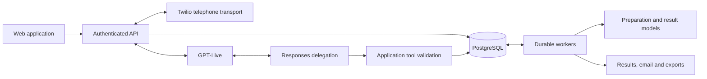

# Architecture

**Source reviewed:** 2026-11-08, current working tree; migration catalog `0001`–`0115`.

SHPROHLI has a Next.js web application, a Fastify API, PostgreSQL-backed durable
workers and shared TypeScript contracts. The API owns authorization and immutable
execution snapshots. Workers perform preparation, transcript/result processing,
retention, notifications and reconciliation. External providers supply telephony,
voice, delegated reasoning and explicitly requested text/audio processing.

## Runtime boundaries

Without a named profile, the default voice configuration selects managed `UnifiedLiveCall`
(`live-managed-v9`). It retains application-controlled disclosure, affirmative
consent and rendered closing. The opt-in `NativeLiveV2Call` implementation gives
GPT-Live the opening, ordinary conversation and brief spoken closing. Responses
delegation handles reasoning and tools; application checks still own authority,
action evidence, privacy and telephone termination. Native v2 starts recording
with a declarative notice and discards content on refusal. Explicit production selection
is supported. Realtime and legacy hybrid implementations remain compatibility paths.

Native v2 was accepted as stable on 2026-11-08 after local telephone testing. This
integration keeps runtime selection explicit; see the
[acceptance decision](reports/native-v2-stable-acceptance-2026-11-08.md) and subsequent
[production preparation](reports/native-v2-production-readiness-2026-11-08.md).

The recommended `CALL_RUNTIME_PROFILE=native_v2` binds voice selection to the integrity
preparation policy: compiler 13, plan schema 9 and approval 8. The audited configuration
command applies the policy; API and worker startup require a matching saved value.
The [profile contract](runtime-profiles.md) defines activation and rollback. Low-level
compatibility flags and model choices alone do not switch the preparation policy.
See the [native runtime specification](native-live-runtime.md) for the version matrix.

## Data and evidence boundaries

- Preparation preserves the complete original task and facts alongside a reviewable
  plan. Approval freezes authority, language, identity and runtime settings.
- Live receives primary task context at startup. Optional indexed appendix content
  is retrieved only when needed. Tools cannot expand approved permissions.
- Appointment journals distinguish authorization, delivery, uncertainty and confirmed
  outcome. Spoken claims do not independently verify the recipient's calendar.
- Transcript revisions, result artifacts and assessment revisions preserve their
  source identities. Display reassessment does not rewrite canonical credit evidence.
- Privacy deletion fences late writes. Encrypted trace content is separate from
  operational diagnostics and accounting; missing evidence is never reconstructed.
- Provider expenses, account billing and user credits are separate quantities.

## Task input, testing and presentation

The approved native context preserves the objective, context, facts and clarification
answers. Relevant factual information can come from any of them; explicit withholding
and disclosure conditions still apply. Action authority is grounded separately in the
objective or clarification answers. The review UI exposes original sources alongside
the compiled plan. Personal data does not grant new action permissions.

Tester access is an independent capability with automatic access for active
superadmins. The API owns grants, immutable encrypted scenario revisions and audit
records. Scenario buttons only populate an editable objective; they enter the normal
preparation and approval pipeline. Catalog reads do not enter the Live conversation
path. Preparation attribution is stored outside approval hashes and joins subsequent
usage records; missing historical attribution remains unclassified.

Fresh-call audio defaults to 30 days. Existing choices and the attempt's frozen
policy remain authoritative; later callbacks do not renew an established deadline.
Objective projections and scenario revision payloads use the data encryption keyring.
Transcript PDFs render a first-page assessment from saved evidence for the exported
revision, without invoking a model. Pending, unavailable and partial evaluation are
distinct presentation states.

## Detailed references

| Topic | Maintained document |
| --- | --- |
| Repository ownership and shared domain rules | [Engineer guide](engineer-guide.md) |
| Preparation, errors, policy and worker admission | [Preparation runtime](preparation-runtime.md) |
| Native prompts, actions, closing, results and evidence | [Native GPT-Live runtime](native-live-runtime.md) |
| API, environment and compatibility paths | [Runtime and API reference](runtime-reference.md) |
| Input sources, retention, tester access and PDF assessment | [Task information and testing](task-input-and-testing.md) |
| Offline checks, probes and telephone acceptance | [Native validation](native-live-validation.md) |

Dated reports are evidence for their recorded code and environment, not deployment
certification. Superseded designs and investigations remain in the [archive](archive/README.md).
