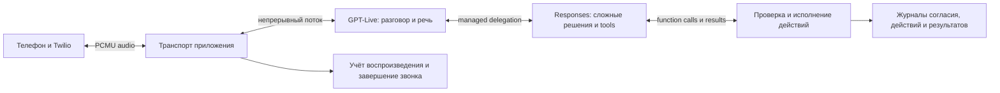

# Экспериментальный рантайм GPT-Live с минимальной оркестрацией

> **Archived on 2026-11-08.** Historical design, investigation or verification record.
> Original dates, language and acceptance scope are preserved; this is not the current specification.
> Use the [documentation index](../../README.md), [native runtime](../../native-live-runtime.md)
> and [validation guide](../../native-live-validation.md) for maintained behavior and remaining checks.

Дата: 5 ноября 2026, Europe/Zurich. Ветка: `codex/live-audit-validation-2026-11-05`.
Статус: **информационный срез E0–E3 реализован на текущей ветке; акустическая приёмка E4 ещё не выполнена**.
Исходный HEAD: `513c0217a754d9991151f60071926a03960af1f5`.
Рабочее дерево также содержит A0–A3; его нельзя обозначать одним SHA исходного HEAD.

Дальнейшее направление уточнено пользователем 6 ноября и зафиксировано в
[плане подготовки и рантайма v2](live-native-v2-implementation-plan-2026-11-06.md).
Он заменяет проектные решения ниже о consent handoff, кратком startup brief и
разрешении backend на прощание; сведения о выполненной реализации v1 сохраняются.

## 1. Предлагаемое решение

Добавить выбираемый режим `live_native_v1` на этой ветке. В нём GPT-Live ведёт обычный
разговор: выбирает формулировки и следующий вопрос, принимает поправки, выдерживает
паузы, реагирует на перебивания, подводит итог и произносит прощание. Managed Responses
backend вызывается самим Live для сложного решения, защищённого действия или запроса
завершения звонка. Приложение соединяет аудиопотоки, проверяет право на действие,
исполняет функции, сохраняет результаты и отключает телефон после завершения речи.

Главный эксперимент — **убрать конкурирующее управление диалогом из приложения**.
Ускорение модели, изменение голоса, транспорта и consent policy не смешивать с ним.
Сохраняемый `unified_live` служит контрольным вариантом и путём возврата для новых
попыток. Это контроль, а не утверждение, что его разговорное качество удовлетворительно.

Первый полностью проверяемый сценарий — информационный звонок с уточнением и итогом,
аналогичный последнему тесту. Затем подключаются сценарии с обязательствами.
Полная свобода формулировок для обычной речи входит в основной эксперимент;
передача модели права самостоятельно менять разрешения и считать действие выполненным — нет.

Основание архитектуры: OpenAI рекомендует Responses delegation для управления
backend-запросами со стороны Live. Вызов пользовательских функций и проверки разрешений
остаются у приложения. Это непосредственно соответствует предлагаемому разделению.
[Delegation and tools in GPT-Live](https://developers.openai.com/api/docs/guides/live-delegation).

## 2. Что даёт основание для эксперимента

Последний [разбор звонка](live-runtime-a-implementation-2026-11-05.md) зафиксировал:

- около 200 мс первого звука после consent, затем 8,64 с до полноценного вопроса;
- около 24,72 с без речи ассистента перед итогом;
- ожидание старого `response.create` до 15-секундного таймаута, включая около 10,34 с
  после готовности результата инструмента;
- ещё два backend response длительностью 4341 и 4668 мс до решения о завершении;
- 1503 мс application speech pipeline для итоговой фразы;
- 18 команд и 17 419 UTF-8 bytes при передаче task context после consent.

Гонка ожидания воспроизвелась на исходной и текущей оркестрации. Причина первого
обрыва пока не доказана. Поэтому эксперимент должен проверять две гипотезы отдельно:
исчезновение собственного цикла принятия решений уберёт известную блокировку;
сокращение управляющих инструкций и переключений источника речи может улучшить начало
и естественность разговора. Вторая гипотеза требует аудиозаписи и слуховой проверки.

| Нынешний механизм | Решение в эксперименте | Основание в коде |
| --- | --- | --- |
| Fallback через 5 с после ответа / 2 с после native activity | Убрать из обычного разговора. Начало backend-работы выбирает Live. | `scheduleTaskDecision`, `requestTaskDecision` в `live-conversation.ts` |
| `report_task_state` и состояния continue/wait/keep_closing/resume_conversation | Убрать из набора обычных task tools и prompt. Следующий вопрос не требует разрешения приложения. | `liveManagedTools`, `UnifiedLiveCall.tool` |
| Prepare silently → 18 context commands → ACK → Begin | Заранее загрузить approved voice context через startup input; после recording admission передать короткое изменение фазы. | `configureBackend`, `#acknowledgeOutputContext` |
| Широкое правило delegate после содержательного ответа | Делегировать при необходимости backend-возможности; обычные уточнения и ответы из известных фактов выполняет Live. | `buildLiveInstructions` |
| Input energy автоматически вызывает Twilio `clear` | Отключить для обычного native-диалога. Input VAD остаётся измерителем и защитой границ действий. | `UnifiedLiveCall.activity` |
| Приложение формулирует и синтезирует итог/прощание | Native speech Live; приложение отслеживает возможность безопасно отключить телефон. | `#startClosingSpeech`, `#playApplicationText` |
| `max_output_tokens=512`, low reasoning, один tool за раз | Сначала сохранить настройки модели для сопоставимости. Тюнить только по измеренным incomplete/latency. | `#backendConfiguration` |
| Transcript, provider accounting, authorization, consent receipts | Сохранить. Разделить с необязательной диагностикой. | `CallService`, repositories, `LiveTelemetry` |

Значения 5/2/15 секунд не заменяются меньшими числами: удаляется сама причина
периодически запускать модель от приложения. Таймаут уже выполняющейся операции
остаётся механизмом восстановления, а не сигналом повторить её.

## 3. Документация и её практические границы

Ниже — проверенные положения документации. Выбор конкретной архитектуры, порогов и
этапов в остальных разделах является проектным решением для этого репозитория.

| Положение GPT-Live | Следствие для проекта |
| --- | --- |
| Разговорный prompt рекомендуется делать коротким; процедуры отделяются в backend. Для вызова backend рекомендована формулировка `Generate <\|SpawnThinking\|>`. | Новый prompt без инструкций о внутренних state machines; исправить нынешнее общее «Delegate to the backend». [Prompting](https://developers.openai.com/api/docs/guides/live-prompting) |
| Начальный `input` доступен с начала сессии; append-контекст поступает по временной шкале. Append ACK не подтверждает выполнение инструкции или произнесение текста. | Не использовать ACK в качестве границы готового устного ответа. Учитывать предел 500 tokens для каждого append и 8192 tokens для startup input. [Sessions](https://developers.openai.com/api/docs/guides/live-conversations) |
| Результаты функций передаются через `response.item.create`, затем нужен `response.create`. Принятый запрос может ожидать текущий response. | Тонкий tool loop обязателен; повтор по неоднозначному таймауту не является безопасным ускорением. [Delegation](https://developers.openai.com/api/docs/guides/live-delegation) |
| `response.event` содержит вложенные события; correlation ID и delegation ID могут отсутствовать. Primary audio chunks не имеют session timestamps. | Различать command/delegation/response/call IDs и отсутствие корреляции. Не изобретать точное сопоставление audio и transcript. [WebSocket reference](https://developers.openai.com/api/reference/resources/live/primary-websocket) |
| Нет авторитетного события конца речевого turn/audio. | Native closing нельзя завершать по backend `response.completed` или первой паузе. [Evaluation guide](https://developers.openai.com/cookbook/examples/audio/voice_agent_evaluation) |
| Управление слышимым аудио выполняется в клиенте/media relay; модель может продолжить речь после просьбы остановиться. | У native interruption остаётся измеримый риск задержки; аварийный stop/clear приложения сохраняется. [Server controls](https://developers.openai.com/api/docs/guides/voice-server-controls?api=live) |
| Входящий поток должен идти непрерывно и с реальной скоростью; поддерживается PCMU 8 kHz. WebRTC рекомендован, WebSocket поддерживается. | В первом эксперименте сохранить Twilio↔WebSocket PCMU; смену транспорта измерять отдельно. [WebSockets](https://developers.openai.com/api/docs/guides/voice-websockets?api=live) |
| Twilio mark возвращается как после воспроизведения, так и после clear. | Mark должен проверяться вместе с поколением playback и фактом clear. [Twilio Media Streams](https://www.twilio.com/docs/voice/media-streams/websocket-messages) |

Realtime-параметры `turn_detection`, `response.cancel`, transcript-done или
audio-done не переносятся в GPT-Live по аналогии. Для неподтверждённого механизма
сначала нужен протокольный эксперимент, затем включение в проект.

## 4. Разделение ответственности



| Ответственный | Его решения |
| --- | --- |
| Live | Формулировки, уместный порядок вопросов в рамках задачи, уточнения, backchannels, обычные паузы, реакция на поправки, словесный итог и прощание. |
| Managed backend | Решения, требующие полного плана или инструментов; точное предложение действия; запрос закрытия; трактовка сложной поправки. |
| Приложение | Подлинность attempt/snapshot, допустимость записи и действия, фактическое исполнение, идемпотентность, реальные статусы, воспроизведение очереди, пределы ресурсов и телефонный hangup. |

Live вправе отвечать из текущего разрешённого контекста без backend. Он не обязан
получать одобрение после каждого ответа абонента. Неизвестные факты остаются неизвестными;
отказ и невозможность выполнить задачу являются нормальными результатами разговора.

## 5. Запуск, consent и передача контекста

### 5.1. Сохранить обязательное начало как отдельную границу

В первом варианте сохранить существующие disclosure, hybrid/semantic consent policy,
DTMF и `startRecordingAfterConsent`. Первое тестирование использует ровно ту policy,
которая была закреплена для контрольного звонка. Успешный tool не заменяет подтверждение
запуска записи, а короткое «да» не разрешает проигнорировать последующее отрицание.

Эта часть не должна управлять обычным разговором после handoff. Задержка до разрешения
записи учитывается отдельно от задержки первого вопроса. Проверенная запись disclosure
остаётся application-owned: документация допускает такой путь для точного текста и
известной границы playback. [Managing sessions](https://developers.openai.com/api/docs/guides/live-conversations).

Сознательно изменить одно существующее ограничение **только в экспериментальном
режиме**: разрешённый инициатором task context можно предоставить Live до consent
абонента. Нынешний запрет на такой preload — архитектурная граница v9, а не требование
GPT-Live. Уже утверждённый план не равен новым разрешениям от абонента.

Новая жёсткая граница остаётся в приложении: до disclosure/consent/recording admission
task-аудио не поступает в телефон, task tools не исполняются, запись и сохранение
pre-consent recipient content не включаются. Предварительная загрузка разрешённых
инициатором фактов не должна открывать ни один из этих путей. Секреты доступа,
неразрешённые факты и внутренние raw artifacts в voice context не включать.

Это существенное изменение, поэтому существующий тест «нет task context до consent»
сохраняется для контрольного runtime. Для native добавляются отдельные проверки
ранней генерации, случайного task tool, отрицательного consent, AMD и утечки аудио.
Не подменять эти проверки одной инструкцией модели «молчи».

### 5.2. Startup context и короткий handoff

При создании Live-сессии передать в `session.input` детерминированный voice brief из
approved snapshot: цель, стороны разговора, нужные вопросы/условные уточнения,
доступные факты, существенные запреты и критерий завершения. Полезный исходный
ориентир — до 1200–2000 tokens для обычной задачи; это проектный бюджет, не минимум.
Учитывать общий лимит startup input 8192 tokens. Полные внутренние процедуры и
журналы не должны становиться разговорной инструкцией.

Сохранить `store=false`; механизм сохранения Live-сессий для fork/replay не включать
попутно. Content hash и режим preload входят в descriptor.
Данные approved plan подавать как обозначенные факты/задачу, не как произвольное
продолжение system instructions из непроверенного текста.

До разрешённой task phase инструменты backend ограничены consent-возможностями
с существующими проверками. Даже если Live ошибочно делегирует заранее, task-действие
не выполняется. Отдельно измерять ненужные ранние backend requests и их стоимость.

После recording admission:

1. Одним обновлением задать managed backend полный approved execution context,
   инструкции и доступные task tools. Ошибки асинхронной валидации обрабатывать отдельно
   от обычного `session.updated`.
2. Одной короткой application instruction сообщить доказанный факт: disclosure
   доставлен, consent принят, запись запущена, можно продолжать задачу из startup context.
   Это единственное управление началом; второго позднего «Begin now» после ACK нет.
3. Открыть native output после recording admission и отправки handoff, сохранив все
   дальнейшие порции. Не ждать transcript, чтобы выпустить начало нового ответа.
4. Продолжать принимать весь входящий поток. Реплика во время handoff должна попасть
   в Live; модель сама выбирает, нужен ли первый вопрос или ответ уже был получен.

Append handoff значительно короче лимита 500 tokens. Длину всего контекста проверять
совместимым tokenizer либо доказуемой консервативной оценкой; нынешняя граница
в UTF-8 bytes не выдаётся за универсальный подсчёт tokens.

Task brief строится детерминированно из approved snapshot. Он не проходит через ещё
одну модель для сокращения. Удаляются дубли и технические поля, но не существенные
условия, факты и запреты. Если необходимый разговорный контекст превышает лимит,
не обрезать его молча: до звонка выбрать контрольный runtime и записать причину
неприменимости этого этапа эксперимента. Такие попытки не включать в native-метрики.

Если понадобится сохранить и прежнюю границу предоставления контекста модели,
отдельный альтернативный arm — компактный task brief после consent либо новая
task-сессия с полным startup input после consent. Второй вариант добавляет startup
latency и два session IDs. Эти компромиссы измерять отдельно; не скрывать их за тем же
descriptor. Для поставленной цели максимального упрощения основной вариант — preload.

В primary WebSocket нет временных меток audio: поздний pre-handoff хвост невозможно
надёжно отличить только по transcript ACK. Поэтому тесты первых секунд, включая
неожиданную раннюю речь и поздние пакеты, являются обязательной проверкой этого решения.

### 5.3. Prompt

Разговорный prompt: ориентир 500–800 tokens без task brief; это бюджет проекта.
Сохранить имя/роль, locale/formality, правила представительства и допустимых фактов.
Подробные appointment recovery, состояние журналов и служебные команды из него убрать.
Полный approved plan и процедуры остаются в backend instructions.

Каркас для информационного этапа, который нужно адаптировать к текущим identities:

```text
You are the telephone assistant acting for the represented person.
Speak in the approved language and form of address.
The task context is available for preparation; it is not permission to act.
Before the application enables the task, listen silently and do not start task work.
Once enabled, pursue the supplied goal in a natural conversation.
Ask a useful question when needed; use answers already given and accept corrections.
Use only supplied facts and what the recipient actually says. Preserve uncertainty.
Keep application bookkeeping private. Do not promise unprovided services.

Backchannel policy: Brief acknowledgments are welcome when they help the caller.
Interruption policy: Yield to the caller and continue from their latest meaning.

Delegation policy:
Backend tools: request call ending; other capabilities only when enabled.
Generate <|SpawnThinking|> when a protected capability, difficult decision,
or call ending is needed after task activation.
Do not generate <|SpawnThinking|> when asking an ordinary question, clarifying,
or using a known fact. Do not initiate task delegation before activation.
An external action is complete only when its verified result establishes it.

When the informational goal is resolved, give a concise natural recap and farewell.
Ask the backend to end the call; the application controls disconnection.
If the recipient adds something material, continue the conversation and update the result.
```

Это проектный каркас, не точный текст для production. Не вводить фиксированный скрипт
реплик, скрытый пошаговый reasoning или требования упоминать внутренние tools.
Перечень возможностей адаптируется к этапу эксперимента.
[Prompting GPT-Live](https://developers.openai.com/api/docs/guides/live-prompting).

## 6. Минимальный backend loop

Для информационного пилота expose только `end_call`. Для reasoning Live может
делегировать без вызова application function; краткий полезный результат допустим.
Отсутствие `report_task_state` не считается ошибкой или отсутствием прогресса.

Тонкий executor выполняет следующие обязанности:

1. Собирает законченные function items из `response.output_item.done`, проверяет
   аргументы и исполняет разрешённую функцию. Не ждёт глобального «разрешения говорить».
2. Для каждого call ID сохраняет результат и fingerprint аргументов. Повторное событие
   не повторяет действие; тот же ID с другими аргументами является конфликтом.
3. Отправляет все требуемые function outputs и один запрос continuation для этого
   набора. Результат не ждёт optional telemetry или другого несвязанного делегирования.
4. Учитывает nested response lifecycle, точную корреляцию `client_event_id`, а при её
   отсутствии — известный predecessor/delegation. Не присваивает неизвестному событию
   текущую revision и не объявляет случайный response подтверждением старой команды.
5. Отдельно учитывает физически выполняющийся response и допустимость его действий.
   Поправка делает результат устаревшим для действия, но не означает, что provider
   прекратил работу. Это особенно важно при ожидании ответа и разрыве соединения.

Реестр pending call IDs должен учитывать все уже объявленные вызовы, а не только
последний. Отправленные outputs, запрошенная continuation и наблюдаемый response —
разные записи. Если после запроса появились новые calls, обработать новый набор
отдельно. Не превращать этот реестр обратно в глобальный запрет continuation до
завершения любого другого response. В conversation phase application `response.create`
разрешён для настоящего возврата tool results, но не для догадки, что Live пора подумать.

Отсутствующий optional delegation ID не является само по себе fatal protocol error.
Сопоставлять response по уже известному response ID/command ID, сохранять usage;
если принадлежность action call не установлена, не исполнять его и не приписывать
к текущей попытке/revision по догадке. Это отдельный контрактный тест executor.

В новом post-consent пути не должно быть unscoped fallback `response.create` от
таймера. Так исчезает источник воспроизведённой гонки. Остальные continuation races
остаются предметом тестов; архитектурное упрощение не заменяет их проверку.

Не переносить общее правило «любой новый fragment делает всё устаревшим» на обычную
речь. Для read-only reasoning Live использует текущий разговор. Для защищённого
действия и hangup сохраняются свежесть наблюдений, recheck непосредственно перед
эффектом и блокировка, пока потенциальная поправка ещё звучит.

Пока оставить `gpt-live-1`, `gpt-6-luna`, текущий голос, `reasoning.effort=low`,
`max_output_tokens=512` и `parallel_tool_calls=false`. Сначала сокращается число
ненужных обращений. Возможность параллельных read-only tools и другой effort/tier —
отдельные сравнения после проверки основного варианта.

Consent-протокол сохраняет свои команды и сроки. Поздний ответ consent backend
после handoff не вправе повторно запустить запись или удержать task speech; его
continuation и accounting должны завершиться в собственном контексте.

## 7. Аудио и перебивания

В обычной task phase входящие PCMU bytes передаются Live непрерывно; исходящие
порции идут в Twilio по порядку. Не добавлять новый TTS, ресэмплинг, массовое
буферизование до transcript или периодические команды о том, кому сейчас говорить.

Input VAD сохраняется для измерения, consent и ожидания перед необратимым эффектом.
В task speech он не вызывает автоматический `clear`, не запускает reasoning и не
сбрасывает task state. Live получает возможность самостоятельно реагировать на
короткие подтверждения, шум и реальные перебивания.

Остаются явные причины остановить playback: обязательный disclosure/protected action,
команда пользователя остановить звонок, доказанное нарушение разрешённой области,
аварийное завершение транспорта. Для каждого clear сохраняются причина и generation.

Сетевые очереди всё равно нужно ограничивать. Измерять фактический остаток playback,
задержку mark и backpressure. Рост очереди не лечить бесшумным удалением середины фразы.
Если без общего energy-clear реальное перебивание слишком медленное, этот вариант
не проходит проверку: отдельно исследовать bounded transport flush. Нельзя считать
его результатом успешного «нативного прерывания».

Из предыдущего звонка известны native chunks до 100 мс; это не доказывает отсутствие
джиттера или генерации всплесками. Новый pacing вводить только после измерения.

## 8. Native итог и завершение звонка

### 8.1. Разделить итог задачи и физическое отключение

Live может немедленно озвучить обычный информационный итог из разговора: например,
повторить полученное предпочтение. Для этого не требуется ещё один backend review.
Но результат внешнего действия озвучивается только после подтверждённого действия.

`end_call` сохраняется как запрос завершения и запись terminal decision. В native
режиме `resultSummary` является структурированным фактическим результатом для хранения,
а не текстом, который приложение обязано заново синтезировать. Accepted tool не
вызывает `#playApplicationText` и не блокирует уже начатую native речь.

Не переносить всю задержку за прощание: измерять отдельно время до итога и время
от окончания прощания до disconnect. Backend вправе начать подготовку закрытия
параллельно native заключению; отключение допускается только после проверок ниже.

### 8.2. Прототип определения конца речи — обязательный этап

Минимальные состояния: `active → closing_requested → drain_pending → ended`.
В состоянии closing native output остаётся открыт. Приложение наблюдает речь,
а не говорит вместо Live.

Кандидат протокола для проверки:

1. Проверенный `end_call` фиксирует provisional terminal revision и закрывает доступ
   к новым действиям, не отключая аудио. Позднее противоречащее наблюдение отменяет
   эту revision; запись итогов не должна выдавать её за окончательный результат.
2. Отслеживаются реально переданные voiced samples и output transcript. Нужны
   наблюдения заключительной речи в контексте этого закрытия; `response.completed`
   и пустой audio chunk для этого недостаточны. Наличие текста не доказывает playback.
3. После наблюдаемой заключительной речи и стабильной паузы отправляется Twilio mark
   за уже отправленным audio watermark. Начальная исследуемая пауза — 800–1200 мс,
   не production-константа. Непрерывные silent frames не считаются продолжающейся речью.
4. Любая новая voiced output порция или входящая активность делает pending drain
   неготовым. Новый содержательный transcript отменяет старое закрытие; Live получает
   возможность ответить и инициировать свежее завершение без `resume_conversation`.
5. Hangup разрешён только для актуальной terminal revision, подтверждённого mark,
   не очищенного playback generation и отсутствия новой речи. После hangup отдельно
   завершаются Live accounting и transcript capture.

Это **эвристика приложения**, а не гарантия API. Пауза посреди длинного farewell,
запаздывающий transcript и заключительная речь до получения end_call способны
нарушить наивную реализацию. Окно 800–1200 мс само по себе проблему не решает.
Нужна проверка всех порядков событий, а затем реального звука.

Для reciprocal goodbye, короткого backchannel и материальной поправки измерить
поведение отдельно. Нельзя возвращать циклическую обязательную backend-классификацию
каждого «до свидания» под новым названием. Если эти случаи неразличимы надёжно,
сохранять разговор открытым до свежего решения; дополнительное ожидание считать
недостатком candidate, а не скрывать из метрик.

Первый протокол smoke допускает ручное завершение оператором, чтобы проверить native
речь независимо от hangup. Это не успешная end-to-end приёмка runtime. Если native
автозавершение не проходит проверку, stage остаётся экспериментальным; возврат к
application farewell является отдельным arm сравнения, а не незаметным fallback.

## 9. Что нельзя упростить только настройкой prompt

### 9.1. Запись и обязательные данные

Сохранить signed stream binding, approved snapshot, disclosure receipt, consent
evidence, подтверждение recording admission и исключение pre-consent transcript
из сохраняемой расшифровки. Диагностические логи не должны возвращать туда speech,
который исключён основной политикой хранения. В новых trace достаточно ID, времени,
типов событий, размера очередей и причин переходов.

Явный отказ/требование остановить текущую запись не обрабатывается как обычная
разговорная пауза. Проверить действующий путь остановки и его provider outcome до
расширения пилота; не считать возможность сказать «я остановился» доказательством.

### 9.2. Разговорное обязательство — тоже действие

В этом продукте `request_appointment` не создаёт запись через календарный API.
Он произносит поставщику точный запрос; реальная запись может возникнуть вследствие
этих слов. Поэтому оставить только tool authorization и разрешить любую native
формулировку бронирования — не эквивалентная защита.

Первое расширение на appointments сохраняет узкий участок application-owned
commitment speech, существующую проверку proposal, action journal, последующее
подтверждение и status-only recovery. Весь сбор информации, ответы на встречные
вопросы и обычный диалог остаются у Live. Это не мешает проверить, насколько большая
часть нынешней оркестрации лишняя.

Полностью native commitment — отдельный, более рискованный этап: сначала sandbox
с вымышленным поставщиком, затем механизм сопоставления **фактически произнесённого**
proposal с авторизацией. Проверка transcript после playback не предотвращает уже
услышанное неверное обязательство; проверка до playback требует буфера и добавляет
задержку. При невозможности доказать эту границу сохранить protected speech.

Не менять `sending/delivered/uncertain/confirmed` и не записывать `played` без
подходящего доказательства доставки. «Слот доступен» и «поставщик сообщил, что записал»
не становятся проверкой внешней базы. Неопределённое действие не повторяется как новое.

### 9.3. Ресурсы и ошибки

Сохранить ограничение длительности звонка, квоты, provider reservations, bounded
очереди, timeout соединения и аварийный stop. Эти ограничения не должны задавать
длину каждой обычной паузы. Один idle watchdog предотвращает зависшую сессию; он не
запускает новый backend request каждые несколько секунд.

Отказ optional telemetry не закрывает разговор. Ошибка обязательной записи действия
не превращается в успешное действие. После ambiguous provider timeout не повторять
эффект до выяснения статуса. Разрыв соединения не означает ни успех, ни отмену.

## 10. Изменения по файлам и способ изоляции

Предпочтительно выделить общий admission/consent/recording слой и два post-consent
controller: текущий и native. Не копировать целиком два больших класса и не
распределять десятки `if (experimental)` по private methods.

| Файлы/область | План изменения |
| --- | --- |
| `apps/api/src/config/voice-runtime.ts`, `runtime-environment.ts` | Ввести opt-in `VOICE_RUNTIME_LIVE_EXPERIMENT=native_v1`; отсутствие сохраняет текущее поведение. Противоречие с legacy driver/fallback отклонять при старте. |
| `apps/api/src/voice/create-voice-runtime.ts`, `openai-live-bridge.ts` | Выбор runtime; проверяемый общий admission adapter; подготовленная сессия привязана к attempt, snapshot и variant. |
| `apps/api/src/voice/unified-live-call.ts`, `voice-runtime.ts` | Выделить только необходимый интерфейс передачи post-consent управления. Consent и protected action helpers переносить с неизменными характеристическими тестами. |
| Новые `live-native-session.ts`, `live-native-call.ts` | Протокольный transport/tool loop и минимальный lifecycle без task-decision scheduler. Имена предлагаемые. |
| Новый `live-native-prompts.ts` | Короткие role/delegation prompts, детерминированный startup voice brief, проверка бюджета и пригодности задачи. |
| Новый `live-native-closing.ts` | Отдельно тестируемый provisional close и проверка playback drain. |
| `live-managed-tools.ts` / native tool definitions | Отдельный набор инструментов без `report_task_state`; различная семантика native closing при совместимых доменных проверках. |
| `runtime-descriptor.ts`, `packages/contracts/src/call-telemetry.ts` | Новый runtime/версия, режим closing/interruption, prompt/brief hash, модель и actual selection. Не записывать native как `live-managed-v9`. |
| `telephony/create-telephony-provider.ts` | Учесть новый mode в async AMD: сейчас там точное сравнение с `unified_live`. |
| `storage/history-read-model.ts`, repositories, telemetry-export | Чтение старой и новой истории, allowlist diagnostics, terminal/capture совместимость и rollback reader. |
| `app.ts`, preparation lifecycle | Проверить ранний prepare/release, duplicate status/socket, mismatch варианта, освобождение provider session. |
| `docs/runtime-reference.md`, `.env.example` | После реализации описать включение, область поддержки, доказательства и возврат. |

Вариант фиксируется до prewarm и остаётся неизменным для attempt. Если процесс
перезапущен с другим выбором, он не должен продолжить старую попытку другой
реализацией молча. Неподходящий для native план направляется в контрольный режим
до начала звонка с явной причиной; переключения посреди фразы нет.

Не требуется менять утверждённые задания ради эксперимента. Не обещать отсутствие
SQL migration до проверки хранения нового descriptor и terminal revisions: даже
JSONB без SQL-изменения требует совместимых readers и exports.

## 11. Этапы реализации и критерии готовности

| Этап | Конкретный результат | Проверка перед следующим этапом |
| --- | --- | --- |
| E0. Зафиксировать контроль | Manifest исходников A0–A3, новых файлов, lockfile, prompts, models/policy; сценарии и аудиометрики. | Dirty build имеет собственный digest; исходный HEAD не выдаётся за tested build. |
| E1. Граница runtime | Opt-in selector, descriptor и общий admission adapter. Текущий controller подключён через новый интерфейс. | Текущее поведение сохранено тестами consent, AMD, preparation, recording, history/export и cancellation. |
| E2. Свободный task-диалог | Native controller, startup context и короткий handoff, короткий prompt, delegation по инициативе Live, отсутствие `report_task_state` и fallback scheduler. | Preload не обходит consent/action gates; простая задача проходит протокольные и аудио smoke, ordinary speech не зависит от tool-state ACK. |
| E3. Native closing | Structured terminal result без TTS; проверяемый closing/drain tracker. | Нет обрезанного конца, false mark success и потери поправки. Ручной hangup не засчитывается. |
| E4. Локальная парная приёмка | Контроль и native на одинаковых сценариях с записью; воспроизводимые результаты и раздельная оценка разговора/задачи. | Выполнены критерии раздела 13. По одному хорошему звонку runtime не объявляется лучше. |
| E5. Действия | Appointment scenarios с существующей защищённой границей commitment speech; native остальной диалог. | Все authorization, uncertain delivery, status-only, confirmation и correction сценарии проходят. |
| E6. Отдельные эксперименты | Альтернативная загрузка контекста, native disclosure/consent/commitment, другой transport или backend tier. | Каждый вариант имеет отдельную гипотезу, контроль и проверку; не входит скрыто в E2–E4. |

E0–E3 — минимальный законченный вертикальный срез для повторного простого звонка.
E5 не должен задерживать проверку основной гипотезы и не считается реализованным
в информационном пилоте. Порядок E2/E3 позволяет независимо выяснить, помогло ли
упрощение беседы, если закрытие пока требует доработки.

## 12. Проверки

### Протокол и доменные ограничения

Тестировать реальные альтернативные порядки событий, а не только наличие строк prompt:

- exact/missing/unknown correlation ID, отсутствующий delegation ID, nested lifecycle;
- несколько function calls в одном response, duplicate output/terminal events,
  конфликт call ID, неполные аргументы, late errors;
- новая речь между delegation, tool validation, записью результата и playback mark;
- response продолжает выполняться после timeout; запрос не дублируется;
- consent denial, split negation, отказ записи, DTMF, ранняя речь и поздний consent result;
- prepared/cold startup, два socket, неверная attempt binding, interruption/disconnect;
- optional telemetry зависла; обязательный action journal отказал;
- текущая история читается после native-событий и после возврата режима.

Для closed/drain тестов нужна модель Twilio, возвращающая mark и при playback, и при
clear, а также continuous silent audio. Мок, где «нет audio packets» означает тишину,
не воспроизводит наш транспорт.

### Разговорная матрица

| Сценарий | Что проверять |
| --- | --- |
| Простая условная задача из последнего звонка | Полный первый вопрос, уточнение только при нужном ответе, быстрый естественный итог. |
| Сразу ответ после согласия | Ответ не теряется и не провоцирует повтор уже отвеченного вопроса. |
| Неизвестный факт / отказ отвечать | Нет выдуманного ответа и бесконечных уточнений. |
| Встречный вопрос по известным фактам | Live отвечает сам, без обязательного backend cycle. |
| Длинная реплика и пауза внутри неё | Нет преждевременного вопроса или terminal action. |
| Кашель, фоновый звук, короткое «угу» | Нет обрезанной native речи и повторного task decision. |
| Настоящее «подождите» посреди ответа | Live уступает; измеряется оставшаяся слышимая речь. |
| Поправка во время backend work | Старое действие не выполняется, новая информация учитывается. |
| Прощание с паузой в середине | Телефон не отключается на этой паузе. |
| Reciprocal goodbye | Нет повторения всей задачи и длинного пустого ожидания. |
| Поправка во время итога | Нет hangup по старому mark; итог отражает поправку. |
| Тихая речь, delayed transcript, audio без captions | Необоснованный complete/played не записывается. |
| Provider stall / обрыв сети | Нет повторного действия, понятный и честно учтённый outcome. |
| Appointment authorization и uncertain delivery | Только после E5; использовать существующие S02–S07 с фиктивным поставщиком. |

Использовать существующий [каталог приёмки](voice-acceptance-protocol-2026-11-02.md),
дополнив информационным сценарием и точками перебивания. Сначала контролируемые
audio inputs, затем записанная речь, затем многоходовой разговор. Не запускать один
WAV целиком быстрее реального времени. [Evaluation guide](https://developers.openai.com/cookbook/examples/audio/voice_agent_evaluation).

Начальный локальный отбор: 3 пары каждого из 6 основных разговорных сценариев
(простой, быстрый ответ, встречный вопрос, реальное перебивание, goodbye, correction).
Это 36 попыток, не статистическая оценка p95. Варьировать порядок A/B, сохранять
одинаковые facts/approval, voice, models, locale, consent policy и сеть.
Такая серия является предложением для следующего этапа; она не запускалась этим планом.

## 13. Измерения и критерии решения

### Что сохранять

На attempt: source/build digest, variant, eligibility, prompt и brief hashes, модели,
голос, locale, consent policy, snapshot hash. На timeline: consent/recording timestamps,
handoff, первая voiced порция, начало полезной реплики, delegation/tool/continuation,
closing revision, voiced/silent boundaries, каждый mark/clear и hangup.

Технические события не содержат transcript/audio payload. Разрешённые запись и
расшифровка используются отдельно для слухового анализа. Native captions, отправка
audio, Twilio playback и фактическое понимание собеседником — разные наблюдения.

### Основные показатели

| Показатель | Зачем |
| --- | --- |
| Consent boundary → начало полного полезного вопроса | Не принимать короткое «хорошо» за успешное открытие. |
| Конец содержательного ответа → начало полезной следующей реплики | Проверить основную разговорную задержку. |
| Последний необходимый ответ → начало итога | Прямая метрика жалобы на конец разговора. |
| Последняя речь farewell → disconnect | Не переносить задержку за прощание. |
| Остаток речи после реального перебивания | Оценить отказ от energy-clear. |
| Потерянные начала/концы, повторы, ненужные вопросы | Оценить естественность независимо от текста отчёта. |
| Число delegation runs, function calls, continuation и application instructions | Проверить, действительно ли сократилась оркестрация. |
| Task correctness, запрещённые/повторные действия, подтверждение результата | Не обменять корректность на скорость. |
| Voice seconds, backend usage, TTS requests и стоимость attempt | Выявить рост затрат и скрытые повторные запросы. |

Проектные цели первого информационного smoke: отсутствие обрывов; ноль
`report_task_state`; ноль task-fallback `response.create`; ноль application TTS для
нормального итога; отсутствие воспроизведённого 15-секундного ожидания.
Обычный ответ из известных фактов не требует backend. Финальное сохранение может
требовать delegation с `end_call` и одной штатной continuation — это не «ноль backend».

Предварительные акустические ориентиры для простой задачи: median до первого
полного вопроса ≤2,5 с от принятого consent, median до итога ≤3 с от последнего
необходимого ответа. Это цели эксперимента, не обещания OpenAI. Сравнить также с
контролем: абсолютное достижение числа не оправдывает ухудшение перебиваний или смысла.

Native проходит начальный отбор, если:

- нет нарушения consent/authorization, повторного действия или преждевременного hangup;
- нет новых обрывов, потерь поправки или деградации корректности задачи;
- уменьшается воспринимаемая задержка в парных сценариях, а проигрыши разобраны;
- слуховая оценка подтверждает более естественный разговор без подсказок о выбранном arm;
- новый reader/export и возврат на контроль проверены.

Провал критического сценария останавливает расширение. Маленькая серия показывает
пригодность к дальнейшему тесту; для заявления p95 нужны большая выборка, определение
метрики и учёт таймаутов/незавершённых разговоров. Исключать неуспешные попытки из
латентности без отдельного учёта нельзя.

## 14. Возврат и дальнейшие варианты

Включение меняет только новые попытки в локальной среде. Возврат — выключить opt-in
после завершения активных звонков/prewarm и запустить контрольную реализацию с
совместимым reader. История и данные experiment не удаляются. Автоматического
переключения реализации посреди звонка нет.

Следующие возможные эксперименты после E4:

- Native disclosure/consent — только с доказательством доставки обязательного текста
  и сохранением фактического recording gate; не объединять с первым task-пилотом.
- Deferred context вместо startup preload — при необходимости сохранить прежнюю
  границу task context; отдельно измерить цену chunks или дополнительной сессии.
- WebRTC/SIP — отдельный transport arm; потребует проверки интеграции Twilio и recording.
- Другой reasoning effort/service tier — после измерения оставшихся backend задержек.
- Native commitment — только после решения задачи авторизации произносимого действия.

Готовый результат E4 — отдельный работающий opt-in runtime, измеренное сравнение,
список пройденных и проваленных сценариев и проверенный возврат. Целью не является
удалить максимальное число строк: цель — оставить приложение вне обычного хода
разговора и проверить, что Live справляется с ним лучше.

## 15. Реализация на ветке, 5 ноября

Контроль A0–A3 сохранён до изменений: `.tools/live-native-control-20261105/manifest.json`,
573 файла с SHA-256 и копиями исходников, lockfile и patch рабочего дерева.
Это локальный технический артефакт, без `.env`, ключей и записи звонка.

Opt-in: `VOICE_RUNTIME_LIVE_EXPERIMENT=native_v1`; значение по умолчанию `off`.
С legacy driver/fallback эксперимент несовместим и отклоняется при старте.
Перед prewarm выбирается `live_native_v1` либо контроль с конкретной причиной.
Информационные типы: information_request, document_requirements,
receipt_confirmation, neutral_message. Appointment authority, неподдержанный тип,
выключенный hangup или превышение бюджета оставляют попытку на контроле.
Повторная инициализация описанной попытки с другой native-конфигурацией запрещена;
переключение требует новой попытки. Асинхронный AMD поддерживается в обоих режимах.

Реализация разделена на `live-native-prompts.ts`, `live-native-call.ts` и
`live-native-closing.ts`. Общий `UnifiedLiveCall` сохраняет admission, consent,
recording и транспорт. `OpenAILiveConversation` переиспользует протокол, capture
и provider accounting, с отдельной native-политикой на границе task phase.
Большие lifecycle/transport классы не скопированы.

Voice brief детерминированный, без LLM-сжатия и обрезания условий. Используется
консервативный предел 7500 UTF-8 bytes плюс запас на framing вместо приблизительного
подсчёта токенов; это может чаще выбирать контроль для длинных Unicode-задач.
После recording admission отправляются backend configuration и один короткий
handoff. Нет fan-out контекста, второго Begin, report_task_state и task fallback
response.create. Обычная входная энергия не очищает Twilio playback.

Native closing сохраняет структурированную decision revision, а Live произносит
итог и прощание. Приложение ожидает новые voiced audio и captions после end_call,
1500 мс quiet tail, реальный Twilio mark и дополнительный guard 350 мс. Новый вход,
caption/voiced output или clear отзывают соответствующий watermark. DTMF также
отменяет closing. Нет скрытого TTS fallback. Closing ограничен 30 с; idle — 90 с;
общая продолжительность native controller — 10 минут (provider admission limits
также остаются). Технический timeout не записывается как успешный hangup.
Decision journal фиксирует решения, включая отменённые поздней поправкой revisions;
доставка и disconnect подтверждаются отдельными playback/lifecycle событиями.

Executor возвращает результаты всех известных calls до continuation, проверяет
call ID/fingerprint и exact client_event_id, учитывает optional delegation scope.
Неатрибутированный response учитывается для usage, но не исполняет действия.
Устаревший closing tool получает явный отказ вместо потерянного function output.
Неоднозначно принятая continuation повторно не отправляется. Ожидание unrelated
response без pending tools не блокирует возврат результатов.
Сознательно сохранён консервативный барьер: законченные function items собираются
из output_item.done, но доменный эффект выполняется после terminal event **своего**
response и обязательных accounting writes. Выполнение функции до завершения
собственного response не входит в этот срез; отдельную оптимизацию следует измерять
после E4, не ослабляя durable evidence ради предполагаемой экономии миллисекунд.

Ограничение остаётся существенным: quiet tail не доказывает окончание высказывания.
Длинная пауза внутри прощания или очень поздний transcript могут нарушить эвристику.
Факт прохождения автоматических тестов не означает, что обрыв и задержка из
предыдущего звонка устранены на реальном аудио. E4 и E5 пока не приняты.

Проверки реализации:

- 548 API-тестов в 20 файлах: voice lifecycle, native/protected task, preparation,
  runtime configuration, PostgreSQL capture/descriptor и telemetry export. Последний
  полный прогон: `.tools/live-native-validation-20261105.log`.
- 261 тест контрактов в 25 файлах; исторические telemetry versions продолжают читаться.
- API и Web TypeScript, API build и комплектование миграций — успешно. Проверка
  sourceDigest отдельно повторена после добавления поля (3 descriptor-теста).
- Контрольный и native режимы последовательно запущены локально. API live/ready и Web:
  HTTP 200; private API через tunnel: 404; неподписанный Twilio webhook: 403;
  подписанная пустая проба: 400 INVALID_TWILIO_STATUS. Звонки этими пробами не создаются.
- Сценарий предыдущего простого звонка пригоден: `eligible`, voice brief 1733 UTF-8 bytes.
  Реальное аудио этим сравнением не оценивается.

Локально оставлен `native_v1`; приложение: `http://localhost:3000/ru`.
Рабочая БД — прежняя отдельная `callassist_hardening_20261102` на localhost:5543;
интеграционные тесты использовали временные БД. Реальных звонков и новых inference
запросов в ходе реализации не запускали.

Manifest кандидата: `.tools/live-native-candidate-20261105/manifest.json` (578 файлов
и hashes сборок index/worker), source digest
`b8923883c785f96eda242fbbf96706f5945e81baa66bb0880e2cf298ba292af9`.
Локальный launcher передаёт его через `SHPROHLI_RUNTIME_SOURCE_DIGEST` в descriptor
новых попыток. Он не подменяет release SHA исходного HEAD.

Возврат локалки: `.tools/restart-live-audit.ps1 -LiveExperiment off` из корня проекта;
повторное включение: `-LiveExperiment native_v1`. Скрипт проверяет PID/роль процессов,
отсутствие активных звонков, preparation и running jobs и сохраняет копию state.
Переключение режима не удаляет историю. После изменения кода нужно пересобрать,
повторить относящиеся к изменению проверки и обновить source manifest/digest.
