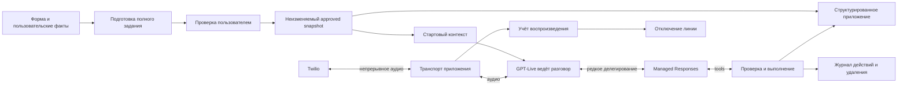

# План реализации нативного рантайма GPT-Live и новой подготовки задания

> **Archived on 2026-11-08.** Historical design, investigation or verification record.
> Original dates, language and acceptance scope are preserved; this is not the current specification.
> Use the [documentation index](../../README.md), [native runtime](../../native-live-runtime.md)
> and [validation guide](../../native-live-validation.md) for maintained behavior and remaining checks.

Текущее состояние реализации и ограничения приёмки: [стабилизация и составные native-профили](live-native-profiles-stabilization-2026-11-06.md). Чеклист ниже задаёт полную приёмку, включая этапы с телефонным аудио.

Дата: 6 ноября 2026, Europe/Zurich. Ветка: `codex/live-audit-validation-2026-11-05`.

Статус после повторной проверки: **основной native-код и четыре appointment operations реализованы, но P5/P6 и стыки P8 не завершены; P7/P8 акустическая приёмка и P10 остаются открытыми**. [Аудит целостности](live-native-consistency-audit-2026-11-06.md) содержит воспроизведённые дефекты, проверку конечных prompts, актуальную матрицу этапов и порядок завершения. [Запись об имплементации](live-native-actions-implementation-2026-11-06.md) и [первый информационный этап](live-native-v2-implementation-2026-11-06.md) сохраняют историю выполненных изменений и проверок.

Новые задания закрепляют policy `preparation-live-native-actions-2026-11-06`, compiler **11**, schema **9**, approval **8**. Задания предыдущей policy сохраняют compiler 10 / schema 8 / approval 7. Итоговая речь всегда относится к представляемому лицу: «Анна записана…», а не «Вы записаны» в адрес клиники.

Уточнение по фактической истории: прежние эксперименты уже использовали compiler 7–9, schema 5–7 и approval 4–6. Первый информационный native v2 этап использовал compiler **10**, schema **8**, approval **7**; native actions использует **11/9/8**. Отдельные архивные readers сохраняются. Исходная таблица ниже описывает код на момент планирования, а не текущую готовность или весь исторический каталог данных.
Исходный HEAD: `513c0217a754d9991151f60071926a03960af1f5`.
Рабочее дерево содержит изменения предыдущих экспериментов, поэтому этот SHA не описывает весь текущий код.

Цель — дать GPT-Live полный контекст для самостоятельной беседы со старта и сократить обращения к backend и управляющие команды приложения. Подготовка создаёт утверждаемое задание с фактами, условиями и полномочиями. Live сам ведёт вступление, проверяет удобство разговора, выбирает вопросы, принимает поправки и прощается. Приложение отвечает за транспорт, действительные полномочия, запись, удаление, исполнение действий и отключение линии.

Документ заменяет проектные решения v1 о consent handoff, кратком стартовом brief и обязательном разрешении backend на прощание. [План v1](live-native-experiment-plan-2026-11-05.md) сохраняет значение как история реализации и проверок. Его акустическая приёмка не завершена. Публичная бета находится за пределами первого внедрения; сначала проверяется локальный эксперимент.

## 1 Согласованные решения

| Область | Решение для v2 |
| --- | --- |
| Разговор | Одна GPT-Live сессия произносит все обычные реплики от вступления до прощания. |
| Подготовка | Компилятор собирает самостоятельное задание для Live, сохраняющее полноту пользовательских данных и условий. |
| Приоритет контекста | Со старта доступны цель, все утверждённые факты, условия их раскрытия, существенный контекст, ограничения действий и критерии результата. |
| Сложные задания | Объёмные дополнительные справочные сведения можно хранить в структурированном приложении к утверждённому заданию и получать по необходимости. |
| Форма создания | Уменьшить лимит свободного контекста; проверять общий размер задания и окончательный startup payload. |
| Вступление | Представление, выбранная причина использования ассистента, декларативное уведомление о записи, вопрос об удобстве, пауза; затем цель от имени представляемого человека. |
| Причина | `speech_impairment`, `language_barrier` или `none`. При `none` причина полностью опускается. |
| Запись | В локальном режиме запускается с соединения независимо от речевого перехода к задаче. Основание записи хранится отдельно от ответа на вопрос об удобстве. |
| Отказ | Отказ от разговора или записи завершает задачу и запускает удаление сохранённого содержимого этой попытки. |
| Backend | Существующее нативное Responses delegation. Обычная беседа не вызывает backend; инструменты и сложные вопросы вызываются по необходимости. |
| Завершение | Live кратко резюмирует результат главной задачи, вежливо благодарит и прощается. Подробности беседы не перечисляются. Приложение проверяет воспроизведение и физически завершает звонок. |
| Decisions | Отдельный последующий эксперимент после получения устойчивого результата v2. |
| Проверка | Сравнимые локальные звонки, измерения слышимых задержек и проверка данных; тестов протокола недостаточно для акустической приёмки. |

«Максимальные полномочия Live» означают самостоятельность в ведении утверждённой задачи. Новые платежи, обязательства, раскрытие запрещённых данных или расширение разрешённых дат не возникают из свободной формулировки модели.

## 2 Текущее состояние кода и необходимые изменения

| Поверхность | Наблюдаемое поведение | Изменение |
| --- | --- | --- |
| [Компилятор](../../../apps/api/src/brief-compiler/brief-compiler.ts) | Opening готовится после recording consent; представление считается уже выполненным. | Новая версия генерации задания и независимая спецификация полного вступления. |
| [Контракт задания](../../../packages/contracts/src/call-brief.ts) | Compiler 6, schema 4, execution snapshot 3; исходные поля намеренно исключены из runtime snapshot. | Новые версии с утверждённым исходным контекстом, фактами и режимом доставки контекста. |
| [Initial disclosure](../../../packages/contracts/src/initial-disclosure.ts) | Локализованный вопрос о разрешении записи. | Версионированное декларативное уведомление и вопрос об удобстве. |
| [Предпросмотр](../../../apps/web/components/call-plan-presentation.tsx) | Адресат, цель, затем readiness в одной строке. | Вступление, ожидание ответа, затем пример перехода к цели. |
| [Native prompts](../../../apps/api/src/voice/live-native-prompts.ts) | Максимум 7500 UTF-8 bytes; ожидание `Task enabled`; нет документированного маркера делегирования. | Полный стартовый пакет с проверкой tokens, короткая политика поведения, правильный маркер. |
| [Общие execution data](../../../apps/api/src/voice/live-managed-tools.ts) | `alreadyDisclosed: true` до реального вступления в native preload. | Никаких вымышленных состояний доставки в данных задачи. |
| [Live conversation](../../../apps/api/src/voice/live-conversation.ts) | Транспорт, consent и task orchestration связаны; tools открываются после recording admission. | Изолировать транспорт и protocol loop от старого речевого lifecycle. |
| [Unified call](../../../apps/api/src/voice/unified-live-call.ts) | Disclosure, consent, recording, opening, task и защищённый TTS объединены. | Отдельный v2 lifecycle без разговорного consent scheduler. |
| [Native closing](../../../apps/api/src/voice/live-native-closing.ts) | Учитывает заключительную речь только после запроса завершения; использует quiet tail. | Непрерывное наблюдение воспроизведения, корректная привязка к эпизоду завершения. |
| [Call service](../../../apps/api/src/call-service.ts) | `startRecordingAfterConsent`; удаление пользователем рассчитано на завершённый звонок. | Отдельные операции записи с соединения и удаления по отказу во время звонка. |
| [Twilio provider](../../../apps/api/src/telephony/twilio-telephony-provider.ts) | Исходящий звонок создаётся с `record: false`. | Параметры записи из закреплённой политики попытки, обработка ранних callbacks. |
| [Хранилище текста](../../../apps/api/src/storage/postgres-call-text-store.ts) | Общая очистка данных звонка и публикация производных текстов. | Запрет сохранения и очистка содержимого конкретной попытки во всех путях записи. |

Причина прежнего обрезанного начала не доказана. Отмеченная ранее задержка завершения включала ожидания оркестрации и backend. Новая архитектура убирает эти зависимости из обычной речи, но улучшение подтверждается отдельной акустической проверкой.

## 3 Архитектура



Разговор не должен ждать записи telemetry, обновления UI, сохранения очередного фрагмента транскрипта или генерации письменного отчёта. Потоковые данные сохраняются асинхронно с ограниченными очередями. Действие с последствиями и запрос удаления требуют надёжной фиксации до подтверждения результата.

Приложение не выбирает следующий вопрос, не отмечает каждый ответ через `report_task_state`, не запускает модель по таймеру после каждой паузы и не требует отдельного разрешения на обычную реплику. Наличие аудиореле и обработчика событий не считается разговорной оркестрацией: эти части необходимы для телефонного транспорта.

Технические состояния попытки: `prepared → connecting → active → ending → closed`, с отдельным результатом ошибки. Состояния записи и удаления ведутся независимо. «Представился», «спросил об удобстве», «обсуждает цель» — наблюдаемые события для оценки качества, а не обязательные разрешающие переключатели приложения.

## 4 Новая подготовка плана звонка

### 4.1 Результат подготовки

Компилятор создаёт пакет, из которого Live может вести обычную беседу без получения дополнительных объяснений от backend. Для первого среза сохраняется существующий pipeline подготовки, включая модерацию, проверку языка, валидацию и пользовательское утверждение. Нового обязательного модельного этапа для «сжатия под Live» не добавляется.

Пакет содержит:

1. Цель и желаемый результат, сформулированные от имени представляемого человека.
2. Участников и принадлежность каждого факта или пожелания конкретному человеку.
3. Полный набор разрешённых к раскрытию фактов и явные условия раскрытия.
4. Существенный контекст: причины обращения, предысторию, ограничения, уже известные ответы и поправки.
5. Темы и обязательные сведения, которые нужно выяснить. Пример вопроса не навязывает порядок беседы.
6. Условные уточнения, условия успеха, допустимые неполные результаты и условия остановки.
7. Точные полномочия на действия, включая даты, время, часовой пояс, ограничения количества и финансовые условия.
8. Настройки вступления, языка, обращения, тона, голоса и допустимого переключения языка.
9. При необходимости — индекс дополнительных справочных разделов и их связь с задачей.

Явно заданный пользователем порядок действий остаётся обязательным. Во всех остальных случаях Live выбирает порядок тем по разговору, объединяет ответы и не задаёт вопрос, на который уже получил достаточный ответ.

### 4.2 Полнота исходных данных

Учитывать `objective`, `context`, `allowedFacts`, ответы на уточнения и действительные инструкции о результате. Из этих полей не должны исчезать адрес, номер документа, ограничение даты или иная полезная деталь лишь потому, что генератор не включил её в краткое описание цели.

Для нового snapshot сохранять утверждённые пользовательские источники и нормализованное представление. Нормализованный факт получает стабильный ID и ссылку на источник. Источник служит данными, не дополнительной системной инструкцией. В runtime не передаются служебные prompts подготовки, результаты модерации, секреты, отладочные ответы провайдера и данные других заданий.

Общий текст не дублируется в нескольких startup разделах без необходимости. Разрешены точная дедупликация, ссылки на IDs и компактная сериализация. Смысловые условия и значения не удаляются ради размера. Нормализация не считается доказательством полноты сама по себе: проверки должны искать пропуски и противоречия.

При конфликте исходных фактов и нормализованного задания исправить подготовку до утверждения. Поздняя явная поправка пользователя заменяет прежнее значение с сохранением происхождения. Неразрешённое существенное противоречие показывается на этапе подготовки. Live не получает два несовместимых значения как одинаково действующие.

### 4.3 Факты и условия раскрытия

Проект внутреннего представления:

```typescript
type ApprovedFact = {
  id: string;
  subject: string;
  value: string;
  spokenValue?: string;
  sourceRefs: string[];
  disclosure: "when_relevant" | "on_request" | "conditional" | "never";
  condition?: string;
};
```

Это проект контракта, не существующий тип. Условия выводятся только из явно утверждённых указаний пользователя. Общая осторожность модели не создаёт новый запрет на предоставление уже разрешённых данных. Содержание с `never`, которое модели не требуется знать для задачи, вообще не включается; в стартовый пакет входит соответствующее ограничение. Не использовать факты как инструкции на выполнение платежа, записи или отправки сообщения.

Все факты, разрешённые к использованию в беседе, передаются Live со старта. Модель раскрывает их по смыслу и условиям, не перечисляет при знакомстве и не вызывает backend для чтения известного адреса, даты, номера или ответа. Вопрос собеседника о факте не требует повторного разрешения инициатора, если это уже покрыто заданием.

### 4.4 Темы вместо обязательного прохождения списка

Новая схема сохраняет для темы `id`, смысл, необходимость выяснения и пример формулировки. Технически обязательный вопрос означает обязательный результат выяснения, если ответ ещё неизвестен и человек готов продолжать; он не означает обязательное повторение заранее написанной фразы.

Сохранить отдельные стоп-условия и разрешённые исходы «не знает», «информация отсутствует», «не удалось уточнить». Уточнения задаются собеседнику естественно. Данные, которые можно получить во время звонка без расширения полномочий, не становятся причиной лишнего блокирующего вопроса пользователю при подготовке.

### 4.5 Изменения compiler prompt

Удалить предположение «запись уже разрешена и представление произнесено». Объяснить, что цель, темы и факты доступны Live с начала разговора, а вступление задаётся отдельной политикой.

Добавить требования:

- сохранять полный смысл источников и все явные ограничения;
- отличать представляемого человека от собеседника и ассистента;
- формировать естественную цель: «Анна хотела бы узнать…», «Анна хочет записаться…»;
- отмечать необходимые сведения без искусственного порядка вопросов;
- готовить дополнительные разделы только при действительной сложности задания;
- не помещать сохранение, биллинг, подготовку отчёта или API-процедуры в цель разговора;
- не обещать email, передачу результата или обратный звонок без соответствующего задания и поддерживаемого действия;
- сохранять условия бронирования в проверяемой структуре, а не только в свободном тексте.

### 4.6 Проверка и утверждение

Сохранить один существующий этап пользовательского утверждения. Предпросмотр показывает цель, существенный контекст, факты с условиями использования, полномочия, пример вступления и темы беседы. Для сложного задания дополнительные разделы доступны для просмотра в том же задании.

Вступление отображается двумя частями: начальная реплика с вопросом об удобстве; затем явно показанное ожидание ответа; после него пример перехода к цели. Пример не обещает точного будущего воспроизведения всей беседы.

Новый review receipt и hash связывают весь утверждённый пакет, включая приложение. Изменение факта, полномочия или существенного дополнительного раздела создаёт новую ревизию; активная попытка продолжает использовать закреплённую версию. Исторические approvals не переписываются.

## 5 Стартовый контекст и приложение для сложных задач

### 5.1 Состав стартового пакета

```typescript
type LiveTaskPackage = {
  version: "live-task-v1";
  identity: ApprovedParties;
  preferences: ApprovedConversationPreferences;
  opening: NativeOpeningSpec;
  objective: string;
  context: ApprovedContext;
  facts: ApprovedFact[];
  topics: ApprovedTopic[];
  followUps: ApprovedFollowUp[];
  successCriteria: string[];
  unresolvedCriteria: string[];
  stopConditions: string[];
  prohibitions: string[];
  actionAuthorization: ApprovedActionAuthorization | null;
  appendixIndex: ApprovedAppendixEntry[];
};
```

Схема иллюстрирует границы данных; определения вложенных типов должны использовать действующие доменные контракты. Snapshot и startup payload имеют отдельные hashes: первый подтверждает утверждённое содержание, второй — конкретную проекцию и порядок сериализации.

В стартовом контексте обязательно находятся все условия, нарушение которых может сделать реплику или действие неверным. Нельзя вынести в приложение единственный запрет раскрытия, предел цены, допустимую дату, условие отказа или необходимое объяснение цели.

Текст задачи передаётся как данные `session.input`. Политика поведения и доверенная инструкция вступления находятся в соответствующих полях instructions/developer. Пользовательский текст не повышается до системной инструкции ради обхода лимита.

### 5.2 Два режима полноты

| Режим | Начало сессии | Дополнительные обращения |
| --- | --- | --- |
| `full_startup` | Полное утверждённое задание и факты, весь относящийся к задаче контекст. | Для обычной информации не нужны. |
| `startup_with_appendix` | Полная цель, все раскрываемые факты и обязательные условия; существенный контекст; индекс дополнительных справочных разделов. | Только при вопросе, требующем конкретных дополнительных сведений. |

По умолчанию используется `full_startup`. Приложение к заданию появляется при содержательной сложности или объёмных справочных материалах. Пустой индекс не показывается модели как повод искать дополнительные сведения.

В приложение допустимо вынести подробную историю документов, необязательные объяснения редких процедур, длинные варианты справочных материалов. Пользовательские факты из поля разрешённой информации остаются в startup. Если они сами превышают допустимый размер, подготовка требует сокращения или разделения задачи; тихо переносить их в backend нельзя.

### 5.3 Доступ к приложению

Предложенный инструмент `get_task_context` принимает существующий `sectionId` и при необходимости точный `itemId`. Авторизация определяется серверным attempt и snapshot; модель не выбирает произвольный call ID, URL, файл или SQL-запрос.

Возвращать утверждённое содержимое раздела, его версию, связь с предметом вопроса, условия использования и признак полноты. Не делать дополнительную модельную суммаризацию результата. Длинный раздел заранее разбивается по смысловым единицам; размер каждого результата проверяется при подготовке. Ошибка чтения не разрешает Live выдумывать содержимое.

Первый вызов проходит через нативное Responses delegation и обычный function result. Повторное чтение того же раздела обслуживается кэшем попытки. Уже полученный ответ Live использует без повторной делегации. Backend имеет тот же базовый пакет и доступ к тому же неизменяемому приложению.

Условия для измерения: в простом информационном звонке должно быть ноль вызовов `get_task_context`; каждый такой вызов в сложном сценарии должен соответствовать отсутствующей в startup справочной детали. Новые сведения о реальном мире, отсутствующие в задании, не выдаются за справочные данные из приложения.

## 6 Ограничения формы и бюджета контекста

Текущие значения в `CALL_BRIEF_INPUT_LIMITS`: контекст 12000 символов, цель 4000, до 40 фактов по 300, до 10 уточнений по 1000; общий soft/hard предел текста 16000/20000. Такие значения не обеспечивают размещение полного runtime пакета в startup.

Для нового режима предлагается следующая исходная конфигурация. Это продуктовые лимиты v2, а не гарантированное соответствие tokens:

| Поле | Сейчас | Новый режим |
| --- | --- | --- |
| Свободный контекст | 12000 символов | 4000 символов |
| Цель | 4000 | 4000, с общим бюджетом |
| Один факт и количество | 300 / 40 | Сохранить; учитываются в общем бюджете |
| Одно уточнение и количество | 1000 / 10 | Сохранить; учитываются в общем бюджете |
| Общий текст, предупреждение | 16000 | 6000 символов |
| Общий текст, предел | 20000 | 8000 символов |
| Окончательный startup input | Нет общего model-aware контроля v2 | Проектный предел 7500 tokens при лимите API 8192 |

В общий счётчик включить цель, контекст, факты, инструкцию доставки и уточнения. Имена, настройки, opening и сериализация учитываются при окончательном подсчёте payload. Максимумы отдельных полей нельзя одновременно заполнить сверх общего бюджета.

Показать счётчик и понятное сообщение на форме создания и в уточнениях. Учитывать paste, восстановление черновика и серверные запросы в обход UI. Старый длинный черновик не обрезается при открытии: текст сохраняется, пользователь видит превышение и может его исправить.

Текущий helper общего объёма считает нормализованные Unicode code points, а отдельные ограничения могут использовать длину строки JavaScript. Выбрать и документировать одну семантику новых лимитов; API, UI и тесты должны совпадать для кириллицы, emoji, combining marks и CRLF. Нормализация не должна менять значимые номера и значения.

Подсчёт символов не заменяет tokens. При подготовке измеряется финальное сериализованное `session.input`, включая developer opening. Применяется подтверждённый для модели tokenizer; если его соответствие неизвестно, фиксируется оценочный характер и проводится отдельная проверка provider admission до допуска экспериментального сценария. Нельзя выдавать количество bytes за точное количество tokens.

Последовательность при переполнении: удалить только точные дубли и технический шум; вынести допустимые справочные разделы в утверждаемое приложение; повторно проверить полный startup. Если обязательные факты и условия всё ещё не помещаются, остановить подготовку до набора номера с указанием перегруженных разделов. Ни молчаливого усечения, ни автоматического перехода на другой runtime с иным поведением.

Официальные лимиты: instructions до 16384 tokens; startup input до 128 сообщений и 8192 combined tokens; один append до 500 tokens. Большое окно текущей беседы не увеличивает лимит startup. [Управление GPT-Live сессиями](https://developers.openai.com/api/docs/guides/live-conversations).

## 7 Вступление и настройки

### 7.1 Спецификация вступления

`NativeOpeningSpec` содержит locale, addressing, tone, assistant identity, представляемого человека, выбранную причину, декларативный текст, readiness question и пример цели. Данные берутся из approved snapshot, а не из изменившегося после утверждения профиля.

Порядок: краткое представление → причина, если выбрана → уведомление о записи и расшифровке → вопрос об удобстве → ожидание ответа → цель. Имя собеседника не превращается в имя ассистента; голос ассистента не определяет род представляемого человека. Не выводить диагноз, степень нарушения речи или языковые способности из других полей.

Пример для русского языка и языкового барьера:

> Здравствуйте! Я Шпрохли, ИИ-ассистент. Звоню от имени Анны Смирновой из-за языкового барьера. Разговор записывается и расшифровывается. Вам удобно сейчас говорить?

После приглашения продолжить:

> Анна хотела бы узнать, какие документы нужны для подачи заявления.

При `speech_impairment` упоминаются только утверждённые нарушения речи; при `none` соответствующая часть отсутствует. При неформальном обращении: «Тебе удобно сейчас говорить?». Все примеры локализуются в язык звонка; поддерживаемые языки и переключение сохраняют выбранные настройки.

### 7.2 Короткая инструкция вступления

```text
Начни на выбранном языке с заданными обращением и тоном.
Кратко представься ИИ-ассистентом и назови представляемого человека.
Упомяни выбранную причину использования ассистента; при none опусти её.
Произнеси уведомление о записи и расшифровке.
Спроси, удобно ли сейчас говорить, и дождись ответа.
Затем изложи цель от имени представляемого человека.
Если собеседник уже явно предложил продолжить, не спрашивай повторно.
```

Вопрос об удобстве не классифицируется приложением как consent и не разрешает никаких внешних действий. Полный смысл обязательного уведомления сохраняется даже при адаптации обычных формулировок.

| Реплика | Поведение Live |
| --- | --- |
| «Да», «слушаю», «говорите» | Перейти к цели. |
| «По какому вопросу?» | Кратко пояснить цель без механического повторения readiness. |
| «Секунду» | Подождать; не трактовать паузу как отказ. |
| «Сейчас неудобно» | Завершить согласно политике отказа; не обещать самостоятельно перезвонить. |
| «Не записывайте», «не хочу разговаривать» | Прекратить задачу и вызвать `stop_and_discard`. |
| Содержательный ответ по задаче | Использовать ответ, не спрашивать заново то, что уже выяснено. |
| Перебивание до окончания уведомления | После уместного ответа естественно договорить недостающую часть; при отказе сразу завершать. |

### 7.3 Запуск вступления

Одна функция управляет единственным opening request. Стартовые developer instructions задают вступление; после `session.started` и готовности телефонного канала отправляется одна инструкция произнесения через `session.instructions.append`, с уникальным event ID и `delegation_id: null`. Параллельный второй greeting через commentary не отправляется. Это выбранная композиция startup и disclosure механизмов; её нужно проверить отдельно на дубли и преждевременную генерацию.

Не запускать незаметное для собеседника приветствие при prewarm. На первом этапе заранее готовятся контекст, конфигурация и ресурсы; создание/активация голосовой сессии привязывается к готовности канала. Более ранний model prewarm допускается только после проверки, что он не создаёт потерянных реплик и неверной истории.

ACK команды не означает, что уведомление прозвучало. Для наблюдения раздельно фиксируются request, generated transcript/audio и playback. Дословная доставка не гарантируется native speech; акустическая приёмка проверяет существенные элементы уведомления. [Вступление и disclosure](https://developers.openai.com/api/docs/guides/live-conversations#deliver-a-disclosure).

## 8 Разговорный prompt и backend prompt

Короткий разговорный prompt задаёт роль, язык, поведение и основания делегирования. Полнота задания находится в данных. Не ограничивать полезные факты искусственной целью «1200–2000 tokens для brief» из v1.

Сохранить документированные разделы `Backchannel policy`, `Interruption policy`, `Delegation policy`, подписи `Backend tools`, `Generate <|SpawnThinking|> when`, `Do not generate <|SpawnThinking|> when`. Примеры ниже — проект содержания под этими разделами, а не копия универсального шаблона. [Prompting GPT-Live](https://developers.openai.com/api/docs/guides/live-prompting).

| Часть prompt | Содержание |
| --- | --- |
| Роль | ИИ-ассистент, представляемый человек, различение участников, выбранные язык и стиль. |
| Задача | Использовать весь approved package; выбирать порядок беседы; сохранять обязательные условия. |
| Факты | Отвечать из разрешённых фактов по необходимости, соблюдать условия раскрытия, не выдумывать отсутствующее. |
| Вступление | Следовать `NativeOpeningSpec`; не повторять уже состоявшееся представление. |
| Backchannels | Короткие уместные подтверждения без перекрытия речи собеседника. |
| Перебивания | Уступать содержательной реплике и учитывать её; шум не меняет задачу. |
| Делегирование | Защищённое действие, отсутствующий справочный раздел, действительно сложная неопределённость, завершение или удаление. |
| Самостоятельная беседа | Приветствие, readiness, вопрос, ответ по факту, обычное уточнение, пересказ известного и исправление собственного понимания. |
| Итог | Одним коротким предложением передать главный результат задачи или существенную нерешённость. Не перечислять все ответы и подробности; не сообщать успех внешнего действия без результата. |
| Прощание | После краткого итога вежливо поблагодарить и попрощаться с выбранными обращением и тоном, без ожидания разрешения на речь; учитывать новую реплику. |

Backend prompt содержит те же утверждённые данные и только необходимые правила инструментов. Он не выбирает каждую следующую реплику, не пишет сценарий ответа и не требует отчёта о состоянии после каждого высказывания. Результат backend — краткие проверенные сведения, ограничения или результат действия. Нового модельного шага для превращения результата в речь нет.

Удалить из v2 инструкции `Task enabled`, «подготовься молча», «ожидай Begin», «consent already accepted», а также выдачу `alreadyDisclosed: true` при старте. Эти формулировки остаются только в историческом контрольном runtime, если ещё нужны ему.

## 9 Минимальный цикл делегирования

Первый вариант использует `gpt-live-1` и существующую модель Responses backend, сохраняя выбранные голос и транспорт. Их изменение не смешивается с оценкой новой подготовки и речевого lifecycle. Responses-конфигурация и полный базовый пакет готовы при создании сессии; задача не включается повторно после вступления.

### 9.1 Инструменты информационного среза

| Инструмент | Назначение | Что он не должен требовать |
| --- | --- | --- |
| `end_call` | Зафиксировать причину обычного завершения и запросить отключение после речи. | Обязательный длинный summary, завершение отчёта, разрешение на устное прощание. |
| `stop_and_discard` | Принять отказ от разговора/записи, остановить задачу, запретить сохранение и запустить очистку. | Ожидание обычного closing, завершения всех вопросов или формирования итога. |
| `get_task_context` | Прочитать разрешённый раздел приложения сложного задания. | Новая генерация плана или повторное одобрение уже утверждённых фактов. |

Для `end_call` достаточно причины и ссылки на текущую попытку, определяемой приложением. Итог разговора уже доступен в истории; его письменная обработка выполняется позже. Если внутренний контракт terminal decision требует summary, обновить его для v2 и читатели истории, а не вставлять фиктивную строку ради старой схемы.

`stop_and_discard` имеет отдельный приоритетный обработчик. Он не наследует проверку «собеседник сейчас молчит и прошло 600 мс после всех fragments», способную задерживать отказ. При этом он проверяет активную сессию, допустимый tool scope и привязку к попытке. Случайное «нет» в предметном ответе не является основанием удаления.

Семантическое распознавание отказа остаётся модельным и требует проверки пропусков. Для локальных тестов доступна немедленная ручная остановка. Если тесты обнаружат пропущенные отказы, отдельно оценить узкий независимый detector; не включать без измерения ещё один классификатор на каждый turn.

### 9.2 Protocol loop

Сохранить завершённые function items, соответствие call IDs, scope, идемпотентность и защиту от устаревшего действия. События Responses поступают вложенными; результаты всех ожидающих функций возвращаются перед продолжением. Продолжение `response.create` необходимо по протоколу и не является новым планированием каждого пользовательского ответа. [Delegation and tools](https://developers.openai.com/api/docs/guides/live-delegation).

Обработку готового tool результата не задерживать optional telemetry или независимым расчётом стоимости. Сначала завершить необходимую транзакцию действия, затем оперативно вернуть результат. Для accounting сохранить надёжный журнал с идемпотентной последующей сверкой; не терять учёт реальных provider requests.

Убрать app-triggered fallback `response.create` из обычной беседы. Таймаут делегирования не порождает автоматически второй такой же запрос. Потерянный ответ инструмента сверяется с журналом, а уже выполненное действие не повторяется. Возвращённый устаревший результат не управляет новой репликой.

Для простого сценария целевой профиль — ноль делегирований на вступление, readiness, обычные вопросы и ответы; один логический запрос завершения. Один логический запрос может включать несколько protocol events и backend responses: в измерениях эти величины разделяются.

## 10 Аудиопоток и запуск записи

### 10.1 Транспорт

Сохранить PCMU 8 kHz, текущие настройки голоса, привязку Twilio stream к attempt, аутентификацию webhooks, AMD и ограничения длительности. Не менять одновременно кодек, модель, voice, AMD policy и управление беседой.

Передавать входящий поток постоянно, включая тишину. Выходные frames сохраняют порядок и начало фразы; первые frames не ждут транскрипта. Не выбрасывать начальные тихие фонемы по собственной energy-фильтрации. Ограниченные очереди, учёт задержки и backpressure защищают процесс от неограниченного буфера.

Нативное перебивание проверяется акустически. Приложение не делает `clear` на каждый всплеск энергии. Если фактическая очередь Twilio вызывает заметное продолжение речи после перебивания, это отдельный transport experiment с метриками и проверкой обрезания, а не возврат общего task scheduler.

### 10.2 Запись с соединения

Ввести явную политику `recordingPolicy: local_preconsented_declarative_v1` для первого пилота. Отдельно хранить основание и способ допуска; не записывать `affirmative consent`, которого в разговоре не было. «Вам удобно говорить?» относится к готовности беседовать.

До создания provider call подготовить recording intent и binding попытки. Twilio request может включать `record: true`, dual channels и подписанный callback с тем же attempt binding. `in-progress`, `completed` и `absent` обрабатываются независимо от готовности Live. Такой механизм предусмотрен [Twilio Call resource](https://www.twilio.com/docs/voice/api/call-resource).

Callback может прийти раньше ответа `calls.create` или записи Recording SID в БД. Нужны идемпотентное присоединение по binding/Call SID, сверка подписи и повторная обработка без создания второй записи. Если уже установлен запрет сохранения, найденный SID становится объектом удаления, а не поводом запускать транскрибацию.

Ошибка записи не должна удерживать первое предложение Live. Если записать разговор не удалось, приложение передаёт фактический статус; при возможности безопасно продолжать разговор идёт без сохранённого аудио, UI отражает отсутствие записи. При неопределённом состоянии сохраняется возможность прекращения и последующего удаления найденного файла. Не сообщать человеку подтверждённую запись или удаление на основании одного исходящего запроса.

Неуспешный вызов, автоответчик и ошибочно допущенный stream проходят собственную политику очистки. Начало записи на стороне провайдера не разрешает задачу для неизвестного или неподтверждённого адресата. Проверки привязки звонка и answering policy сохраняются.

### 10.3 Локальный режим и публичная бета

Локальный пилот с записью от соединения проводится с заранее согласными тестовыми участниками. Перед публичной бетой отдельно определяется допустимое основание записи для поддерживаемых стран и сценариев. В Швейцарии исключения для определённых деловых звонков ограничены; последующее удаление не устанавливает автоматически основание первоначальной записи. [Разъяснение EDÖB](https://www.edoeb.admin.ch/de/aufzeichnung-von-gespraechen).

Сохранить `store: false` у Live. Это не означает удаления всех следов обработки у внешних поставщиков. Проверить настройки хранения и delegated endpoint; не обещать мгновенного стирания всех внешних данных. [Контроль данных OpenAI](https://developers.openai.com/api/docs/guides/your-data).

## 11 Отказ и удаление содержимого

### 11.1 Состояния и приоритет

Минимальный жизненный цикл сохранения: `retaining → discard_requested → purging → purged`; ошибка удаления хранится вместе с состоянием и очередной попыткой. Обратного перехода к сохранению у той же попытки нет. Исправление распознавания после принятой операции не восстанавливает уже удалённые данные.

Первой транзакцией фиксируется `discard_requested` и запрет публикации/записи содержимого. Затем выполняются остановка записи, завершение звонка и очистка. Нельзя ждать успешного удаления у провайдера, прежде чем закрыть доступ к содержимому в приложении.

Обычное завершение отменяется новой содержательной репликой. Уже принятое удаление от новой реплики не отменяется. Правило свежести решения для обычного closing и правило необратимости удаления должны быть разными.

### 11.2 Область удаления

Удаляется содержимое конкретной попытки: provider audio, локальные копии и части экспорта, native transcript, итоговая ASR-расшифровка, фрагменты и revisions, summaries, переводы, оценки, содержимое tool/transcript diagnostics и подготовленные уведомления с результатом разговора. Удаляются или отзываются доступные экспортные файлы, содержащие эти данные.

Исходное задание пользователя и другие попытки не удаляются этой операцией автоматически. Их отдельное удаление владельцем сохраняет прежний смысл. Минимальные технические и финансовые записи могут оставаться без разговорного содержимого, с явной причиной и политикой хранения.

Отдельно очистить текстовые observations/evidence в terminal decisions и voice actions, диагностические metadata provider operations и содержательные audit payloads. Идемпотентные ключи и минимальный факт уже исполненного действия сохраняются там, где нужны для предотвращения повтора. Отказ от записи не отменяет автоматически уже согласованную запись на приём и не запускает новое внешнее действие. Результат операции, успевшей выполниться до отказа, сверяется отдельно от удаления её разговорных данных.

Уже скачанный пользователем экспорт или отправленное внешнему адресату сообщение невозможно отозвать обычным удалением БД. Поэтому результаты разговора публикуются после проверки актуального retention state; отказ блокирует ещё не отправленные уведомления. Обещание удаления относится к управляемым сохранённым данным.

### 11.3 Защита от гонок

Каждый writer и publisher проверяет retention generation в той же транзакции, где фиксирует содержимое. Одной проверки при постановке job в очередь недостаточно. Работающий worker может закончиться после отказа; его результат отклоняется и очищается.

Обязательные точки проверки: transcript delta/batch, finalization, ASR chunks, текстовые артефакты, telemetry payloads, export generation/download, notification send и поздний recording callback. Provider deletion повторяется после получения ранее неизвестного Recording SID. Дубликат операции возвращает уже известное состояние.

Очистку выполняет durable job с идемпотентностью, backoff и отдельной видимостью зависших попыток. Перезапуск процесса не теряет запрос. Временный сбой провайдера не разрешает доступ к заблокированному аудио. Очереди и in-memory buffers также очищаются; ошибочные payloads не попадают в обычный лог.

Подход fonio подтверждает необходимость удалять запись и транскрипт и прекращать последующую обработку после отказа. [Описание автоматического удаления](https://www.fonio.ai/de/news-cool-stuff/automatische-loschung-der-anrufdaten-aktivieren/).

## 12 Итог и физическое завершение

Обычное завершение состоит из **краткого резюме главной задачи, вежливой благодарности и прощания**. Live сам выбирает естественную формулировку в языке, обращении и тоне звонка. Ориентир — одно короткое предложение о результате и короткая благодарность с прощанием; это не жёсткий дословный сценарий.

В резюме назвать достигнутый главный результат либо существенную нерешённость. Включать только детали, без которых результат будет неоднозначным или вводящим в заблуждение: например, подтверждённые дату и время записи на приём. Не зачитывать весь план, перечень вопросов и ответов, все переданные факты, промежуточные уточнения, личные данные и внутренние процедуры. Полнота стартового контекста нужна для ведения беседы и не означает полноту устного отчёта в конце.

Примеры при соответствующих фактических результатах:

> Понял, заявление получено. Спасибо за помощь. До свидания!

> Уточнить срок сегодня не удалось. Спасибо за уделённое время. До свидания!

Инструкция для разговорного prompt:

```text
В завершение кратко резюмируй результат главной задачи, затем вежливо
поблагодари и попрощайся. Сохрани только существенные детали результата
и важную неопределённость. Не перечисляй все обсуждённые подробности.
```

Главный итог произносится один раз в эпизоде завершения. Если он уже прозвучал, запоздалый результат инструмента не вызывает повторный пересказ. При новой существенной поправке Live отвечает и при необходимости кратко уточняет изменившийся итог. При отказе от разговора или записи приоритет имеет немедленное вежливое завершение по политике отказа, без пересказа содержимого задачи.

Запрос `end_call` может обрабатываться параллельно с заключительной речью. Приложение не отправляет после результата инструмента новую обязательную команду «теперь скажи прощание». Подробный письменный результат остаётся отдельной послезвонковой обработкой, если сохранение разрешено.

Closing observer наблюдает output и playback постоянно. При получении запроса завершения он связывает его с текущим эпизодом и проверяет, могла ли заключительная речь уже прозвучать. Нельзя принять произвольную давнюю реплику за прощание, но нельзя и ждать второй farewell только потому, что первая опередила tool result.

Условия отключения: актуальный запрос завершения, наблюдаемая заключительная речь для соответствующего эпизода, опустевшая очередь отправленного audio, действительный playback mark, отсутствие новой речи/поправки. Поздние output frames сбрасывают границу ожидания. Mark, возвращённый вследствие `clear`, не доказывает проигрывание.

Quiet tail остаётся явно обозначенной эвристикой. Первую проверку выполнять с консервативными параметрами существующего observer, затем менять их только по акустическим данным. Текстовый transcript и пауза не являются универсальным audio-done событием. Не вводить вымышленные Realtime events в Live protocol.

Необходим ограниченный deadline с отдельным исходом ошибки, чтобы звонок не зависал навсегда. Сбой closing не запускает повторные summaries и несколько TTS fallback. Письменный итог и сохранение аналитики не входят в условие проигрывания farewell.

## 13 Сценарии записи на приём и другие действия

Первый включаемый срез остаётся информационным. Подготовка и контракт сразу умеют описывать действие, но selector не выдаёт неподдерживаемый action runtime за готовый.

Для перехода appointments на v2 требуются:

1. Полные полномочия, календарные даты, weekday labels, часовой пояс, ограничения и имеющиеся данные человека в startup.
2. Самостоятельное обсуждение доступности и сбор недостающих сведений Live.
3. Проверка конкретного предложения инструментом до произнесения обязательства, с сохранением version/proposal hash.
4. Произнесение допустимого предложения Live; регистрация наблюдаемой доставки с честным статусом неопределённости.
5. Подтверждение собеседника после предложения, относящееся к тем же дате, времени, услуге и человеку.
6. При перебивании — проверка состояния того же предложения, без автоматического повторного бронирования.

Текущий `request_appointment` включает защищённый application TTS. Его перенос требует разделения проверки полномочия, речевой доставки и подтверждения. Удаление TTS без нового delivery contract недопустимо. Prompt сам по себе не гарантирует, что модель не произнесёт неразрешённое обязательство; соответствующие adversarial и acoustic cases обязательны перед допуском.

Статус «собеседник подтвердил» отделяется от независимой проверки календаря. Не добавлять фиктивный API бронирования или автоматическую отправку письма. Новые классы внешних действий подключаются только с собственным контрактом и проверкой фактического результата.

## 14 Подробная телеметрия Live

По дополнительному требованию пользователя v2 получает отдельный подробный канал диагностики Live и полный экспорт. Совместимость чтения истории прежней production-реализации — самостоятельный критерий готовности, включая тексты, результаты, billing и существующие exports.

### 14.1 Каналы и влияние на разговор

Существующий [LiveTelemetry](../../../apps/api/src/voice/live-telemetry.ts) имеет очередь на 64 события и предназначен для необязательных diagnostics. Он не является хранилищем полного protocol trace.

Предлагаются два класса записи:

- **Обязательные доменные события:** авторизация действия, факт его исполнения, запрос удаления и финансовый учёт. Для них сохраняется необходимая надёжность существующих журналов.
- **Подробный Live trace:** входящие/исходящие protocol events, этапы обработки, медиаметаданные, timings и payload references. Для него отдельный асинхронный writer и хранилище.

Модельный websocket handler и отправка audio не ожидают запись trace. Writer пишет batches с ограниченными очередями и отдельным бюджетом соединений/памяти. В режиме максимальной диагностики нет незаметного sampling: перегрузка записывается как пропуск с диапазоном sequence, причиной и количеством. Разговор имеет приоритет перед необязательной диагностикой; бесконечный рост памяти запрещён.

Проверить вариант выделенной append-only таблицы событий и зашифрованных крупных payloads/parts. Настройки batch size, flush interval, byte/event queue budgets и retention фиксируются в descriptor. Начальные значения выбираются нагрузочным тестом, а не добавляются в hot path произвольно. Режимы `standard` и `full` имеют явную спецификацию; локальная приёмка использует `full`.

### 14.2 Обязательная оболочка trace event

```typescript
type LiveTraceEnvelope = {
  schemaVersion: 1;
  callAttemptId: string;
  runtimeVersion: string;
  connectionId: string;
  processInstanceId: string;
  sequence: number;
  capturedAt: string;
  monotonicMs: number;
  direction: "in" | "out" | "internal";
  source: "live" | "responses" | "twilio" | "application";
  eventType: string;
  providerEventId?: string;
  clientEventId?: string;
  delegationId?: string;
  responseId?: string;
  callId?: string;
  sourceOffsetMs?: number;
  payloadRef?: string;
  privacyGeneration: number;
};
```

Это предлагаемый контракт. Время wall clock и monotonic измеряется раздельно. Monotonic timestamps разных процессов нельзя вычитать без преобразования. Сохранять provider/media offsets и оценку синхронизации, а не делать вид, что шкалы часов совпадают.

### 14.3 Состав подробного trace

| Категория | Что сохранять |
| --- | --- |
| Подготовка | Compiler/policy/schema версии, состав и полнота пакета, число facts/topics/appendix sections, token/byte counts, результат budget validation. |
| Конфигурация | Фактически отправленные model/voice/delegation настройки, opening/prompt/context hashes, ссылки на защищённые snapshots, feature flags и source digest. |
| Соединение | Время preflight, dial, answered, AMD, stream binding, websocket open, session.start/started, reconnect/close/error. |
| Все Live events | Тип, ID, направление, размер, исходный разрешённый payload или ссылка, порядок приёма/отправки и результат локальной обработки. |
| Append commands | Содержание в защищённом payload, event ID, очередь, send, ACK/error, offsets; ACK не отмечается как произнесение. |
| Transcript | Input/output deltas и revisions, offsets, связи с сохранёнными segments, задержка поступления; содержимое подчиняется удалению. |
| Audio transport | Sequence, timestamps, payload bytes, sample count/duration, queue depth, enqueue/send times, underrun/overflow/gap/clear/mark. |
| Делегирование | Причина по доступным данным, delegation/response связи, request lifecycle, first event/token/tool, completed/error/cancelled, stale rejection. |
| Инструменты | Аргументы и результаты в защищённом payload, call IDs, start/end, ожидаемые результаты, idempotency, authorization/journal latency. |
| Closing | Номер эпизода, запрос завершения, речь до/после запроса, quiet-tail решения, marks, отмена, новый output, фактический hangup. |
| Запись и удаление | Intent, provider status/SID, actual start, refusal decision, retention generation, tombstone, purge retries и подтверждённые результаты. |
| Стоимость | Provider operation IDs, usage, модель и service tier запроса/ответа, сверка; неизвестные значения остаются неизвестными. |
| Качество диагностики | Пропуски, ошибки writer, потерянные диапазоны sequence, неполная финализация, версия преобразователя и причины отсутствующих полей. |

Нельзя получить внутренние рассуждения или server-side события, которые API не предоставляет. «Максимально подробно» означает полноту доступных событий, конфигурации и наблюдений приложения. Выведенные причины помечаются как inferred, не как факт провайдера.

### 14.4 Payloads и аудио

Не помещать base64 audio в каждую JSON-строку trace. Для обычной диагностики достаточны frame metadata и запись Twilio. Для акустического разбора локальный `full` режим может сохранять отдельные input/output audio tracks со ссылками на timeline, ограниченным сроком хранения и теми же правилами удаления. Это отдельная настройка, видимая в manifest.

Полные prompts, startup facts, tool arguments/results и transcript являются содержимым разговора или задания. Они хранятся шифрованно с ограничением доступа; обычные server logs содержат только безопасные идентификаторы и коды. Authorization headers, API keys, cookies, токены подписи и секреты провайдеров исключаются на входе capture.

Сохранять доступные provider payloads без потери полезных полей внутри защищённого формата, применяя явную фильтрацию секретов и binary content. Неизвестный тип события сохраняется как неизвестный диагностический тип и не запускает управляющее действие. Reader не должен падать из-за нового безопасного event type.

Privacy generation проверяется при записи batches, выгрузке payloads и экспорте. Буфер, поставленный до отказа, не может записать содержимое после отказа. Полный trace не становится обходом удаления аудио/транскрипта. Допустимые обезличенные технические milestones сохраняются отдельно.

### 14.5 Экспорт

Расширить существующий telemetry export, сохранив текущие источники и добавив Live trace, payload references, context snapshots и media timeline. Предложенный новый format version — 3; существующий format 2 остаётся читаемым. Увеличение версии не требует перезаписи старых архивов.

Manifest содержит версии runtime/экспорта/схем, список доступных частей, hashes, количество событий, диапазоны sequence, capture mode, missing/dropped counts, privacy/redaction state и основания отсутствия данных. Логически выделить `live-events`, `live-payloads`, `media-timeline`, `runtime-config`, `metrics` и при разрешённом audio export — аудиофайлы; итоговая упаковка следует существующему формату архива.

Экспорт должен позволять восстановить хронологию «собеседник закончил → Live начал ответ → ответ отправлен в Twilio → воспроизведение подтверждено», а также объяснить ожидание backend/tool/storage. Различать измерение на сервере и слышимую границу в записи. Отсутствующее событие не заменяется нулевой задержкой.

Проверить пагинацию больших traces, стабильную сортировку, дедупликацию, generation-safe возобновление экспорта, срок жизни ссылки и включение audio по существующему разрешению. Inventory test должен требовать явного решения для каждой новой таблицы. Старые поля нельзя исключить из экспорта только потому, что v2 перестал их записывать.

Экспорт, собранный до отказа, отзывается по существующему privacy epoch механизму либо его расширению на attempt. Generation и download повторно проверяют актуальный запрет. Уже скачанные копии отмечаются как неподконтрольные последующему отзыву.

## 15 Чтение истории и совместимость с production

Совместимость означает сохранение смысла старой записи, а не её преобразование в вид нового runtime. Исторические consent timestamps не превращаются в declarative recording; отсутствие подробного trace означает «не собирался», а не «событий не было».

### 15.1 Версии контрактов

Принятые после сверки реального архива версии: compiler `brief-compiler-10`, compiled schema `8`, approved execution snapshot `7`, runtime `live_native_v2`, trace schema `1`, export format `3`. Первоначальные номера 7 / 5 / 4 пересекались с сохранёнными экспериментами и не используются новыми writers. Prompt/preparation policy версии закрепляются отдельно.

Новые writer используют новые схемы. Reader понимают старые compiled schemas и execution snapshots, существующие runtime descriptors, `live-managed-v9`, `live-native-v1` и действительно встречающиеся более ранние версии. До изменения production получить разрешённые обезличенные fixtures из прежней реализации либо эквивалентный проверенный архив. Не считать локальный v1 единственной существующей историей.

Чтение versioned JSON выполняется соответствующим parser. Старые nullable/отсутствующие поля остаются такими. Не прогонять исторический объект через strict writer schema v2 и не удалять поля с непонятной новой версии. Неизвестная версия отображается ограниченно с сохранением безопасного исходного объекта; повреждённая запись отмечается отдельно, остальные записи списка остаются доступны.

### 15.2 Лимиты новых заданий и старые данные

Уменьшение контекста до 4000 касается новых/редактируемых входных данных v2. Текущие общие схемы применяют лимит и к сохранённому brief: простое уменьшение единственной константы может сломать чтение старых записей длиной до 12000.

Разделить validation нового ввода и historical storage schema, либо выбрать versioned input policy с сохранением старых допустимых размеров при чтении. Исторические планы, черновики и экспорт не обрезать. При повторном запуске старого задания через v2 выполнить новую подготовку и обычное утверждение; не приписывать старому approval новые источники и recording policy.

### 15.3 Матрица читателей

| Читатель | Обязательная проверка |
| --- | --- |
| Пользовательская история | Списки, статусы, детали, результат, транскрипт и доступность старой записи. |
| Plan/review UI | Старые opening fields и новые вступления отображаются каждый в своём смысле. |
| Admin inspector | Старые runtime diagnostics и descriptors читаются без новых обязательных полей. |
| Billing/usage | Исторические суммы и неизвестные provider параметры не пересчитываются по новому default. |
| Telemetry export | Старые call_events, actions, consent, snapshots и артефакты не исчезают из источников. |
| Archive reader | Форматы 2 и 3 читаются; старые архивы не требуют миграции. |
| Повторная подготовка | Версия генерации и policy закрепляются; старый job не исполняется незаметно новым prompt. |
| Удалённые звонки | Tombstone сохраняет смысл; отсутствие содержимого не является ошибкой миграции. |

Миграции БД добавляют поля/таблицы и совместимые readers до переключения новых writers. Не перезаписывать старые snapshot hashes, compiler versions, consent evidence или prompt hashes. Исправление неправильных старых метаданных, если обнаружится, оформляется отдельной миграцией с происхождением, а не подстановкой текущих значений.

## 16 Ошибки и поведение восстановления

| Ситуация | Требуемое поведение |
| --- | --- |
| Startup пакет не помещается | Ошибка подготовки до звонка; показать разделы, сохранить текст. |
| Существенные противоречия | Уточнить при подготовке; не выбирать произвольный факт. |
| Неподдерживаемое действие | Не допускать попытку в v2; показать выбранный режим до запуска. |
| Live session start rejected | Зафиксировать исход; не менять модель/режим незаметно. |
| Вступление не началось | Ограниченный startup timeout, trace; без бесконечных повторов greeting. Политика одного диагностируемого retry проверяется в протокольном spike. |
| Перебили вступление | Live отвечает по смыслу, договаривает нужное; не перезапускать TTS. |
| Backend медленный | Обычная речь не блокируется; результат действия не выдумывается. |
| Tool выполнен, результат потерян | Прочитать журнал и вернуть тот же результат; действие не повторять. |
| Поправка во время backend | Старое действие проверяет revision; Live учитывает новую реплику. |
| Recording SID появился после отказа | Присоединить только для очистки, не для публикации. |
| Удаление временно недоступно | Доступ закрыт, job повторяется, статус честно остаётся pending. |
| Telemetry writer завис | Audio продолжает работу, очереди ограничены, виден gap/loss counter. |
| Повреждён старый diagnostic | История остаётся читаемой, запись обозначена как неразобранная. |
| Разрыв соединения | Не повторять обязательства; восстановление только с закреплёнными контекстом, action journal и recording/privacy state. |
| Процесс перезапущен во время очистки | Durable job продолжает удаление, legacy worker не восстанавливает артефакты. |

## 17 Карта изменений по файлам

Имена новых модулей ниже предлагаются для разделения ответственности; при реализации их можно уточнить без изменения контрактов плана.

| Файлы или область | Изменение |
| --- | --- |
| `packages/contracts/src/call-brief.ts` | Новые версии, input limits отдельно от storage readers, пакет задания и совместимость. |
| `packages/contracts/src/initial-disclosure.ts` | Новая декларативная версия, reason/locale/addressing, legacy renderer сохраняется. |
| `packages/contracts/src/preparation-policy.ts` | Закрепление compiler/prompt/context delivery policy для новых preparations. |
| Новый `packages/contracts/src/live-task.ts` | Типы package, opening, facts, appendix index, budgets и preflight результата. |
| `apps/api/src/brief-compiler/brief-compiler.ts` | Новая генерация задания и schema, полнота источников, гибкие темы. |
| `apps/api/src/brief-compiler/compilation-integrity.ts` | Hash полного approved package и приложения, version-aware validation. |
| `apps/api/src/brief-compiler/execution-language.ts` | Проверка новых разговорных полей и spoken facts; оригиналы источников не объявлять ошибкой языка. |
| `apps/api/src/text-processing/*` | Полнота переводов/review и новые поля без изменения фактических значений. |
| `apps/web/components/create-call-form.tsx` | Новый лимит контекста, агрегатный счётчик, сохранение переполненного черновика. |
| `apps/web/components/compilation-review.tsx` | Уточнения в общем бюджете, одно утверждение полного задания. |
| `apps/web/components/call-plan-presentation.tsx` | Opening с паузой, темы, facts и дополнительные разделы. |
| `apps/web/lib/i18n/*`, `apps/web/lib/*messages*` | Сообщения бюджета, нового вступления и статусов на поддерживаемых языках. |
| Новый `apps/api/src/voice/live-task-context.ts` | Детерминированная сборка полного startup, budget accounting и hashes. |
| Новый `apps/api/src/voice/live-native-v2-prompts.ts` | Разговорный prompt и короткие backend instructions. |
| Новый `apps/api/src/voice/live-native-v2-call.ts` | Самостоятельный технический lifecycle v2 без legacy consent phases. |
| `apps/api/src/voice/live-conversation.ts`, `openai-live-bridge.ts` | Общий транспорт/protocol adapter; подключение v2 без размножения phase flags. |
| `apps/api/src/voice/live-native-closing.ts` или новый observer | Непрерывное наблюдение, речь до tool, защита от новых frames и clear marks. |
| `apps/api/src/config/voice-runtime.ts`, `create-voice-runtime.ts` | Выбор `native_v2` до попытки, eligibility и ясная причина отказа допуска. |
| `apps/api/src/voice/runtime-descriptor.ts` | Новая версия, context/appendix/opening hashes, recording и telemetry policies. |
| `apps/api/src/telephony/*provider.ts` | Start-on-connect, stop recording, ранние callbacks, идемпотентное удаление. |
| `apps/api/src/call-service.ts` | Recording intent, refusal operation, фоновые результаты, согласованность lifecycle. |
| `apps/api/src/storage/*call-repository.ts` | Snapshot/appendix storage, privacy generation, action и recording bindings; parity in-memory/Postgres. |
| `apps/api/src/storage/postgres-call-text-store.ts` | Проверка запрета в точке записи/публикации, attempt-scoped purge. |
| `apps/api/src/jobs/durable-job.ts`, worker/service | Durable purge и cleanup, lease/generation guards, role routing. |
| Новый `packages/contracts/src/live-trace.ts` и API trace writer | Версионированный подробный канал, payload encryption, queue loss accounting. |
| `packages/contracts/src/call-telemetry.ts` | V2 events без потери чтения старых вариантов. |
| `apps/api/src/telemetry-export/*`, `packages/contracts/src/telemetry-export.ts` | Новый export format, источники, manifest, timeline, privacy revocation, legacy readers. |
| `apps/web/components/admin-call-inspector.tsx`, `admin-telemetry-exports.tsx` | Trace ссылки, capture completeness и совместимое чтение. |
| `apps/api/src/db/migrations/*` | Добавочные version/privacy/trace изменения; номер определяется по актуальной миграционной цепочке. |

`runtime-reference.md` и `preparation-runtime.md` обновляются после реализации соответствующих этапов. До этого настоящий документ описывает целевое состояние, а не текущую production-конфигурацию.

## 18 План внедрения и критерии этапов

| Этап | Результат | Критерий перехода |
| --- | --- | --- |
| P0 База и протокольные проверки | Зафиксированы dirty-tree baseline, модели/голос, тестовые сценарии, production history fixtures; выбран способ проверки startup tokens и opening bootstrap. | Воспроизводимый контроль, понятные ограничения протокола, нет смешения версии кода и одного HEAD. |
| P1 Контракты и readers | Новые версии пакета и budgets; backward-compatible readers; отделение новых input limits от storage. | Старые records/exports читаются; новый невалидный ввод отвергается без усечения. |
| P2 Подготовка и review | Новый compiler, полный пакет/facts, optional appendix, проверка полноты, обновлённый preview. | Все утверждённые условия присутствуют; старый job использует старую policy; обычное утверждение связывает весь пакет. |
| P3 Telemetry и экспорт | Отдельный trace writer, raw protected payloads, timeline, export v3 и history adapters. | Нагрузка trace не блокирует audio; старые exports и history fixtures проходят; потеря событий видима. |
| P4 Запись и отказ | Recording intent и ранние callbacks; durable discard и защита всех writers, включая trace/export. | Отказ во всех гонках закрывает доступ и очищает данные; ошибки провайдера безопасно повторяются. |
| P5 Native startup и разговор | Самостоятельный v2 controller, полный startup context, одно вступление и readiness в Live, tools готовы со старта. | Ни TTS handoff, ни per-turn scheduler; нет потерянного начала или дублированного приветствия в тестах. |
| P6 Backend и closing | Минимальные tools, prompt delegation, готовые результаты без лишнего ожидания, native farewell/playback. | Обычная беседа не делегирует; closing учитывает раннюю речь и новые поправки; нет преждевременного отключения. |
| P7 Локальная приёмка | Парные информационные звонки, трассы, записи и метрики. | Выполнены функциональные и акустические критерии; gaps объяснимы, регрессий нет. |
| P8 Appointments | Native speech для конкретного разрешённого предложения и последующего подтверждения. | Нет повторных/неразрешённых обязательств; неопределённость не выдаётся за успех. |
| P9 Дополнительные эксперименты | Decisions, более ранний prewarm, настройка модели или quiet tail по отдельности. | Каждый эксперимент имеет свой descriptor, контроль и измеримый выигрыш. |
| P10 Готовность беты | Режимы записи, доступы, нагрузка, retention и production rollout проверены отдельно. | Успешная локальная проверка не подменяет проверку условий публичного использования. |

P1–P4 подготавливают совместимость и инфраструктуру до включения новых звонков. P5–P7 дают первый пользовательски проверяемый результат. P8 не блокирует информационный пилот, но без него нельзя объявлять новую архитектуру готовой для бронирований.

Рекомендуемые границы изменений: contracts/readers; preparation/UI; trace/export; privacy/recording; native runtime; closing/protocol; acoustic acceptance record. Каждый набор имеет собственные проверки. Не объединять замену всего runtime, новые модели и правки всех старых readers в один непрозрачный шаг.

## 19 Матрица проверки

### 19.1 Подготовка и полнота

- Все три assistance reasons; выбранные locale, tone, formality и voice; переключение языка только в разрешённых пределах.
- Цель, context, allowedFacts и clarification answers содержат разные полезные данные: ни один источник не потерян.
- Факт есть только в длинном context; Live отвечает без retrieval, если он нужен в обычной беседе.
- Условное раскрытие, явный запрет, факт о другом человеке, отсутствие значения и противоречивые поправки.
- Все пользовательские даты/суммы/адреса/номера и ограничения представлены в пакете без расширения полномочий.
- Большой справочный раздел вынесен в appendix; обязательные факты и запреты остаются в startup.
- Переполнение контекста/агрегата/токенов, multibyte текст, emoji, CRLF, длинный старый черновик и прямой API request.
- Preview и runtime получают одинаковую ревизию фактов, opening и полномочий.
- Повтор подготовки, retry и смена policy не меняют незаметно закреплённый prompt.

### 19.2 Protocol и lifecycle

- Перестановки `session.started`, stream binding, AMD, answered и recording callbacks.
- Startup opening инициируется ровно одним компонентом; ACK без audio не считается доставкой.
- Ранние input/output frames, тишина, задержка transcript и поздний caption не режут начало речи.
- Несколько tool calls в одной delegation, duplicate IDs, неверный scope, out-of-order terminal events и ошибки продолжения.
- Медленные DB/telemetry/accounting не блокируют обычную речь; нужный action journal остаётся надёжным.
- Backend correction race: устаревшее предложение не исполняется после изменения существенного условия.
- Прощание до tool result, после result, поздняя новая речь и mark после clear.
- Разрыв/перезапуск не приводит к повторному действию, повторному набору номера или сбросу discard state.

### 19.3 Отказ и удаление

- Отказ в начале, посреди дисклеймера, после вопроса об удобстве, во время задачи и при завершении.
- Предметное «нет» и «не знаю» не вызывают удаление; «подождите» не означает завершение.
- Refusal tool при незавершённых fragments не ждёт обычного closing settle.
- Recording SID неизвестен в момент отказа; callback приходит после закрытия; повторный callback.
- ASR, transcript finalizer, summary, notification и trace batch завершаются после tombstone.
- Export создаётся/скачивается одновременно с отказом; старый готовый файл отзывается.
- Provider deletion падает, процесс перезапускается, worker повторяет job, job доходит до видимого ошибочного состояния.
- Содержимое исчезает из audio/text/trace/export; минимальная техническая история и корректный billing сохраняются.

### 19.4 История и телеметрия

- Реальные обезличенные формы прежнего production snapshot, descriptor, consent events и transcript provenance.
- Legacy записи с context больше нового лимита и старые compiled schema/compiler combinations.
- История без descriptor, без trace, с частичным diagnostic, с неизвестной версией и с одним повреждённым событием.
- Export v2 и v3, смешанные периоды с несколькими runtime версиями, большие traces и повтор генерации.
- Отсутствующие значения не становятся нулём, старые policy не заменяются новой, старые поля остаются экспортируемыми.
- Полнота correlation IDs и timeline; выявление sequence gaps, backpressure и незавершённого flush.
- Нагрузка full trace на типичной и пиковой частоте аудиособытий; ограниченность памяти и отсутствие синхронного write в audio hot path.

### 19.5 Разговорная и акустическая проверка

Использовать фиксированные сценарии с вариациями формулировок: простой ответ; несколько фактов; уточнение; «по какому вопросу?»; «секунду»; отказ; перебивание начала; исправление результата; вопрос во время прощания; редкий appendix lookup. Добавить тихую речь, фоновые звуки и обычные короткие подтверждения.

Для завершения отдельно проверить разговор с большим количеством фактов: Live должен назвать главный результат, поблагодарить и попрощаться без перечисления всех подробностей. Проверить также неполный результат, существенную неопределённость, подтверждённые параметры записи на приём, отсутствие повторного итога после tool result и корректировку итога после новой реплики. Наличие благодарности и прощания оценивается по смыслу, без требования одной фиксированной фразы.

Начать с 10–15 повторяемых сценариев и нескольких повторов на одинаковых настройках. Малую выборку использовать для нахождения регрессий; p95 считать ориентиром до накопления достаточного числа сопоставимых наблюдений. Бронирование имеет отдельную матрицу с точными датами, условиями и recovery.

Автоматические проверки дополняются прослушиванием реального телефонного аудио. Текст transcript не доказывает отсутствие обрыва, перекрытия голосов или длинной паузы. Нормальный отказ удаляет данные; для проверки механизма сохраняется только допустимое техническое доказательство очистки, а содержательные повторы сценария выполняются на синтетических данных.

## 20 Метрики и критерии приёмки

### 20.1 Измерения

| Метрика | Границы и смысл |
| --- | --- |
| Время вступления | Answered → первый слышимый звук; отдельно stream ready → первый звук. AMD/сеть не смешиваются с генерацией. |
| Реакция на readiness | Конец «да, слушаю» → первый звук цели. Отдельно видно отсутствие backend delegation. |
| Обычный ответ | Конец речи человека → первый полезный ответ; filler и substantive speech учитываются отдельно. |
| Завершение | Последний содержательный ответ → итог/прощание; затем конец farewell → физический hangup. |
| Обрезания и перекрытия | Потерянное начало, прерванные слова, speech overlap после перебивания, повтор вступления. |
| Делегирование | Число логических delegations, реальных backend responses, tool calls, appendix lookups и причин. |
| Startup полнота | Число/IDs фактов и условий, payload tokens/bytes, appendix разделы, исходный и runtime hashes. |
| Речевые вмешательства приложения | Число инструкций после opening, TTS segments, clears и app-triggered decision requests. |
| Privacy | Отказ → tombstone; tombstone → остановка записи/доступа; запрос → подтверждённое удаление; повторные записи после tombstone. |
| Trace | Captured/written/dropped events, gaps, queue peaks, flush latency, влияние на CPU/memory и audio delay. |
| История | Успех чтения/экспорта каждой поддерживаемой версии, количество повреждённых/неизвестных records. |

### 20.2 Обязательные критерии

1. В простых сценариях Live получает все утверждённые факты и обязательные условия со старта; retrieval для них отсутствует.
2. Вступление включает AI identity, представляемого человека, выбранную причину, уведомление и readiness; при `none` причина не выдумывается.
3. После readiness действительно есть ожидание; при уже полученном приглашении повторного вопроса нет.
4. Нет app-owned TTS вступления/итога и per-turn task scheduler в выбранном v2 срезе.
5. Нет обрезанных первых/последних слов, повторного представления или преждевременного hangup на проверяемой матрице.
6. Задержки перед первой задачей и итогом не хуже сопоставимого контроля; многосекундные необъяснённые паузы блокируют продвижение.
7. Нормальные ответы и факты не вызывают backend; каждое лишнее делегирование имеет разбор, а не скрывается общим средним.
8. Отказ принимается, содержимое недоступно и удаляется; поздние jobs/events не восстанавливают его.
9. Старые production records и exports читаются без изменения смысла, потери полей или перерасчёта по новым defaults.
10. Full trace экспортируется и объясняет хронологию; при потере данных явно указан неполный capture. Нагрузка trace не ухудшает акустику.
11. Action tests не допускают повторного исполнения, выдуманного успеха или расширения полномочий.
12. Обычное завершение содержит краткое резюме главной задачи, вежливую благодарность и прощание. Все обсуждённые детали не перечисляются; существенная неопределённость и необходимые параметры результата сохраняются.

Абсолютные latency SLO фиксируются после P0 на наблюдаемой инфраструктуре. Проект не объявляется быстрее по числу удалённых строк или размеру prompt. Ускорение до прощания и задержка отключения после него оцениваются отдельно.

## 21 Включение и откат

Добавить `VOICE_RUNTIME_LIVE_EXPERIMENT=native_v2` с выбором до создания попытки и закреплением в descriptor. Перезапуск, prewarm expiry и восстановление не переключают активную попытку между v1/v2. Неподдерживаемый snapshot или действие отклоняется до вызова, с понятной причиной.

В descriptor включить runtime/compiler/prompt/package версии, model/voice, source digest, startup/appendix hashes, context budget, opening policy, recording authorization policy, action capabilities, closing policy и telemetry capture version. Разделить идентичность поведения и необязательные измерения.

Для истёкшего prewarm или повторного подключения сравнивать закреплённые данные, а не только строку режима. Если доступная сборка не поддерживает закреплённую версию, попытка получает явную ошибку восстановления; скрытая замена новым prompt исключена.

Откат выключает v2 для новых звонков. Активные попытки завершаются на своей версии или контролируемо останавливаются. Новые readers и purge workers продолжают работать: откат не должен оставить незавершённое удаление или сделать новые/старые записи нечитаемыми.

Миграции добавочные; удаление старых колонок, schema branches и exporters в эту работу не входит. До перезапуска локальных сервисов проверяются активные звонки и jobs. Production data/migrations и внешние звонки не изменяются в рамках фиксации этого плана.

## 22 Решения протокольных проверок

Следующие вопросы имеют конкретное место проверки и не закрываются предположением:

| Проверка | Этап | Решение по результату |
| --- | --- | --- |
| Подсчёт startup tokens для модели | P0/P1 | Подтверждённый tokenizer и framing либо явно описанная проверка provider admission; модель не набирает номер с неподтверждённым пакетом. |
| Однократное native opening с обязательным уведомлением | P0/P5 | Выбранная последовательность startup/append не порождает двойную или потерянную речь. |
| Заключительная речь раньше tool result | P6 | Observer подтверждает нужный эпизод без повторного farewell и раннего hangup. |
| Максимальный trace без влияния на аудио | P3 | Закреплены queue/batch/storage budgets и доказано отсутствие hot-path ожиданий. |
| Полнота истории production | P0/P1/P3 | Состав fixtures и список реально поддерживаемых версий зафиксированы до rollout. |
| Нативное произнесение обязательства | P8 | Доказаны соответствие предложению и recovery; иначе action срез остаётся выключенным. |
| Польза Decisions | P9 | Сравнение с тем же Responses baseline; это не условие первой версии. |

## 23 Чеклист завершения реализации

Это критерии окончательной приёмки, а не перечень отсутствующего кода. Аудит от 6 ноября сохранён как исторический baseline; актуальные исправления, профили, результаты тестов и остающиеся ограничения приведены в [записи стабилизации](live-native-profiles-stabilization-2026-11-06.md). Потеря раннего input, блокировка continuation после incomplete и механизм closing исправлены; добавлены составные prompts, общий builder бюджетов, сообщения об изменении action journal и ограниченное восстановление пропущенной delegation на границах delivered/confirmed. Фактическая естественность речи, семантика обязательства и акустическая приёмка проверяются отдельно. Непомеченные пункты ниже относятся к полной приёмке, включая модель/телефон/эксплуатацию, а не отменяют выполненные программные проверки.

- [ ] Зафиксированы baseline, fixtures истории и разрешённый локальный тестовый сценарий.
- [ ] Новая подготовка сохраняет полноту цели, контекста, фактов, уточнений и полномочий.
- [ ] Новые лимиты формы не ломают чтение старых данных и не обрезают текст.
- [ ] Полный startup пакет и optional appendix связаны с одним утверждением и hash.
- [ ] Live самостоятельно выполняет вступление и проверку удобства.
- [ ] Обычная беседа использует факты без обращения к backend.
- [ ] Recording lifecycle не блокирует речь и не создаёт фиктивного consent evidence.
- [ ] Отказ очищает audio/text/trace/export и защищён от гонок.
- [ ] Native closing проверен на аудио, раннее прощание и поздние поправки.
- [ ] Завершение кратко резюмирует главную задачу, содержит благодарность и прощание, не превращается в подробный пересказ беседы.
- [ ] Подробный trace работает отдельным каналом и экспортируется с manifest полноты.
- [ ] История production, старые descriptors и exports читаются совместимо.
- [ ] Проверены выбранные языки, настройки и негативные сценарии.
- [ ] Парная акустическая приёмка подтверждает отсутствие ухудшения.
- [ ] Appointments включаются только после отдельной приёмки P8.
- [ ] Работают отключение v2 для новых звонков и завершение незаконченной очистки после отката.

## 24 Источники и связанные документы

Официальные API источники использованы для конкретных ограничений и механизмов; структура задания, этапы и критерии выше являются проектными решениями CallAssist.

- [GPT-Live architecture](https://developers.openai.com/api/docs/guides/live) — разговор и делегирование.
- [GPT-Live prompting](https://developers.openai.com/api/docs/guides/live-prompting) — короткая политика поведения и документированный маркер.
- [GPT-Live sessions](https://developers.openai.com/api/docs/guides/live-conversations) — startup context, append, вступление и ограничения подтверждений.
- [GPT-Live delegation](https://developers.openai.com/api/docs/guides/live-delegation) — protocol loop и результаты функций.
- [Live primary WebSocket](https://developers.openai.com/api/reference/resources/live/primary-websocket) — поля и типы событий для реализации и capture.
- [Live with Decisions](https://developers.openai.com/api/docs/guides/decisions-voice) — отдельный последующий эксперимент.
- [OpenAI data controls](https://developers.openai.com/api/docs/guides/your-data) — хранение сессий и пределы удаления.
- [Twilio calls](https://www.twilio.com/docs/voice/api/call-resource) и [recordings](https://www.twilio.com/docs/voice/api/recording) — запись и provider lifecycle.
- [Fonio deletion](https://www.fonio.ai/de/news-cool-stuff/automatische-loschung-der-anrufdaten-aktivieren/) — продуктовый пример удаления записи и транскрипта после отказа.
- [EDÖB](https://www.edoeb.admin.ch/de/aufzeichnung-von-gespraechen) — условия записи перед публичным использованием.
- [План v1](live-native-experiment-plan-2026-11-05.md), [разбор A0–A3](live-runtime-a-implementation-2026-11-05.md), [подготовка](../../preparation-runtime.md), [telemetry export](../../../apps/api/src/telemetry-export/README.md) — существующие границы и история проекта.
