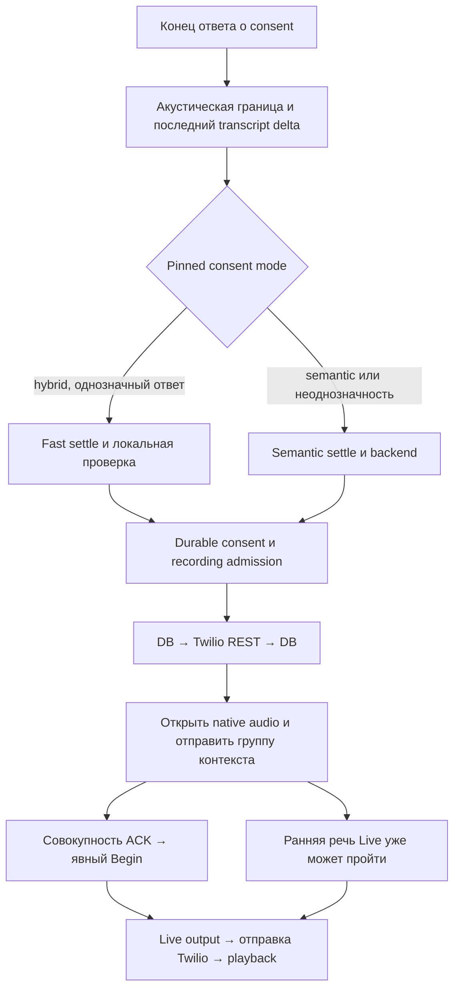

# Проверка аудита GPT-Live и план улучшения разговорного рантайма

> **Archived on 2026-11-08.** Historical design, investigation or verification record.
> Original dates, language and acceptance scope are preserved; this is not the current specification.
> Use the [documentation index](../../README.md), [native runtime](../../native-live-runtime.md)
> and [validation guide](../../native-live-validation.md) for maintained behavior and remaining checks.

Дата: **5 ноября 2026**, Europe/Zurich. Статус на момент аудита: **обоснованный план, реализация не начата**.
Последующая согласованная реализация первой очереди A0–A3 описана в
[отдельном отчёте](live-runtime-a-implementation-2026-11-05.md). Выводы ниже относятся к исходному commit.

Ветка: `codex/live-audit-validation-2026-11-05`.
Проверенный исходный commit: `513c0217a754d9991151f60071926a03960af1f5`.
При начале проверки рабочее дерево было чистым. В этой работе добавлен только этот документ.

Источник проверки: `C:\Users\slavi\.gemini\antigravity\brain\26144fa8-6642-4235-bbce-a73a013f3df9\audit-report.md`.
SHA-256 источника: `F9228F41BA5695FF27055D9C13CC873926E395A8024953BC10480D8E40359BAE`.

Проверялись реализация и тесты Live, consent/recording, application playback, Twilio transport,
компилятор, календарные ограничения и связанные текущие документы. Это не полный security-аудит
всего приложения. Production-конфигурация, БД, текущий сетевой маршрут и слышимый результат
нового звонка не проверялись. Реальные звонки, платные модельные пробы и deployment не выполнялись.

## 1. Решение

**Аудит полезен как перечень проблем и гипотез, но его нельзя непосредственно превращать в backlog реализации.**
Основные механизмы найдены верно: полностью буферизованный TTS, энергетическое прерывание,
консервативная отмена protected speech, накопление инструкций, пробелы IVR/hold/transfer и
расхождение части документации с кодом. Однако причинность и размеры задержек часто не доказаны;
несколько утверждений противоречат действующей реализации. В частности, неверно описаны
последовательность ACK, повторный синтез прощания, отсутствие ожидания приветствия и UTC-расчёт расписания.

Наиболее опасная часть — обозначение streaming TTS, расширения consent и отключения `clear`
как относительно простых улучшений. Они меняют частичную доставку обязательств и обработку
поправок. **Приоритетный путь: измерения → узкие исправления → раздельные эксперименты →
парная слуховая приёмка.** Обещать конкретную экономию секунд до замера нельзя.

Сверка выполнена именно с **GPT-Live (`gpt-live-1`, `/v1/live`)**. Механизмы Realtime API
не считаются доступными в Live по аналогии. Основное разделение «Live ведёт беседу, backend
выполняет задачи, приложение контролирует разрешения» соответствует официальной архитектуре.
[Getting started with GPT-Live](https://developers.openai.com/api/docs/guides/live).

## 2. Что в аудите соответствует коду

Обозначения: **подтверждено** — механизм непосредственно виден в коде; **частично** — механизм
есть, но эффект/масштаб не установлен; **исправить вывод** — существенная часть утверждения неверна.
Номера строк относятся к указанному commit.

| Тезис исходного аудита | Вердикт и основание |
| --- | --- |
| `started` энергетического VAD вызывает Twilio `clear` | **Подтверждено.** RMS ≥600, 100 мс энергии, 600 мс тишины: [pcmu-activity.ts:15](../../../apps/api/src/voice/pcmu-activity.ts#L15). Conversation очищает output, если нет protected playback: [unified-live-call.ts:680](../../../apps/api/src/voice/unified-live-call.ts#L680). Последующее native audio продолжает пересылаться. Реальные ложные срабатывания на эхо/кашель требуют аудио и событий. |
| В Twilio обязательно многосекундный буфер, потому что Live генерирует быстрее реального времени | **Частично.** Собственного pacing нет: [unified-live-call.ts:1234](../../../apps/api/src/voice/unified-live-call.ts#L1234). Размер очереди и скорость генерации из этого не следуют. Документация GPT-Live не устанавливает такую скорость; перенос свойства Realtime некорректен. |
| Во время application speech Live-output отбрасывается | **Подтверждено с оговоркой.** Есть output suppression, transcript fences и последующий контекст восстановления: [live-conversation.ts:184](../../../apps/api/src/voice/live-conversation.ts#L184). Это не полное отсутствие синхронизации. Запись application playback в БД на :992 сама по себе не добавляет произнесённый текст в контекст модели. Согласованность «что Live считает сказанным / что было проиграно» остаётся отдельным риском. |
| Любой непустой transcript перебивает protected request | **Подтверждено:** [unified-live-call.ts:629](../../../apps/api/src/voice/unified-live-call.ts#L629); после выпуска аудио также действует ≥500 мс энергии (:664). Консерватизм нужен из-за возможного уже услышанного обязательства. «Да» и «нет» нельзя различать только числом слов. |
| TTS непотоковый | **Подтверждено:** `arrayBuffer()` до playback, [rendered-speech.ts:52](../../../apps/api/src/voice/rendered-speech.ts#L52). Путь включает также durable provider journal до запроса и после результата: [unified-live-call.ts:431](../../../apps/api/src/voice/unified-live-call.ts#L431). |
| Абонент слышит другой голос и металлический звук | **Гипотеза.** Модели действительно разные, resampling — усреднение трёх отсчётов: [rendered-speech.ts:70](../../../apps/api/src/voice/rendered-speech.ts#L70). Слышимость различия, его причина и значимость не установлены без сравнения аудио. Одинаковый voice ID не является доказательством акустической идентичности. |
| Disclosure всегда начинает говорить поверх приветствия | **Исправить вывод.** Код уже ждёт, если речь обнаружена: [unified-live-call.ts:345](../../../apps/api/src/voice/unified-live-call.ts#L345), :353–358, :693–697. Возможна гонка до обнаружения первых 100 мс речи. Добавлять всем 1,2 секунды ожидания без её воспроизведения нельзя. |
| Cold start последовательно запускает Live, затем disclosure TTS | **Подтверждено:** [unified-live-call.ts:235](../../../apps/api/src/voice/unified-live-call.ts#L235), :307–310, :353. Warm path уже использует `Promise.all(start, render)` на :127. Это ограниченный кандидат на улучшение. |
| Контекст — N последовательных `append → ACK`, только потом открывается аудио | **Исправить вывод.** Все сообщения отправляются циклом без ожиданий между ними: [live-conversation.ts:225](../../../apps/api/src/voice/live-conversation.ts#L225). Явный Begin ждёт всю группу ACK (:485–510), но аудиогейт открыт раньше (:218–223). Не возвращать прежнюю блокировку ранней речи. |
| Обычно отправляется 5–15 чанков | **Не установлено.** Есть 16 логических вызовов `add` до дробления: [live-managed-tools.ts:112](../../../apps/api/src/voice/live-managed-tools.ts#L112). Число и размер зависят от плана; измерять фактическую группу. |
| Recording admission может ждать callback `in-progress` | **Исправить вывод.** Ожидаются `beginRecording`, REST `recordings.create`, `attachProviderRecording`; callback отдельный: [call-service.ts:1127](../../../apps/api/src/call-service.ts#L1127), [Twilio provider:133](../../../apps/api/src/telephony/twilio-telephony-provider.ts#L133). REST/DB действительно стоят перед opening. |
| Все решения/прощания задерживаются минимум на 5 секунд | **Исправить вывод.** Это grace для fallback при отсутствии подходящей native delegation: [live-conversation.ts:276](../../../apps/api/src/voice/live-conversation.ts#L276). Уже активный closing и waiting deadline обходят grace (:291, :313). Первичный переход к closing может ждать fallback, если Live не делегировал. |
| Перебитое прощание каждый раз заново синтезируется | **Исправить вывод.** Проигрывается целиком заново, но тот же текст берётся из per-call Promise cache: [unified-live-call.ts:420](../../../apps/api/src/voice/unified-live-call.ts#L420), :459–460, :1193. Новый синтез нужен при другом тексте или после неудачного render. |
| Пререндер отдельного farewell снимет задержку обычного closing | **Не в текущем коде.** Ключ кэша — полная строка; closing рендерит динамический `summary + farewell` единым клипом (:1193). Разделение клипа — новое поведение, а не попадание в существующий кэш. |
| Двойное прощание | **Подтверждено в узкой ветке.** При end_call без evidence после waiting deadline summary заменяется на failure copy (:1133), уже содержащий прощание; :1193 добавляет ещё одно. Не путать с acoustic replay или всеми failure paths. |
| Временные команды накапливаются в instructions | **Подтверждено:** `instruct()` на [live-conversation.ts:337](../../../apps/api/src/voice/live-conversation.ts#L337), opening на :228, closing на [unified-live-call.ts:1212](../../../apps/api/src/voice/unified-live-call.ts#L1212). Что именно они вызывают паузы — ещё не измерено. |
| Ошибка телеметрии завершает звонок | **Подтверждено для общего callback:** [unified-live-call.ts:287](../../../apps/api/src/voice/unified-live-call.ts#L287). Playback diagnostics уже обрабатывают ошибку без обрыва (:514–521). Durable consent/action/provider/transcript записи — другая категория; fail-closed на :1012 в live-conversation нельзя просто удалить. |
| Требование voice в `session.updated` и `end_ms` в ACK избыточно | **Не подтверждено официальным контрактом.** Схема ACK требует `end_ms`; update возвращает resolved session configuration. Не ослаблять проверки на основании гипотетического частичного ответа. |
| `#seen`, `#runs`, `#announced` монотонно растут | **Частично.** `#seen` ограничен 50 000 входящих событий с ID (:368), `#runs` — 128 (:721). `#announced` удаляется на `response.created` (:725). Исходящие 20-мс кадры микрофона не входят в `#seen`; официальные primary audio deltas не имеют обязательного event ID. Простая арифметика «15 минут × 50» здесь недостаточна. |
| Без agent-hangup флага всегда failure ровно через 45 секунд | **Частично.** Tools и guard действительно отключают end_call: [live-managed-tools.ts:41](../../../apps/api/src/voice/live-managed-tools.ts#L41), [unified-live-call.ts:1114](../../../apps/api/src/voice/unified-live-call.ts#L1114). Собеседник может завершить звонок сам, а fallback зависит от состояния. `.env.example` не доказывает production value. Deployment check требует только explicit true/false: [deployment-check.ts:32](../../../apps/api/src/config/deployment-check.ts#L32). |
| Prepared session теряется при другом процессе | **Подтверждено как архитектурное ограничение:** process-local map в [openai-live-bridge.ts:43](../../../apps/api/src/voice/openai-live-bridge.ts#L43). Частота cold fallback и необходимость изменения routing ещё не измерены. |
| HMAC Media Stream без expiry | **Подтверждено:** [Twilio provider:321](../../../apps/api/src/telephony/twilio-telephony-provider.ts#L321). Но binding, attempt admission и проверка подписи также важны. Отдельный hardening backlog; не источник установленной разговорной задержки. |

### Подготовка плана и сценарии

| Тезис | Проверка и решение |
| --- | --- |
| «Завтра/следующая неделя» рассчитываются от UTC | **Неверно для структурированного расписания.** Prompt получает UTC ISO, но `resolveAppointmentSchedule` строит дату через timezone: [appointment-schedule.ts:108](../../../apps/api/src/brief-compiler/appointment-schedule.ts#L108), :186–195, :214–225. Тесты покрывают Zurich midnight/DST/понедельник. Локальную дату/weekday можно добавить как помощь модели; не объявлять исправлением доказанного календарного бага. Учитывать timezone задачи, не жёстко Zurich. |
| Нужен новый `purposeOneLiner` | `opening.purposeStatement` уже существует: [live-managed-tools.ts:71](../../../apps/api/src/voice/live-managed-tools.ts#L71), [brief-compiler.ts:1075](../../../apps/api/src/brief-compiler/brief-compiler.ts#L1075). Сначала использовать его; произнесение до consent требует отдельного решения. |
| Readiness всегда задаётся лишний раз | Инструкции уже допускают пропуск, когда собеседник пригласил продолжить: [live-conversation.ts:229](../../../apps/api/src/voice/live-conversation.ts#L229). Нужны примеры нарушения действующего правила. |
| Нет ответов на вопросы о данных пользователя | Не хватает специальных сценариев, но известные одобренные факты уже разрешено сообщать через общий [supplied-information.ts](../../../apps/api/src/voice/supplied-information.ts). Изменение 4 ноября описано в [плане раскрытия сведений](user-information-disclosure-plan-2026-11-04.md); ручная модельная приёмка ещё требуется. Не дублировать этот механизм новой схемой без необходимости. |
| Русские шаблоны требуют косвенного падежа, но вставляют неизменённое имя | **Подтверждено:** [initial-disclosure.ts:22](../../../packages/contracts/src/initial-disclosure.ts#L22), [live-appointment-copy.ts:23](../../../apps/api/src/voice/live-appointment-copy.ts#L23). Менять синтаксис предложения, сохраняя утверждённое написание имени. Новая copy version не должна переписывать historical approved snapshots. |
| Последовательная preparation pipeline | **Подтверждено:** [brief-compiler.ts:220](../../../apps/api/src/brief-compiler/brief-compiler.ts#L220), :245, :283–335. Generation model, бюджеты и лимиты могут переопределяться pinned policy; defaults не равны фактическим настройкам. Это задержка подготовки до звонка, не runtime reply latency. |
| `finish-by-16:30` вызывает ложный integrity failure | **Воспроизведено** на действующей `protectedIdentifiers`: `finish by 16:30` → `[]`, `finish-by-16:30` → `["finish-by-16"]`. Источник: [brief-compiler.ts:792](../../../apps/api/src/brief-compiler/brief-compiler.ts#L792). Дополнительные 10–30 секунд не измерены. |
| IVR, hold/music, transfer не покрыты | Отдельных состояний и outbound DTMF tool в Live нет: [unified-live-call.ts:25](../../../apps/api/src/voice/unified-live-call.ts#L25), :162–180. Конкретная музыка не обязательно пересечёт VAD-порог. Семантического voicemail detector нет, но поздний определённый AMD до consent уже переводит в voicemail (:246–270). |
| Два disclosure источника означают случайное расхождение Live | Источники действительно разные, но текущий Live берёт frozen `resolveInitialDisclosure`, а `twilio-copy.disclosure` используется legacy Realtime. Не унифицировать исторические approved snapshots механической заменой. |

## 3. Что действительно следует из документации GPT-Live

**Контекст и команды.** `instructions.append` сохраняется через compaction и используется будущими
делегациями. `thinking.append` подходит для фактов/прогресса, но не является гарантией тайны или
молчания. `commentary.append` передаёт материал для озвучивания. ACK подтверждает принятие в
timeline, не исполнение и не playback. Ограничение append — 500 токенов; 1200 UTF-8 байт в коде —
эвристика, не доказательство лимита для всех входов. `session.update` не заменяет начальные Live instructions.
[Live primary WebSocket](https://developers.openai.com/api/reference/resources/live/primary-websocket).

Отсюда наш вывод: убрать повторное добавление фактов как безусловных поведенческих команд;
постоянные правила сформулировать с областью действия по фазам. Не заменять механически все
`instruct()` на `thinking`. Для каждого вызова определить, передаёт он факт, результат для речи
или команду поведения. Состояние приложения и проверки полномочий остаются источником истины.
[Managing GPT-Live sessions](https://developers.openai.com/api/docs/guides/live-conversations).

**Перебивания и делегация.** Live поддерживает full duplex, но prompt не гарантирует точного момента
остановки. Заголовки Backchannel / Interruption / Delegation в коде соответствуют рекомендациям.
При этом код использует `Delegate to the backend when:` и `Delegate before claims`:
[live-conversation.ts:1084](../../../apps/api/src/voice/live-conversation.ts#L1084). Для `gpt-live-1`
руководство рекомендует `Generate <|SpawnThinking|>` и соответствующие условия запрета делегации.
Это дополнительный кандидат на отдельное сравнение, отсутствующий в исходном аудите.
Короткий voice prompt и подробные workflow в backend — обоснованное направление;
удалять правила точности, языка, имени и разрешённых действий ради краткости нельзя.
[Prompting GPT-Live](https://developers.openai.com/api/docs/guides/live-prompting).

**Доставка.** Live audio/transcript delta и окончание backend-response не доказывают слышимое
завершение реплики. У Live нет взаимозаменяемой Realtime-модели `response.done`/`audio.done` для
голосовой реплики. Для обязательного текста и hangup сохранить управление playback в приложении.
[Migrate to GPT-Live](https://developers.openai.com/api/docs/guides/live-migration).

Application-owned речь сама по себе не противоречит GPT-Live: руководство прямо рекомендует
проверенный recording/rendered clip приложения для точного текста и известной точки завершения
playback. Это подтверждает выбранный подход для disclosure, но не доказывает качество каждого
клипа, полученного нынешним TTS; требуется акустическая проверка.
[Managing GPT-Live sessions — Deliver a disclosure](https://developers.openai.com/api/docs/guides/live-conversations#deliver-a-disclosure).

**Fixtures не подходят как простая замена текущего protected/closing.** Они принимают готовое
PCM16 24 kHz, до 30 секунд, отбрасывают вход во время playback. `fixture.played` означает drain
серверного микшера. Это не преобразователь голоса и не доказательство доставки до абонента.
[Live primary WebSocket — fixtures](https://developers.openai.com/api/reference/resources/live/primary-websocket).
Наш вывод: риск пропустить «стоп, другое время» делает этот вариант неприемлемым для первой очереди.

**Twilio имеет собственную очередь.** `media` проигрываются по порядку; `clear` сбрасывает очередь,
возвращая и оставшиеся `mark`. Поэтому mark после clear нельзя считать успешной доставкой.
[Twilio WebSocket messages](https://www.twilio.com/docs/voice/media-streams/websocket-messages).
Bidirectional Stream получает только inbound track, не фактическую запись обоих услышанных треков;
outbound DTMF как событие этого протокола не поддерживается.
[Twilio Media Streams](https://www.twilio.com/docs/voice/media-streams).
Предложенная замена recording admission на Media Stream timestamp не равноценна текущему механизму.

**Streaming TTS технически поддерживается**, но снижает прежде всего время до первых байтов.
[Text to speech](https://developers.openai.com/api/docs/guides/text-to-speech).
В нашем приложении он меняет контракт «render failure до release означает, что ничего не прозвучало».
Нужна новая обработка частичной доставки; один финальный mark не решает отмену и ошибку посередине.

**Backend можно оптимизировать отдельно.** Managed Responses уже поддерживает постоянные соединения
и подготовку конфигурации; предлагаемые переключения модели/reasoning/tier следует оценивать вместе
с правильностью tools. `session.updated` также не гарантирует успешную асинхронную валидацию backend.
[Delegation and tools](https://developers.openai.com/api/docs/guides/live-delegation).
Новая Decisions-интеграция существует, но сейчас это отдельное исследование, не необходимая миграция.
[Connect voice to Decisions](https://developers.openai.com/api/docs/guides/decisions-voice).

Ни универсальный pacing 100–250 мс, ни обещание экономии 1–2 секунд при preload не установлены
документацией. Pacing без отмены устаревшего аудио просто переносит очередь в приложение.

## 4. Исправленная модель задержек и измерения

Не использовать диапазоны 3,5–6 / 3–9 / 4–10 секунд из аудита как baseline или ожидаемую экономию.
Это оценки, смешивающие разные ветки. Существующие исторические отчёты также не подтверждают
акустическую приёмку текущего HEAD: [no-call results](voice-no-call-results-2026-11-02.md).



При обнаруженной речи VAD ждёт 600 мс тишины; semantic settle затем может ждать 900 мс,
hybrid fast settle — значение pinned policy, обычно 200 мс. Поздняя transcript delta или новая
речь перезапускает ожидание. Transcript-only путь отличается. Нельзя везде подставлять одну сумму.

Для обычного fallback возможны VAD 600 мс + recipient settlement 600 мс + grace 5000 мс,
но native delegation может сработать раньше. Для уже авторизованного closing grace обходится.
Дополнительные зависимости — физически занятый backend, очередь persistence, TTS journal,
render и фактическое воспроизведение. Измерять каждую отдельно.

Первый будущий PR должен давать следующие технические времена без сохранения pre-consent текста/аудио:

| Группа | Что фиксировать и зачем |
| --- | --- |
| Startup | Warm hit/miss и причина; reservation/start/ready; render start/end; admission; первый release. Разделить cache miss, другой процесс и медленный provider. |
| Consent → task | VAD stop и последний delta arrival как технические timestamps; settle, решение, durable receipt; recording DB/REST/attach; число и байты контекста, первый/последний ACK, Begin. Не смешивать локальные часы с Live timeline. |
| Backend | Причина запуска native/fallback/deadline; revision; request/first useful result/tool/continuation; occupancy; ожидание `#writes`. Не логировать скрытые рассуждения или дополнительные персональные данные. |
| TTS | Cache hit; journal до запроса; HTTP headers/полный body; conversion; journal после результата; release; mark/clear. Будущий streaming дополнит first-byte/first-frame. |
| Audio | Размер и межприходные интервалы delta, накопленные миллисекунды отправленного аудио, оценка очереди и отметки её очистки; длительность локальной очереди, если она появится. Не выдавать расчёт за точное время на устройстве абонента. |
| Разговор | Конец содержательного ответа → первый слышимый содержательный ответ; поправка → ответ с её учётом; overlap после перебивания; число ненужных clear/replay и служебных реплик. Нужна слуховая оценка, а не только transcript. |

`conversation.first_audio` сейчас начинается **после** recording admission и фиксирует отправку,
а не воспроизведение: [unified-live-call.ts:853](../../../apps/api/src/voice/unified-live-call.ts#L853), :1234–1237.
Она не измеряет «да → первый слышимый ответ». Не переименовывать старые данные задним числом;
добавить отдельные метрики с явной точкой отсчёта. «Спасибо» не считать содержательным ответом.

Официальная рекомендация оценивать отдельно разговор и выполненную задачу согласуется с этим
подходом: [Voice agents](https://developers.openai.com/api/docs/guides/voice-agents).

## 5. Инварианты плана

Сохранить ограничения [real-call hardening plan, §3](real-call-hardening-plan-2026-11-02.md#3-неприкосновенные-свойства-рабочей-базы):

1. Один основной Live runtime; приложение владеет consent, recording, обязательствами и closing.
2. Полный актуальный disclosure receipt до consent admission; отказ/условие/поправка не превращаются в согласие.
3. Task opening после recording admission. Никакого сохранения pre-consent recipient content.
4. Approved snapshot, разрешённые данные, слот, timezone и финансовые границы остаются авторитетными.
5. `uncertain` восстанавливается status-only для того же слота; не повторять возможное бронирование.
6. `delivered` не означает `confirmed`. Для подтверждения требуется последующий ответ по существу.
7. Один владелец backend-работы; stale revision и timeout не дают права дублировать действие.
8. Hangup только после актуального uncleared playback completion; существенная поправка отменяет closing.
9. Не скрывать gaps, unknown delivery и потерю evidence ради улучшения метрик.

Изменение этих границ не входит в первую очередь. Код и настройки сейчас не изменяются.

## 6. Предлагаемая очередь изменений

Каждый пункт — отдельный reviewable PR с указанной гипотезой, baseline и проверкой. Не объединять
смену модели, consent policy, таймеров, голоса и транспорта в один эксперимент.

### Этап A — измеримость и подтверждённые узкие дефекты

| PR | Изменение | Ожидаемая польза | Риск и обязательная проверка |
| --- | --- | --- | --- |
| A0 | Исправить current runtime reference: end_call summary, фактическую проверку appointment, область применения TTS. Зафиксировать effective runtime descriptor и измерения из §4. | Достоверный baseline и отсутствие оптимизации несуществующих ожиданий. | Низкий/средний для instrumentation. Не сохранять речь до consent, не менять порядок событий. Baseline должен отличаться от candidate SHA/hash, а не только `live-managed-v9`. |
| A1 | Отвязать **необязательную диагностику** общего telemetry callback от закрытия звонка. Ограничить очередь/повторы, дать явный сигнал потери диагностики. | Устойчивость к изолированному отказу telemetry storage. | Средний. Fault injection: telemetry write падает, voice продолжается; consent/action/provider/transcript journal failure по-прежнему закрывает опасный путь. Потеря evidence не засчитывается как успешная приёмка. |
| A2 | Убрать двойной farewell только в ветке no-evidence terminal summary. | Одна естественная финальная фраза. | Низкий. Проверить все locales, обычный summary и отдельный backend-failure path; не менять acoustic replay/mark/deadline. |
| A3 | Параллелить cold disclosure render и Live startup по образцу warm path. | Убрать последовательную зависимость на cold start; выигрыш ограничен перекрытой частью двух операций. | Низкий/средний. Сохранить provider reservation, approved текст, admission, отмену и deadlines. Не проигрывать до разрешения; проверить start/render failure, disconnect, раннюю речь и duplicate media start. |
| A4 | Исправить падежную конструкцию русских шаблонов без изменения имени; корректировать произносимую timezone инструкцию отдельно от structured timezone. | Понятнее речь и меньше технических формулировок. | Низкий для нового copy, средний для compiler prompt. Versioned snapshots; иностранные/несклоняемые имена, все locales, неоднозначные зоны. Не удалять timezone из authorization. |
| A5 | Устранить воспроизведённый `finish-by-16:30` false-positive узким правилом. | Меньше ложных repair/rejection при подготовке. | Средний: integrity-защита. Положительные случаи обычного текста и отрицательные случаи настоящих идентификаторов/добавленных фактов. Вынести из voice latency comparison. |

Начать с **A0–A3**. A4–A5 полезны, но независимы; не задерживать ими проверку главного runtime пути.

### Этап B — небольшие оптимизации после baseline

**B1. Ограниченный prefetch статических фраз.** Выбрать по частоте использования clarification,
no-consent/failure и другие точные строки. Не добавлять все рендеры в критический `Promise.all`:
ошибка ненужной фразы не должна уничтожать prepared session. Ограничить конкуренцию, учитывать
provider ledger/стоимость и отмену. Кэш привязан к text/voice/model/locale/copy version; внутри
одной неизменной сессии допустим существующий text key. Общий кэш требует отдельной политики
данных. Обычный динамический `summary + farewell` этим не ускоряется.

**B2. Сокращение контекста и prompt без изменения полномочий.** Составить карту всех `instruct`/
`thinking`/`commentary`; убрать дубли, сделать фазовые правила условными, передавать актуальное
состояние как данные. Сначала проверить токены/число чанков на семи locales и больших планах.
Первым изолированным кандидатом проверить рекомендованную формулировку `Generate <|SpawnThinking|>`
вместо `Delegate to the backend`, сохраняя условия разрешённых и запрещённых делегаций.
Сравнить своевременность native delegation, долю fallback и лишние backend-запросы; не совмещать
этот опыт с изменением grace. Причинное влияние текущей формулировки на задержки пока не доказано.
Подробные правила исполнения остаются в backend. Не убирать факты и не загружать task context
до consent в этом PR. После playback передавать только доказанный outcome; interrupted нельзя
объявлять полностью delivered. Проверить служебные фразы, ранний opening и повтор disclosure.

**B3. Естественная copy и длина closing.** Сократить повтор уже подтверждённого результата;
сохранить существенные дату/время/статус и различие confirmed/uncertain. Заменять канцелярскую
формулировку эквивалентной короткой просьбой, отдельно прослушивать выбранные voice/locale.
Не повышать speed и не менять голос одновременно. Сначала сократить текст, затем оценивать
другой resampler или разделение summary/farewell как отдельные акустические эксперименты.

**B4. Ресурсные лимиты.** Снять распределение event/run counts и памяти на максимальной длине
звонка; воспроизвести duplicate `response.created` на границе 128. Проектировать ограниченную
очистку только завершённых данных, сохраняя dedup tombstones, pending usage и владельца работы.
Не удалять лимиты без замены. Не обещать ускорения обычного разговора от этой работы.

### Этап C — отдельные поведенческие эксперименты

**C1. Fallback decision grace.** Только если baseline показывает значимую долю ожидания без
native backend. Сравнить несколько значений, не фиксировать 1,5–2,5 секунды как готовую норму.
Сохранить acoustic/transcript settle, native-activity guard, revisions, единственную занятую
сессию и no-retry для неоднозначно принятой команды. Проверить позднюю делегацию, correction
во время backend, late ACK/error и continuation. Критерий: быстрее содержательный ответ,
без роста дублирующих запросов, ложных действий и прерывания полезной речи.

**C2. Streaming TTS.** Сначала ограничить область closing или не создающими обязательства
фразами; disclosure и appointment commitment оставить на прежнем пути до отдельной приёмки.
Проект должен описать `not_released / partially_released / completed / interrupted / failed`,
carry для неполного PCM16 sample и группы resampling между чанками, финальный короткий кадр,
backpressure, cancellation, stale generation, абсолютный deadline и корректный final mark.
Не считать финальный HTTP success доказательством playback. Сбой после release не должен
вызывать автоматический повтор уже возможно услышанного обязательства. Даже closing обязан
сохранять поправки и не завершать звонок по оборванному потоку.

**C3. Conversation interruptions и pacing.** Сначала измерить backlog, длительность overlap
и причины clear на шуме/эхе. Затем независимо сравнить bounded relay queue и критерий interruption.
Нужна отмена устаревшего локального аудио и Twilio queue, а не только задержка отправки.
Проверить «угу» рядом с «стоп», «нет», «другое время», речь на фоне шума, speakerphone echo,
короткие/длинные перебивания и network jitter. Не отключать conversation `clear` по одному
факту внедрения pacing. Protected/consent/closing не включать в первый эксперимент.

**C4. Protected backchannels.** Отдельно от C3. Запретить эвристику «≤2 слова → игнорировать»:
короткая реплика может отменять запись. Если пробовать распознавание backchannel, учитывать
полный контекст и потоковые хвосты «ja, aber …»; при сомнении сохранять uncertainty и same-slot
status-only recovery. Не ставить `confirmed` по междометию или mark. Ввести только после
доказанного снижения ложных отмен без пропуска поправок.

**C5. Consent mode.** Сначала определить фактическую pinned policy: semantic default в коде
не означает, что конкретный звонок использует semantic. Hybrid уже существует. Переключение
default и расширение словаря — самостоятельная приёмка всех отрицаний, условий, поздних
фрагментов и locales; «passt» не универсальное согласие на запись. Не добавлять немедленное
«Спасибо», пока ответ ещё может продолжиться отрицанием. Параллельно C1–C4 режим не менять.

### Этап D — продуктовые и архитектурные направления, вне первой очереди

- **«Кто вы / по какому поводу» до consent:** сначала дизайн ограниченного application-owned
  ответа из уже одобренного `purposeStatement`, с минимальным раскрытием и повтором вопроса.
  Это требует пересмотра границы текущего flow; не разрешать свободную task speech до consent.
- **IVR/hold/transfer:** отдельные состояния, budgets и deadlines; подтверждённые способы DTMF,
  смены собеседника, остановки/возобновления recording и обработки voicemail. Не полагаться
  только на слова «перевожу» или энергетический VAD. Не обещать callback/email без полномочий.
- **Pronunciation hints / anticipated questions:** начать с eval известных фактов и существующего
  purpose; добавлять поля схемы только для реально недостающей информации. Сохранить approval/hash.
- **Twilio Agent Connect / SIP:** технически существующие направления, но нужен отдельный прототип
  с проверкой consent, recording, marks, audit/retention, AMD, регионов и rollback. Не замена
  моста ради предполагаемой экономии. [GPT-Live partner integrations](https://developers.openai.com/api/docs/guides/live-partner-integrations).
- **Native protected speech / fixtures:** не включать в текущую реализацию. Проверка transcript
  после услышанной реплики не предотвращает ошибочное обязательство; fixture теряет вход.
- **Preparation concurrency:** отдельно от runtime. Output moderation и language audit можно
  исследовать для одной immutable candidate revision; repair обнуляет старые результаты.
  Input moderation параллельно generation повышает расход на отклонённых входах и усложняет
  budget/cancellation. FastText/CLD сначала только shadow: он не эквивалентен проверке коротких
  полей, имён и смешанного языка. 20k token cap снижать только по outputs/truncation/repair data.

## 7. Решение по всем 22 рекомендациям исходного аудита

| № | Решение |
| --- | --- |
| 1 | Ограниченный prefetch — B1; не все фразы сразу и не обещание ускорить dynamic closing. |
| 2 | Streaming — C2, отдельный контракт частичной доставки; не quick safe fix. |
| 3 | Принять узкий double-farewell fix — A2. |
| 4 | Принять только для необязательной telemetry — A1; durable journals сохранить. |
| 5 | Hybrid default/словарь/мгновенное «Спасибо» — только отдельная consent-приёмка C5. |
| 6 | Принять cold render overlap — A3, с прежними gates. |
| 7 | Grammar — A4; timezone сохранять в данных и уточнениях, убирать техническую речь. |
| 8 | Локальная дата/weekday полезны для prompt; UTC-bug расписания не подтверждён. |
| 9 | B4: измерить и спроектировать bounded retention; не просто поднять/убрать лимиты. |
| 10 | C3: pacing и interruption раздельно; отключение clear заранее не одобрено. |
| 11 | B2: классифицировать вызовы; blanket `instructions → thinking` отклонить. |
| 12 | Pre-consent task preload отложить. Выигрыш не доказан, serial-ACK аргумент неверен. |
| 13 | Не включать: речь до recording admission нарушает выбранную границу. Сначала измерить REST/DB. |
| 14 | Wait-if-speaking уже есть. Исправлять только воспроизведённую стартовую гонку. |
| 15 | Отдельный дизайн pre-consent purpose — D; использовать существующее поле. |
| 16 | C4; короткие фразы нельзя автоматически игнорировать. |
| 17 | C1; менять только fallback grace после измерений, не все таймеры. |
| 18 | Отложить: native transcript/fixture не заменяют текущую проверку доставки. |
| 19 | B2/B3: уменьшать дубли и улучшать речь, сохраняя ограничения и shared information policy. |
| 20 | D: не дублировать purpose и уже доступные approved facts; новые поля после eval. |
| 21 | D: IVR/hold/transfer — новые продуктовые сценарии, не мелкая runtime-оптимизация. |
| 22 | D: отдельный transport prototype и сравнение, без миграции в рамках этого плана. |

## 8. Проверка, приёмка и откат

За основу взять [voice acceptance protocol](voice-acceptance-protocol-2026-11-02.md), а не создавать
облегчённый допуск. Его текущий статус и исторический `hold` не превращаются в pass этим документом.

Для каждого PR:

1. Зафиксировать source/build SHA, compilation/prompt hash, модели, voice, locale, consent policy,
   cache state, route, thresholds и фактические feature flags. Не изменять утверждения в БД ради сравнения.
2. Офлайн проверить соответствующие ошибки и гонки: split denial; late transcript; stale ACK/mark;
   recording/render/persistence failure; disconnect; partial playback; duplicate/late delegation;
   uncertain same-slot recovery; существенная correction на closing; deadline и максимальную длину сессии.
3. Сравнить ровно одно изменение на одинаковых сценариях. Сначала основные S01/S02/S03/S05/S08/S10,
   затем полную матрицу протокола для затронутой области. Добавить специально для этой работы greeting
   race, noise/echo/backchannel, длинный summary и cold/warm miss. Unsupported IVR не засчитывать как pass.
4. Платные model/telephone проверки и объём внешней серии — отдельный следующий этап с согласованным
   бюджетом и тестовыми получателями. В текущей работе они не выполняются.
5. Сравнивать слышимую задержку **содержательного** ответа, task success, корректность слота/полномочий,
   число ложных clear/replay, overlap, служебные фразы, модели/запросы/стоимость. Filler не улучшает reply latency.
6. На небольшой серии показывать все paired deltas и разброс; не заявлять p95 по пяти парам.
   Для p95 нужен отдельный достаточный объём наблюдений. Новый baseline-pass/candidate-fail — hold.
7. Немедленный stop при нарушении consent, повторном обязательстве, пропущенной существенной поправке,
   ложном success, изменении разрешённых данных или premature hangup. Для неизменённых стадий два
   валидных ухудшения > `max(1000 мс, 20% baseline)` требуют остановки и разбора по текущему протоколу.
   Одно заметное ухудшение тоже расследовать, даже если порог не пересечён.
8. Перед rollout — обычные build/typecheck и соответствующие integration checks для фактически
   выпускаемого artifact. Поведенческий вариант выбирать на новой попытке и фиксировать в descriptor;
   не переключать алгоритм посреди звонка. Откат для новых звонков на предыдущую сборку/политику,
   активным дать завершиться. Не откатывать journal и не повторять реальную запись автоматически.

Критерий успеха: **замеренное улучшение конкретной стадии и естественности при сохранении
правильности действий и отсутствии новых регрессий в затронутых сценариях**. До этого статус
изменения — эксперимент; успешные unit tests не заменяют слуховую приёмку.

## 9. Фактически выполненная локальная проверка

В этой сессии все выбранные существующие тесты прошли: **1067 / 1067, 28 файлов**.

| Набор | Результат |
| --- | --- |
| API voice/realtime/appointments без integration, summary-calendar, smoke runner unit tests | 813 / 813, 21 файл |
| API brief compiler, appointment schedule/compilation, execution language, compilation integrity | 176 / 176, 5 файлов |
| Contracts initial disclosure и calendar date | 78 / 78, 2 файла |

Команды из `apps/api`:

```powershell
$testPaths = @(rg --files src/voice src/realtime src/appointments | Where-Object { $_ -match '\.test\.ts$' -and $_ -notmatch '\.integration\.test\.ts$' })
node node_modules/vitest/vitest.mjs run @testPaths src/text-processing/summary-calendar.test.ts scripts/run-voice-runtime-smoke.test.mjs
node node_modules/vitest/vitest.mjs run src/brief-compiler/brief-compiler.test.ts src/brief-compiler/appointment-schedule.test.ts src/brief-compiler/appointment-compilation.test.ts src/brief-compiler/execution-language.test.ts src/brief-compiler/compilation-integrity.test.ts
```

Из `packages/contracts`:

```powershell
node node_modules/vitest/vitest.mjs run src/initial-disclosure.test.ts src/calendar-date.test.ts
```

Использованы mocked providers / in-memory repositories. PostgreSQL integration, реальные provider
probes, production runtime config и acoustic latency не проверялись. Build/typecheck не повторялись:
production-код, зависимости и конфигурация не изменены. Эти результаты подтверждают текущую
локальную логику и пригодны как исходная точка, но не доказывают отсутствие всех runtime-дефектов.
