# Native GPT-Live runtime

**Status:** Native v2 baseline accepted on 2026-11-08; role-fidelity revision implemented on 2026-11-09. Production activation and real-model validation remain separate steps.\
**Source reviewed:** 2026-11-09, current working tree.\
**Audience:** engineers changing preparation, voice, appointment actions, results or accounting.

This is the maintained specification for `live_native_v2`. It describes application
behavior, including its limits. It does not certify model accuracy, acoustic latency
or the deployed environment. Use the [validation guide](native-live-validation.md)
for checks. The [native integrity record](reports/native-live-integrity-2026-11-08.md)
and [task information and testing record](reports/task-input-testing-implementation-2026-11-08.md)
provide dated evidence for their respective changes.

## Architecture and ownership

GPT-Live owns conversation: the opening, listening, ordinary replies, follow-ups,
interruptions and the spoken closing. A separately configured Responses model handles
delegated reasoning and tool calls. The application owns permissions, durable state,
recording lifecycle, action evidence and telephone disconnection.

This follows the separation described in OpenAI's [GPT-Live prompting guide](https://developers.openai.com/api/docs/guides/live-prompting)
and [delegation guide](https://developers.openai.com/api/docs/guides/live-delegation).
The implementation uses **Responses delegation**, not client delegation. Existing
database identifiers such as `realtime_session` also cover Live usage; their names
do not identify the wire protocol.

| Owner | Responsibilities | Does not establish |
| --- | --- | --- |
| Preparation compiler | Interpret the complete task; produce reviewable constraints and authority | That a recipient has accepted an appointment |
| User approval | Bind a compilation revision, hash, review receipt and execution settings | Permission beyond that snapshot |
| GPT-Live | Choose conversational wording and when to delegate | A durable tool result merely by saying it happened |
| Responses backend | Interpret evidence, prepare tool arguments and resolve conditional meaning | Authority to bypass application validation |
| Application | Validate tools, persist actions/results, track playback, stop/discard/hang up | Independent access to the recipient's calendar |
| Post-call evaluator | Assess the original conversation against the executed task | A replacement for action authorization during the call |

```mermaid
flowchart LR
  Draft[Task and facts] --> Prep[Durable preparation]
  Prep --> Review[User review and approval]
  Review --> Snapshot[Immutable execution snapshot]
  Snapshot --> Admission[Live provider admission before dialing]
  Admission --> Media[Twilio call and media]
  Media <--> Live[GPT-Live conversation]
  Live <--> Backend[Responses delegation]
  Backend --> Tools[Validated application tools]
  Tools --> Journal[(Action and privacy journals)]
  Live --> Transcript[Original transcript]
  Transcript --> Result[Summary and assessment]
  Journal --> Result
  Result --> UI[Card, export and notifications]
```

There is no per-turn host approval or application TTS for ordinary native-v2 speech.
There is still orchestration at admission, refusal, action, completion and failure
boundaries. Bounded recovery can request a silent backend review if the model misses
a necessary action-result or closing delegation.

Sources: [NativeLiveV2Call](../apps/api/src/voice/native-live-v2-call.ts),
[Live transport and delegation](../apps/api/src/voice/live-conversation.ts),
[runtime factory](../apps/api/src/voice/create-voice-runtime.ts).

## Runtime selection and version boundaries

| Selection | Result |
| --- | --- |
| `CALL_RUNTIME_PROFILE=native_v2` | Native v2, compiler 15 policy required, hangup enabled; recommended |
| `CALL_RUNTIME_PROFILE=managed` | Managed Live, compiler 6 policy required, hangup enabled; rollback |
| `VOICE_RUNTIME_DRIVER=live`, fallback `false`, experiment `off` | Managed `unified_live`; default selection |
| Same settings, experiment `native_v1` | Earlier informational experiment; eligibility may select managed control |
| Same settings, experiment `native_v2`, in development or production | `live_native_v2` |
| Live with fallback `true`, experiment `off` | Retained `legacy_hybrid` path |
| Driver `realtime`, experiment `off` | Retained `legacy_realtime` path |

Named profiles require the saved preparation policy to match at startup; use
`runtime:configure --apply` and `runtime:check` after migrations. See
[runtime profiles](runtime-profiles.md) for preview, audit and rollback.
Without a named profile, Native v2 requires `REALTIME_AGENT_HANGUP_ENABLED=true`
at process startup and call initialization. The historical name applies to Live too.
Automatic fallback and the Realtime driver remain incompatible with native v2.
`VOICE_RUNTIME_NATIVE_V2_LOCAL` is obsolete and ignored. Selection is enforced by
[voice-runtime.ts](../apps/api/src/config/voice-runtime.ts); startup requirements are
checked in [runtime-environment.ts](../apps/api/src/config/runtime-environment.ts).

| Contract | Current native role-fidelity path | Compatibility |
| --- | --- | --- |
| Preparation prompt policy | `preparation-live-native-roles-2026-11-09` | Previously pinned policies retain their compiler behavior |
| Compiler | `brief-compiler-14` | Earlier compilers remain readable; not all are executable for new work |
| Compiled plan | Schema `9` | Archived schemas are read through explicit readers |
| Approved snapshot | Version `8` | Native v2 also accepts version `7` through its legacy authority adapter |
| Runtime and prompt identity | `live-native-task-2026-11-09` | Frozen per-attempt descriptor and configuration hashes |
| Opening | `native-declarative-v1` | Part of the approved snapshot |
| Summary generator | `summary-v8` | Earlier artifacts are preserved |
| Native evaluator format | `native-summary-v3` | Selected for context v2; v6/v7 retain their formats when replayed |
| Telemetry archive | Root/schema `4` | Existing JSONL record versions `2`/`3` are retained |

Voice selection and preparation policy are independent. The code's preparation
default is `preparation-live-native-v2-2026-11-06` with `gpt-5.6:default`, not the
integrity policy. Existing database settings can differ. The verified local setup
selected the integrity policy and `gpt-6-luna:default` for generation. The admin
settings API edits generation profile and capacity; it does **not** expose a
`promptVersion` setter. See [preparation runtime](preparation-runtime.md).

The runtime descriptor pins model, voice, startup/backend/tool hashes, budgets and
completion settings. An already-described attempt cannot silently switch runtime
configuration. Missing historical descriptors remain unknown.

Sources: [preparation policy](../packages/contracts/src/preparation-policy.ts),
[compiler selection](../apps/api/src/brief-compiler/brief-compiler.ts),
[configuration identity](../apps/api/src/voice/live-native-configuration.ts),
[descriptor guards](../apps/api/src/voice/runtime-descriptor.ts).

## Task preparation and initial context

Preparation keeps the original objective, context, allowed facts, clarification
answers and delivery instruction alongside the compiled plan. The approved snapshot
freezes those sources, opening settings, spoken identities and action authority.
Edits require a new compilation and approval. User-supplied material is task data,
not a higher-priority instruction to the voice model or evaluator.

Relevant facts in the objective, context, facts list and clarification answers are
available for disclosure when needed. `approvedFacts` is not the complete disclosure
boundary. Live and the backend share instructions to preserve identifiers and their
subjects, respect explicit withholding, and clarify contradictions. Personal details
alone do not authorize a new action. Appointment authority is grounded separately
in the objective or clarification answers; context can supply conditions and values.
The review UI exposes original sources. Scenario buttons populate the objective
through the same preparation pipeline and require no conversation-time catalog read.

`nativeV2Session` assembles:

1. A developer input message containing the opening instruction.
2. A user input message containing parties, the approved plan, original source
   material, opening fields and an optional appendix index.
3. Conversation instructions in `session.instructions`.
4. Backend instructions, tools and output budget in `delegation.responses`.

The complete primary task is available at startup. Optional appendix content is
stored separately: only ID/title/description are sent initially, and
`get_task_context(sectionId)` retrieves one approved section. This is not a search
service or permission to add facts or authority. An appendix cannot replace a
missing critical condition in the approved task.

The shared role contract distinguishes the principal, the recipient heard on incoming
audio, and the subject of each fact. Overlapping names do not merge those roles.
Original task text defines semantic relationships; derived questions or criteria
cannot transfer a recipient's preference to the principal. This does not expand
the approved snapshot's action authority. Compiler 14 checks source fidelity and
language in the existing preparation audit request; prior pinned compiler policies
keep their original audit. See [preparation runtime](preparation-runtime.md).

Live closes with the actual outcome and preserves its subject. A recipient's own
preference is addressed directly; the principal is named when the result concerns
them. Appointment-specific readback remains tied to the authorised represented
person. This adds no ordinary-turn gate, request or script.

### Prompt responsibilities

| Layer | Implemented guidance |
| --- | --- |
| Compiler | Preserve source facts and conditional relationships; derive explicit scheduling authority; resolve relative dates without inventing permissions |
| Live | Brief introduction and notice, readiness question, one useful question at a time, progressive disclosure, natural wording, explicit delegation triggers |
| Backend | Detailed action procedure, exact evidence quotes, uncertainty, correction/status recovery and tool sequencing |
| Evaluator | Full original task, original transcript evidence, conditional criteria and independent action disposition |

For a task such as “ask the price; book only if the price is acceptable,” the
instructions call for asking the price first. Budget and future branches are
decision context, not an agenda to recite. Known or volunteered facts should not be
asked again. Disclosure restrictions and direct questions still apply. This is
prompted behavior; automated prompt assertions do not prove every spoken outcome.

Sources: [compiler instructions](../apps/api/src/brief-compiler/compiler-instructions.ts),
[appointment interpretation](../apps/api/src/brief-compiler/native-appointment-compilation.ts),
[assembled Live/backend prompts](../apps/api/src/voice/live-task-context.ts),
[snapshot and input contracts](../packages/contracts/src/call-brief.ts).

### Input and allocation limits

| Boundary | Limit | Unit / interpretation |
| --- | ---: | --- |
| Objective / context on new input | 4,000 each | JavaScript string length after trimming |
| Allowed facts | 40 × 300 | Count × per-fact string length |
| Clarification answers | 10 × 1,000 | Count × per-answer string length |
| Delivery instruction | 1,000 | String length |
| Aggregate task text | Warning 6,000; hard limit 8,000 | Unicode code points after NFC/newline normalization and trimming, across objective/context/facts/clarifications/delivery; field maxima are not additive allowances |
| Optional appendix | 12 × 4,000 | Sections × content string length; unique section IDs |
| Serialized startup task | 120,000 | UTF-8 bytes, allocation guard |
| Live instructions | 16,384 | JavaScript string length, allocation guard |
| Backend output | General 2,048; appointment `min(16,384, 4,096 + 256 × conditionCount)` | Tokens; count includes common and alternative conditions |
| Tool arguments | 425,984 | Transport bound covering escaped maximum quote fields |

These application limits are not a tokenizer or a provider context guarantee.
Provider session admission runs before dialing and can reject the assembled input.
No silent removal of conditions is used to make it fit. Historical readers retain
larger old field limits, including 12,000-character context.

## Opening, recording and refusal

After provider admission, validated Twilio media admission enables the opening.
The same opening instruction is already in startup input and is sent once as
commentary when media is ready. Live chooses the wording and includes:

- AI identity and the represented person's name;
- only the selected assistance reason: speech impairment, language barrier or none;
- recording and transcription notice;
- a natural readiness question, then a pause before the first task question.

Readiness is conversational, not affirmative recording consent. Native v2 requests
recording from connection with `recording_basis=declarative_local`. The stored value
is a historical identifier, also used for production native calls. It does not
fabricate an affirmative-consent timestamp. The managed consent classifier and its
admin policy are a different path. Opening copy supports the advertised call
languages; seven UI languages do not imply seven selectable voice locales.

Fresh forms and omitted creation settings default to 30-day audio retention. Explicit
0/7/30 settings and historical policies remain valid. The completed-recording callback
uses the frozen attempt policy and preserves an established deadline on repeat
callbacks; transcript or summary retries do not extend it. This retention default
does not change the managed consent requirement or native refusal handling. See
[audio retention](task-input-and-testing.md#audio-retention).

`stop_and_discard` takes priority when conversation, recording or transcription is
refused. It requests disconnection and durable cleanup of attempt conversation
content, trace payloads, derived artifacts and native action revisions. Generation
and privacy guards prevent late writes from restoring deleted content. Provider
recording deletion is retried until settled; retained accounting is separate.
Declining a task question is not automatically refusal of the entire conversation.

Sources: [opening contract](../packages/contracts/src/live-task.ts),
[native privacy store](../apps/api/src/storage/native-live-store.ts),
[discard orchestration](../apps/api/src/call-service.ts),
[privacy tests](../apps/api/src/storage/native-live-privacy.integration.test.ts).

## Capabilities and appointment actions

| Profile | Authority | Tools in addition to common tools |
| --- | --- | --- |
| `general` | Information or message task; no appointment commitment | None |
| `book` | One new appointment within approved alternatives | `prepare_appointment`, `record_appointment_result` |
| `confirm_existing` | Attendance at the exact existing appointment | Same two tools, constrained to confirmation |
| `reschedule` | Replacement of the exact existing appointment | Same two tools; explicit release/replacement of the old slot required |
| `cancel` | Cancellation of the exact existing appointment | Same two tools; no replacement booking |

Common tools are `end_call` and `stop_and_discard`. `get_task_context` is added only
when the snapshot contains an appendix. The strict tool schemas and handlers are
the executable contract; the capability description in a prompt is insufficient.

For `general`, `end_call.noActionRequired` is required to be `null`; its schema
cannot accept appointment-only conditional evidence. A non-null value reaching the
handler is rejected with a focused instruction to use null and keep the observed
closing, without another farewell. Appointment profiles retain the conditional
evidence object and its existing authorisation/observation checks.

### Action lifecycle

1. Backend calls `prepare_appointment` before a binding spoken request or acceptance.
   The application validates operation, approved calendar bounds, conditions,
   alternatives, price/duration evidence and current action state.
2. An `authorized` revision allows Live to make the request. It is not a booking.
3. Playback evidence can establish `delivered`. It is not recipient confirmation.
4. Backend calls `record_appointment_result` with the actual request/readback and
   explicit recipient result. The result becomes `confirmed`, `declined` or
   `uncertain`, subject to the remaining guards.
5. Uncertain delivery/result uses `intent=status_check` for the same proposal.
   A repeated commitment is not the recovery mechanism. A later correction can
   invalidate a previously confirmed result.

The journal is scoped to attempt and snapshot. Revisions, episode identity and
idempotent results survive retries. An explicit matching decline can allow another
authorized proposal. `first_matching` means a qualifying offered slot, not the
earliest possible slot; earliest-selection modes require their own quoted evidence.

Quoted amounts, currency and required duration are checked deterministically.
The parser accepts supported numeric/word forms, rejects inconsistent totals and
qualified prices, and distinguishes a free service from a free estimate or waived
deposit. Receipts retain the checked quote, offsets and text hash. Later numeric
corrections are rechecked at result and completion boundaries. Unsupported wording
remains unverified. Backend interpretation still determines whether a statement
semantically satisfies a condition; exact quote presence alone cannot prove that.

These tools journal a **spoken arrangement**. They do not connect to the recipient's
calendar, send payment, pay a deposit, send an email or schedule an application callback.

Sources: [authority validation](../apps/api/src/appointments/native-appointment-authorization.ts),
[numeric evidence](../apps/api/src/appointments/native-terms-evidence.ts),
[action handler and tool schemas](../apps/api/src/voice/native-appointment-call.ts),
[journal contract](../packages/contracts/src/native-appointment.ts).

## Closing and conditional completion

Live states the main outcome with its actual subject, thanks the recipient and
says goodbye **before** delegating `end_call`. It should not enumerate every fact,
criterion or internal check. The tool requires observed closing speech and the
latest recipient quote. A substantive correction must be handled; a reciprocal
goodbye can reuse the existing closing without repeating it.

| Situation | Completion rule |
| --- | --- |
| Appointment action completed | `objective_resolved` requires confirmed journal state |
| Explicit condition means no action is required | `noActionRequired` carries a literal approved condition and observed recipient answer; no attempted action may exist |
| Unknown condition, failed required action, uncertain commitment | Not a successful no-action branch; preserve uncertainty or inability |
| Recipient ends the conversation | Respect the request; termination does not prove task success |

The host validates quote provenance and journal state. The backend assesses the
conditional meaning and other outstanding work; post-call assessment remains
independent. A hangup reason is not the final assessment or credit decision.

Closing uses an observed episode, voiced audio, a quiet tail and a Twilio mark.
New speech can invalidate it. A mark returned because playback was cleared is not
proof of delivery. Native-v2 scheduling values are 400 ms for a farewell hint,
6,000 ms for a quiet-episode recovery and 2,000 ms for an action-boundary recovery.
They schedule reviews, not automatic success or permission to disconnect.

The continuous closing helper uses a 1,000 ms quiet interval before a mark and
350 ms after acknowledgment to allow late activity to revoke completion, with a
30-second failure deadline. A 90-second idle timeout and 10-minute session limit
are failure bounds. Post-hangup trace/session drainage is bounded separately at
15 seconds. None of these constants is a measured end-to-end latency guarantee.

Sources: [completion recovery](../apps/api/src/voice/live-native-completion.ts),
[playback closing](../apps/api/src/voice/live-native-closing.ts),
[terminal decision contract](../packages/contracts/src/terminal-decision.ts).

## Results, history and notifications

Summary-v8 resolves the executed compilation and transcript revision, freezes the
source context and uses original transcript evidence. Context v2 is selected for
schema-9 plans or an existing native appointment action. All new schema-9 profiles,
including general, receive the original objective, context, facts, clarifications
and delivery instruction. Older general plans do not automatically become context v2.

The evaluator distinguishes task achievement from action disposition. A correct
conditional decision not to book can achieve the task; an unknown condition cannot.
General tasks cannot invent appointment authority or an appointment outcome. For
appointments, the result checks operation/person/slot, matching attempt/snapshot,
recipient evidence and replacement of the old appointment where required.

A native input may use one bounded grounding repair, charged as a separate physical
request. The validator, input and shared budgets remain in force. Normal successful
generation needs no repair request. Chunks are bounded at 28,000 characters and 250
segments, at most eight chunks; each assembled text-processing input is limited to
60,000 counted characters (segment/check text plus serialized context, extraction
and native task sources). This is not the size of the entire JSON request.
Failed/oversized final consolidation preserves cited
extraction with `evaluationCoverage=partial`; a fresh overall assessment is uncertain.
An already-preserved assessment is not silently recomputed. UI, copy, PDF and emails
show the partial-review warning.

Ready historical artifacts are retained. Failed native v6/v7 artifacts can be retried
through a new v8 artifact; queued work and old evidence remain pinned. The display
assessment revision can change without rewriting canonical billing evidence or
charging a second credit. Cards and both notification readers use the selected
display assessment. Calendar export uses the supported result projection, not a
claim that an external calendar was independently verified.

Transcript PDFs place a separate AI task assessment block on the first page before
conversation turns. The versioned export prefers a validated summary assessment,
then a ready lifecycle assessment matching the exported revision. Pending, unavailable
and partial-analysis states are explicit. Legacy exports without assessment evidence
show unavailable. Rendering uses saved results without a model request; see
[PDF evidence selection](task-input-and-testing.md#transcript-pdf-assessment).

Owner email accepts the declared recording basis when a saved assessment confirms
a conversation. Its fallback without an assessment still filters native turns using
an affirmative-consent timestamp. A declarative-only native transcript has no such
timestamp, so that fallback is not equivalent to the ready-assessment path; see the
[email eligibility details](engineer-guide.md#owner-result-emails).

Transcript capture, action state, goal assessment, user feedback, credit settlement
and provider expenses are independent. Recording ASR is explicitly requested; a
page read or missing native fragment does not trigger a paid transcription fallback.

Sources: [summary context](../apps/api/src/text-processing/summary-source.ts),
[native evaluation rules](../apps/api/src/text-processing/native-summary.ts),
[artifact workflow](../apps/api/src/text-processing/text-artifact-service.ts),
[assessment revisions](../apps/api/src/storage/postgres-call-assessment-store.ts),
[owner report](../apps/api/src/notifications/user-call-report.ts),
[admin report](../apps/api/src/notifications/notification-report.ts).

## Telemetry, export and expenses

Protocol trace uses a separate bounded asynchronous writer. Conversational payloads
are encrypted; credentials are filtered; audio is aggregated as metadata, not stored
as base64 in trace. The queue limits are 256 events, 2,000,000 queued bytes and
256,000 bytes per event. Loss is counted and a final manifest records completeness.
Trace failure does not authorize dropping action or accounting writes.

Archive v4 includes `coverage.json`. Per-attempt dimensions expose transcript state,
trace manifest/payload/sequence loss, session closure, usage finality, privacy deletion
and audio availability. A started session without its accounting operation is missing
usage. Legacy absence is `legacy_unavailable`; it is not reconstructed. Root
`completeness` is `complete` or `partial`, while individual dimensions retain their
specific reason. Associated history may extend beyond the selection period.

Derived intervals distinguish host admission, audio forwarding, backend responses,
tool output, closing marks and hangup requests. Samples are capped at 256 per metric
with omitted counts. Transcript timestamps and forwarded audio are not proof of when
the person heard speech. Missing measurements stay unknown. See the
[metric interpretation and troubleshooting guide](native-live-validation.md).

Live voice is accounted by active session duration, separately from Responses token
usage. Cumulative usage updates replace previous observations; they are not summed.
Final session usage must be collected after closure. This matches OpenAI's
[GPT-Live cost guidance](https://developers.openai.com/api/docs/guides/voice-latency-cost).
Model rates in the repository are versioned estimates, not a guarantee of current
account pricing.

The admin explorer groups the full operation cohort by type/stage/model and exposes
outcome, pricing version, tier, usage provenance and final/provisional/unknown status.
Known usage on failed requests still costs money. Missing usage is unknown, not zero.
Live voice, backend, preparation, summary/repair, ASR and telephony remain separate.
Provider billing totals, operation estimates and user credits are different measures;
do not add them together. Historical diagnostics without reliable attribution stay
unattributed. Paid native probes use a separate diagnostic project/key and local run ledger.

Preparation attribution records effective tester access and an optional scenario
revision outside approval hashes. Exports include `testing_preparation_attribution`;
expense records join the applicable preparation and retain unknown historical origin
as unclassified. Cohort totals cover the full selected record set before recent-row
truncation, while the UI cohort filter applies to recent rows only. Neither catalog
edits nor grant changes relabel saved attribution. See
[attribution and expenses](task-input-and-testing.md#attribution-and-expenses) for
write-boundary limitations and unchanged pricing/credit rules.

Sources: [trace writer](../apps/api/src/voice/live-protocol-trace.ts),
[export coverage](../apps/api/src/telemetry-export/coverage.ts),
[derived metrics](../apps/api/src/telemetry-export/timing.ts),
[archive builder](../apps/api/src/telemetry-export/archive.ts),
[admin aggregation](../apps/api/src/admin-operations.ts),
[pricing policy](../apps/api/src/config/provider-pricing-policy.ts),
[diagnostic budget guard](../apps/api/scripts/experiment-budget.mjs).

## Change invariants

- Do not mutate an approved snapshot, completed artifact, accounting fact or applied migration.
- Additive optional fields must not change historical hashes through new defaults.
- Prompt/profile changes must preserve authority isolation and update the pinned identity.
- Never turn availability, playback or a tool authorization into recipient confirmation.
- Refusal deletion must reject late writes and revoke retained exports.
- New reports must not redial, re-execute an appointment or settle credit twice.
- Lower latency must be demonstrated with correct outcomes and delivery evidence,
  not inferred from shorter timers or caption timestamps.

The [validation guide](native-live-validation.md) defines the software checks and
remaining acoustic acceptance. See [production preparation](reports/native-v2-production-readiness-2026-11-08.md)
for configuration, migration evidence and the remaining deployment steps.

## Related feature contracts

See [Task information and testing](task-input-and-testing.md) for input limits,
objective encryption/backfill, tester grants, catalog/API contracts and PDF evidence
selection. These features add no ordinary-turn Live lookup or model request.
