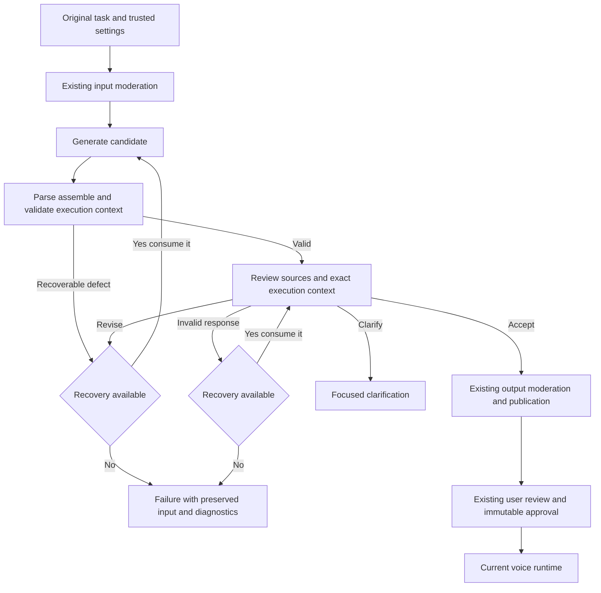

# Simplifying plan preparation and failure diagnostics

Date: 11 November 2026, Europe/Zurich.
Status: implemented, activated locally and accepted by the user on 11 November 2026;
production activation remains a separate operation.
Scope: new native plan-only preparations, compatible with the current voice runtime.
Historical compilations, approvals and hashes remain readable and unchanged.

## Decision

Use one smaller generation contract, deterministic assembly into the actual runtime
plan, and one holistic review in the existing audit stage. Review the complete
original task, labelled parties, trusted settings and exact execution context.
Remove duplicated proof structures and competing text heuristics. Allow one shared
recovery action. Preserve precise failure details before rejected responses vanish.

The canonical plan is entirely in the selected call language, including every
objective, fact, purpose, condition, criterion, optional appendix and native
requirement description. This is an existing invariant, not an optional presentation
choice. The input-language review is a separate display artifact: approval binds its
revision/hash to the unchanged canonical plan, and neither Live nor its reasoning
backend receives that display translation or the original task. Proper names and
exact identifiers retain their identity; source-language metadata is not execution
content. A partially translated plan must be corrected within the existing audit
and shared recovery, even when all spoken questions have the correct language.

Keep current generation/audit model settings for the first paired comparison. Add
no model stage, scenario router, semantic intermediate representation, patch engine,
fuzzy entity matcher or language-specific rules. Simpler structure is not proof of
reliability: acceptance, negative evaluations and runtime compatibility gate release.

This revision changes three earlier decisions:

- Remove model-written native appointment source quotations too. Verify meaning
  directly against permitted original sources; retain typed execution authority
  and all runtime evidence checks.
- An unusable audit may consume the single recovery by reviewing the unchanged
  candidate again. A format error in the reviewer must not regenerate a valid plan.
- Store detailed diagnostics independently of a published compilation, with bounded
  encrypted evidence, access controls, retention and deletion.

## Ownership and flow

| Owner | Responsibility |
| --- | --- |
| Application | Trusted parties/settings, fixed controls, parsing, calendar normalization, execution projection, budgets, storage and approval binding |
| Generator | Localized task, facts, questions, branches, criteria, auto tone/addressing, typed appointment proposal and genuinely missing information |
| Existing auditor | Source fidelity, roles, completeness, consistency, language and actual user authority |
| Voice runtime | Approved snapshot only; action scope, calendars, prices, prerequisites, recipient evidence, delivery, confirmation, refusal and terminal decisions |



Each compiler run has at most two candidate versions and two audit attempts. Normal
preparation uses four provider calls including moderation; candidate correction
uses at most six, audit-format recovery normally five. These counts exclude
transport retries and existing subsequent UI translation jobs.

Keep the existing durable transport retry/defer rules, persistent request accounting,
capacity controls and absolute preparation deadline. A transport-driven worker retry
can repeat a compiler run; count it separately under the preparation-wide request
cap. Do not describe six calls as an absolute bound across worker retries. Add no
automatic whole-preparation retry for content failure, and never reset accounting
or deadlines on recovery.

## Smaller compiler contract

Derive provider schema and local parser from one versioned definition. Keep one
shape, required keys, explicit nulls and bounded arrays. Use existing runtime task
sections; do not introduce another narrative or task representation. Empty optional
sections are valid. Never invent restrictions or facts to fill arrays.

| Field group | New responsibility |
| --- | --- |
| Objective, opening examples, background, questions, follow-ups, criteria, restrictions, appendix | Model generates useful localized task content within execution limits |
| Facts | Localized strings; no copied `sourceText`, identical-count requirement or per-fact provenance |
| Tone/addressing | Infer only for auto; code supplies explicit selections |
| Locale, result handling, voicemail/refusal, parties, assumptions, fixed version fields | Supplied by the application, not copied and then checked for copying mistakes |
| `taskEvidence`, inline `sources`, `namedEntities`, entity provenance | Removed from the new generation and compilation schemas |
| Native appointment | Nullable typed proposal with supported operation, date selectors, alternatives, requirements and limits; no source quotations |
| Clarification, unsupported task, policy concern | Bounded existing outcome data, distinct from parser/provider failure |

Retain raw sources separately. Use consistent names, including `allowedFacts`,
through generation and review; eliminate the generation-only rename to
`approvedFacts`. Freeze input revision, trusted reference time and settings once.

Centralize extraction of complete response text for generation and audit. Distinguish
missing/non-text output, malformed JSON, schema failure, refusal, incomplete output
and transport failure. A completed SSE response is not proof of valid content.
Parse one complete JSON object. Do not repair JSON with regexes, invent missing
business values or publish partial stream deltas. Rejected output may use recovery.

Keep padding, stream-size and deadline guards; request compact proportional output.
Check serialized bytes before dispatch. Remove duplicate payloads instead of raising
limits or truncating the task. Give `PREPARATION_REQUEST_LIMIT` a typed diagnostic
rather than an unexplained `BRIEF_COMPILATION_FAILED`.

## Shared source interpretation

Use the same short interpretation rules for generation, correction and audit:

- Unquoted first-person task text is on behalf of the represented person unless an
  explicit different author/owner/beneficiary or quotation overrides it. During the
  call, first-person speech belongs to the current speaker.
- Preserve principal, recipient and third-party roles despite equal/short names.
  Trusted parties need not be echoed in every question or an entity table.
- Later explicit corrections supersede the targeted statement, preserving unaffected
  facts and conditions. Do not force stale values into execution.
- Preserve uncertainty, prerequisites, alternatives and valid no-action outcomes.
  A fact the call is intended to obtain is not missing user input.
- Accept faithful translation, inflection, paraphrase and equivalent formatting.
  Changed entities, identifiers, dates, quantities, owners or permissions are material.
- Share trusted time, time zone defaults and currency conventions. Facts do not
  themselves grant a commitment or payment power.

Facts may occur anywhere in the task fields; do not require duplication or pronoun
rewriting. Keep the current authority-source boundary: objective instructions and
clarification answers may grant appointment powers; reference context alone does
not. A permission gap needs a meaningful confirmation, not a verbatim rewrite.
Broadening authority-granting source fields is outside this change.

## Assembly and native authority

For the new policy, remove lexical `includes`, postal-address extraction, entity
presence and source-echo blocking gates. Their semantic responsibility belongs to
the holistic review. Keep historical policy checks isolated; never run both systems
in series for new preparations.

Use a pure assembly function to supply application-owned values, assign local IDs,
normalize existing relative date selectors against the frozen clock, and validate
`planOnlyExecutionPlanSchema`. Reuse runtime structural validators. Do not silently
change meaning, discard conditions, infer missing currencies or invent dates.

Native appointment preparation changes as follows:

1. Keep book, confirm attendance, reschedule and cancel distinct. An informational
   enquiry about an existing appointment has null executable authority.
2. Generate one nullable typed authorization proposal. Its operation is the single
   operation identity: remove duplicated `intent`/operation and `authorityEvidence.quote`.
3. Generate requirements and alternatives without copied `sourceText`. Retain the
   existing date selectors and structured price/finish limits. Assign IDs and fixed
   controls locally before review; freeze them after approval. No generated cross
   references are necessary.
4. Validate canonical authority with `nativeAppointmentExecutionAuthorizationSchema`:
   operation/existing appointment, calendars, time zone, alternatives, requirements,
   prices. Code owns `called_recipient`, one appointment and `no_unapproved_terms`.
5. Audit actual canonical authority against permitted original sources. Reject new
   powers, changed beneficiaries, lost conditions or prose price bounds missing from
   structured limits. Reference quotations remain data, not granting instructions.

Extract and reuse the existing pure date normalization for the new proposal shape.
Do not feed it through the old quote-requiring interpretation parser or fabricate
evidence to make that parser accept it. Keep the historical parser unchanged.

Compiler quotation matching proves substring membership, not semantic permission.
Direct comparison in the existing review replaces that preparation-only proof.
This does not remove runtime recipient quotes, transcript evidence, delivery checks
or confirmation. Preserve the principal-only/single-action capability boundary;
do not silently convert third-party appointment requests into principal authority.
Third-party informational enquiries remain supported.

Malformed authorization is a candidate defect. Genuine missing permission/bounds
require clarification or a capability outcome, not a demand to fix model syntax.
Include proposed blocking questions in the same audit of structurally readable
candidates so invented missing-information claims cannot bypass review. No ready
plan may violate an execution invariant.

## Holistic audit contract

```json
{"verdict":"accept","message":""}
```

`verdict` is `accept`, `revise` or `clarify`; `message` is bounded, initially to 800
characters. Prefer empty text on acceptance, but do not reject an otherwise valid
acceptance for including a comment. `revise`/`clarify` need nonblank actionable
text; otherwise the audit is unusable. No paths, evidence arrays, per-field verdicts,
confidence scores or rewritten plan.

Review together: source meaning and roles; conditions and executable powers;
completeness, consistency and call language of the actual runtime context. Send one
source envelope and one assembled context including parties/settings, opening and
full appendix contents. Reuse approval projection. Remove duplicate `compiledTask`,
`executionTask` and `languageFields` representations. Mandatory facts and conditions
stay in primary context; optional appendix is reviewed in full and retrieved by ID.

`revise` addresses material defects, not style or metadata. `clarify` is for ambiguity
the call cannot reasonably resolve; availability and recipient preferences are
normally call topics. Technical audit failure never implies bad user wording and
never permits acceptance.

Map clarification to the existing localized clarification flow. Treat its question
as bounded untrusted display text. Internal repair feedback and diagnostics are
not public questions. Existing review translations remain presentation artifacts,
not an extra semantic gate or execution authority.

## Shared recovery and outcomes

Use one `recoveryUsed` flag per content-processing run, with no separate schema,
language or integrity allowances.

| First recoverable defect | Action |
| --- | --- |
| Missing/invalid/incomplete candidate, generation padding, structural validation | Regenerate complete candidate using current defect and latest rejected candidate or bounded available output |
| Valid audit says revise | Regenerate complete latest candidate with current review message |
| Missing/invalid/incomplete audit or audit padding | Re-audit the exact unchanged candidate with concise response-format feedback |

Consume recovery before dispatch. Reassemble, validate and audit any regenerated
candidate. An audit retry checks the same candidate hash. Respect remaining deadline,
budget and cancellation. Timeouts/429/backoff stay with transport and do not also
receive a content retry.

Pass original sources, trusted context, actual latest candidate and current feedback.
Label candidate data as untrusted. Do not accumulate stale array paths or merge
patches. If no candidate text exists, regenerate from the source and record that
limitation; never fabricate output or reuse an older candidate after a new failure.

Any second content defect ends the run, including schema then semantic, semantic
then schema, or invalid audit then revise. Refusal, policy restriction, unsupported
capability and genuine clarification are not format retries. Preserve input after
failure and show a retry/support outcome with a diagnostic reference, not instructions
to follow internal formatting rules.

## Compatibility across the full lifecycle

Retain approval snapshot 10 and existing terminal/action contracts. The subsequent
conversation correction is identified as `live-plan-only-2026-11-11`. Allocate a new compilation schema/compiler/preparation policy. Do not
change schema 10 in place or manufacture empty evidence/source quotes for its parser.

The execution payload stays in the existing strict plan-only shape. New compilations
can use localized fact strings and source-free canonical authority, already accepted
by the voice runtime. One pure projection serves audit and approval; only envelope
IDs/timestamps are added later. No task-bearing mutation follows review. Changed
input/settings require another reviewed revision.

| Boundary | Required update |
| --- | --- |
| Parsing/hash verification | New variant and compiler/schema mapping; preserve historical parsing order, hashes and approvals |
| Projection | Extend `createPlanOnlyExecutionPlan`, currently restricted to compiled schema 10; avoid legacy fallback |
| Approval | Replace exact `brief-compiler-16` dispatch with an explicit supported mapping including the new compiler, still yielding approval 10 |
| Profile/startup | New preparation policy/compiler/schema with unchanged voice runtime, aligned across API and all workers |
| Review UI/translation | New fact/authority shapes; complete review coverage and unchanged revision/hash binding |
| Post-call assessment | Extend `buildSummarySourceContext` and versioned source contract; a new native schema must not be treated as legacy/informational |
| Telemetry/lifecycle | Readers, export and deletion handle new compilation and diagnostic variants |

Post-call source context currently requires authority `sourceText`. Introduce a
compatible new source-context variant for new artifacts; do not fabricate quotations
or rewrite historical artifact hashes. Original sources remain available to post-call
assessment, never Live or its backend.

Exercise actual `nativeV2Session` with new approvals, its 120,000-byte initial-context
guard, appendix retrieval and existing provider admission before dial. Do not add a
model call for preparation or equate a character check with provider token admission.
Valid tasks near input limits must fit request/runtime bounds without material loss.

Keep all existing price/calendar/action constraints, recipient evidence, refusal,
stop-and-discard, explicit approval, immutable snapshots and action state transitions.
Authorization, delivered commitment and confirmed outcome remain separate.

## Detailed failure recording

Keep transport outcome and application validation outcome distinct. A response may
arrive successfully and fail validation. Never rewrite the immutable provider ledger
to label a schema rejection as failed transport.

Add one versioned `preparation_diagnostic_events` store keyed by preparation, with
optional operation reference and encrypted detail. This requires an additive migration:
existing checkpoints are transport-only and result metadata is bounded/immutable.
Reuse encryption, repository access control, admin inspection, telemetry export and
retention. No external log service, event bus or new diagnostic model stage.

Record candidate/audit validation and final outcomes, including recovered errors,
blocked/clarification plans, cancellation, exhausted limits and publication failure.
Correlate preparation, worker generation/attempt, candidate/audit attempt and operation;
make writes idempotent at those boundaries. It must work without a call/compilation ID.

| Safe structured metadata | Encrypted restricted detail |
| --- | --- |
| Preparation/event/operation/request IDs, attempts, timestamps | Original source/settings once, including frozen reference time |
| Release/build, pinned policy/compiler/schema, effective prompt/schema hashes | Actual generated/audit text and reviewed projection for rejected, recovered and accepted attempts |
| Model/tier requested and returned, stage, duration, bytes, remaining deadline, ledger usage | Exact schema issues, current correction feedback, verdict/message |
| Typed code/component, transport versus validation outcome, recovery/final disposition | Invalid model paths/properties/values that may contain private data |
| Candidate/projection hash, lengths, truncation flags | Bounded partial output, explicitly distinguished from a complete response |

Create typed codes at failure sites, not by parsing arbitrary exception messages.
Distinguish missing/type/JSON/schema output; padding/incomplete/refusal; native authority
structure/calendar; legacy evidence; audit shape/path; semantic revision/clarification;
request size; provider/deadline/budget; publication/integrity. Preserve codes/stage
through compiler errors, service mapping and the real nested worker serializer.
Only known schema roots/indexes and expected/actual types enter plain logs; arbitrary
model paths, values, messages and stacks stay encrypted.

Safe logs contain code and diagnostic reference; authorized admin inspection/export
contains evidence. Failed preparations must be searchable/exportable by preparation
ID, independently of `plan_review_cases`. Public APIs return only the public issue
and reference. Extend existing preparation administration and audit private reads/exports.
Do not add another dashboard or treat diagnostic evidence as runtime authority.

Use the existing 30-day preparation-detail retention and deletion guarantees. Initially
bound detail to 256 KiB per event and 1 MiB per preparation; retain original lengths
and truncation flags. Never retain secrets, headers/cookies or complete HTTP envelopes.
Deletion/cancellation must purge private evidence as applicable and reject late writes.
Cleanup includes failures with no call. Document additional short-lived diagnostic
retention separately from terminal `input_ciphertext`, which currently clears on completion.

Capture the bounded source/candidate/review sequence during processing, before rejection
or correction discards it. If diagnostic storage fails, emit a safe correlated
`PREPARATION_DIAGNOSTIC_WRITE_FAILED`, retain the actual result and surface the gap.
Logging must neither replace the original error nor create a model failure for a valid
plan. Diagnostic detail is excluded from historical approval hashes.

Measure first-pass acceptance, acceptance after recovery, clarification, policy/capability
outcomes, technical failure and semantic blocks separately from worker completion.
Break down by release/policy/models/input size, requests and p50/p95 latency. A completed
worker publishing a blocked plan is not accepted preparation.

## Implementation sequence

1. Add typed diagnostics, bounded evidence, worker logging and lifecycle/access tests
   first, with unchanged preparation behavior. Capture future exact failures and freeze
   synthetic baseline cases under actual production model configurations.
2. Add smaller contracts, version mappings, shared projection and historical fixtures.
   Update approval, UI review, post-call source, export/profile readers before new writes.
3. Implement generation/assembly, removing duplicated metadata/settings and lexical gates
   from the new path while retaining existing structural/runtime validators.
4. Replace audit/recovery with the fixed verdict and shared allowance; pass the actual
   rejected candidate/current feedback and retry unusable audits without changing the plan.
5. Run acceptance checks below, typecheck/build, drain local work, activate policy,
   restart API/workers and verify actual preparation, review, approval and runtime admission.
6. Deploy compatible readers and diagnostics migration before writer activation. Drain
   or preserve pinned work; align all processes. Production activation is separate.
   Register the additive migration and new minimum migration in deployment/profile
   checks rather than retaining the old `0115` assumption.
   Roll back writer selection only on a build that reads both formats, never an
   incompatible older binary over new compilations or post-call artifacts.

Keep historical paths isolated; no backfill, implicit reapproval, model switch or voice
behavior change. Update preparation/runtime/input, diagnostics and retention docs.

## Verification and release gates

| Semantic family | Required boundary |
| --- | --- |
| First person, explicit author, quotation, third party, equal/short names | Natural reference accepted; ownership/beneficiary mutation rejected |
| Translation, inflection, mixed languages, Unicode, whitespace, typos | Equivalent meaning accepted; different entity/value rejected |
| Distributed facts, corrections, contradictions, uncertainty | Latest applicable intent retained without stale echo or invented certainty |
| Conditions and no-action outcome | Inactive branch is not failure; unmet prerequisite grants no action |
| Information, message delivery, documents | No invented commitment or unnecessary clarification |
| Book, confirm attendance, reschedule, cancel | Correct principal, appointment and operation; no separate cancellation during rescheduling |
| Relative dates, ranges, time zones, DST, past/ambiguous periods | Deterministic normalization and unchanged runtime admissibility |
| Prices, currencies, finish limits, alternatives, prerequisites | Structured bounds preserved; no payment/broader authority |
| Phone/email/address/reference and exact values | Equivalent formatting accepted; meaningful substitution rejected |
| Appendix, long/maximal input/output | Complete review, retrievable context, bounded payloads and no silent truncation |
| Source injection and reference instructions | No permission or product-policy escalation |
| Transport, parser, audit, recovery, persistence and lifecycle | Correct outcomes/accounting, no unreviewed acceptance or late publication |

Deterministic tests must cover provider/local schema parity; missing/wrong types and
extra properties; malformed JSON; missing terminal text despite streamed bytes;
refusal/incomplete/padding across chunks; timeout/429 and size limits. Exercise every
first-failure recovery and second-failure stop, including invalid audit then revise,
semantic repair then schema error, and unchanged candidate on audit retry.

Verify audit/approval projection equivalence, trusted settings, native constraints,
actual Live context/admission and action/terminal evidence; preserve old hashes and
approvals byte-for-byte. Test UI translation and post-call adapters for new and historical
variants, with raw task data absent from Live/backend.

Verify detailed diagnostics through the real nested worker serializer and database:
pre-compilation failure, blocked/recovered results, publication/write failure,
concurrent/late writes, access, deletion, retention, truncation and export. Plain logs
must not contain private content. This is part of completion, not a later enhancement.

Real-model evaluation uses the same frozen baseline and pinned models: at least one
positive/negative pair per family, three repeats, held-out paraphrases and all supported
languages across the set. Preserve every result and separate first-pass/recovered
acceptance. Mocked verdicts test orchestration, not semantic accuracy. Use synthetic
external inputs; keep private incident content in authorized diagnostics.

Release gates: relevant tests/typechecks/builds pass; no tested material identity,
value or authority mutation is accepted; at least 95% of valid runs reach review under
these recovery rules, with no consistently rejected supported family; first-pass
acceptance, final rejection, requests and p50/p95 latency do not regress against the
same configuration. The 95% gate is proposed, not a measured rate or guarantee.
Rejecting a negative candidate then accepting a faithful correction is recovery.
If a gate fails, retain the current writer and fix the shared contract rather than
adding reviewers or scenario-specific regex rules.

## Implementation verification

Implemented as compiler 17 / schema 11 / policy
`preparation-live-holistic-2026-11-11`, preserving approval 10 and the existing voice
version. Migration 0116 stores independent encrypted validation evidence. The older
compiler and proof validators remain only for historical pinned policies/readers.

The final synthetic model evaluation reached review in 35/36 runs (97.2%), compared
with 33/36 for the compiler-16 baseline. First-pass readiness rose from 24 to 28;
all 36 tested material mutations were rejected. Median and p95 preparation time
and mean provider requests decreased. The one remaining block stopped a plan that
asked to book before checking the no-new-fees prerequisite; it was not silently
accepted. The experiment is bounded evidence, not a production reliability guarantee.

Contract, compiler, PostgreSQL, voice admission/action/terminal, post-call and web
projection tests, typechecks and builds are recorded in the
[validation report](../reports/preparation-holistic-validation-2026-11-11.md).
The local application has completed real-model preparation and approval through
the HTTP API, with exact audited/approved context equality and audited diagnostic
access. No telephone calls or production modifications were made.

## Implementation map and completion

Primary code: [compiler](../../apps/api/src/brief-compiler/brief-compiler.ts),
[holistic audit and recovery](../../apps/api/src/brief-compiler/holistic-preparation.ts),
[native normalization](../../apps/api/src/brief-compiler/native-appointment-compilation.ts),
[contracts/approval](../../packages/contracts/src/call-brief.ts),
[native authority](../../packages/contracts/src/native-appointment.ts),
[runtime context](../../apps/api/src/voice/live-task-context.ts),
[review fields](../../apps/api/src/text-processing/plan-review-fields.ts),
[post-call source](../../apps/api/src/text-processing/summary-source.ts),
[worker](../../apps/api/src/call-service.ts),
[logger](../../apps/api/src/runtime/pii-safe-logger.ts),
[retention](../../apps/api/src/storage/preparation-observability.ts),
[export](../../apps/api/src/telemetry-export/sources.ts),
[profile](../../apps/api/src/config/runtime-profile.ts).

- [x] Typed diagnostics, encrypted evidence, admin access/export and lifecycle tests.
- [x] New contracts and historical/read/approval/post-call compatibility adapters.
- [x] Smaller generator, pure assembly and removal of redundant gates.
- [x] Holistic audit and shared recovery with actual rejected candidate.
- [x] Deterministic/runtime and repeated model evaluation gates passed.
- [x] Documentation and local service activation verified.
- [x] Separate compatible production activation/rollback recorded in [runtime profiles](../runtime-profiles.md); not executed on production.

## Evidence motivating the change

The latest examined local preparation on 11 November completed in about 77 seconds
with five generations, four model audits and two moderation requests. The final
plan passed local code checks but was blocked by repeated `subject_changed`
findings. It was an informational enquiry about an existing appointment, with no
appointment action authority. The source used first-person facts; the candidate
assigned them to the represented person. The shared instructions identify a source
author without defining the default relationship to that person. This is a strong
explanation for the repeated disagreement, not a proven deterministic trigger.

Independent local probes reproduced false failures for natural date rendering,
corrected earlier identifiers, phone/address spacing and equivalent Unicode in
source citations. Code also requires identities in prose or entity metadata even
though runtime parties already supply them. Address extraction can include words
following the actual address.

Two mocked-provider compiler runs confirmed that repair receives no rejected
candidate, while historical findings retain array indexes from older candidates.
They also confirmed that the first schema error after a semantic repair can abort
preparation without ever using a schema repair.

Ten fictional semantic scenarios were compared using the current audit and an
experimental source-perspective convention. After correcting a fixture that
misclassified a person as an organisation, both variants produced the expected
five acceptances and five rejections. These checks establish useful regression
cases, not a measured reliability improvement or a reproduction of the real block.
Private source text and operational identifiers remain outside this document.

## Production failures and diagnostic limits

Owner-supplied production output at 12:40 Zurich time on 11 November confirms
release `5805392`, active API and both preparation workers with zero recorded
restarts, and preparation policy revision 11: generation `gpt-6-luna`, audit
`gpt-5.6`, total timeout 120 seconds, request timeout 35 seconds, maximum 12
provider requests. Earlier exported preparations used generation `gpt-5.6`.
Compare each request's pinned policy and model, not only the active release or
current settings. Uncommitted local fixes are not part of this production build.

The same public error covers at least three observed failure paths:

| Observation | Established failure boundary |
| --- | --- |
| 10 November, 20:14: initial generation and its schema repair both report `OPENAI_STREAM_PADDING`; another preparation with identical input succeeds at 20:15 | Runaway whitespace stops generation before review. The earlier export also contains padding failures before this release; release causality is not established. |
| 11 November, 12:31:59 preparation: generation and audit report successful provider results, then preparation fails with `BRIEF_COMPILER_RESPONSE_INVALID` | Rejection occurs after receiving the audit response. Its exact format/path defect is not present in the supplied ledger. |
| 11 November, 12:00:19 and 12:32:29 preparations: generation, audit and one integrity repair report successful provider results, then preparation fails with the same code | Rejection occurs after receiving the corrected candidate, before its next audit. Schema, evidence and appointment interpretation checks remain distinct possible causes. |
| 11 November, 12:00:59 preparation: ten provider operations, four audits, then a published blocked review case | Worker completion is successful, but the plan is blocked as `technical_failure`. The reason codes and findings require separate inspection. |

The subsequent worker journal confirms another `OPENAI_STREAM_PADDING` at
10:51:33 Zurich time on 11 November. Four later failures, at 11:59:55, 12:00:49,
12:32:18 and 12:32:55, retain an innermost plain `Error` without a code. Correlation
with preparation completion times narrows the last three failures further:

- The 12:31:59 preparation rejects either an audit path that does not exist in the
  candidate or a missing/non-string audit text. A malformed JSON string or the
  verdict schema would preserve `SyntaxError` or `ZodError` instead. Invalid paths
  are a hypothesis, not an established historical subtype. Streaming text byte
  counts do not prove a usable final response payload: the reader returns the
  terminal response rather than reconstructing its text from deltas.
- The corrected candidates from 12:00:19 and 12:32:29 fail either
  `TASK_EVIDENCE_INVALID` or `nativeAppointmentInterpretation` validation. The
  latter includes shape errors wrapped in plain `Error`, exact authority and
  requirement quotations, intent/operation consistency and canonical calendar
  constraints. Absence of `ZodError` therefore does not exclude all shape errors.
  Both failures hit the production `attempt >= 1` terminal branch.

The returned review-case row for the 10:48:27 blocked plan identifies
`fact_integrity_failure`. This establishes its blocking category, not that the
candidate actually changed the task: that requires comparison with its source.
It does not identify the cause of the later failed preparations.

Provider `succeeded` is recorded before compiler/audit content validation. It
does not establish valid JSON content, a valid audit verdict or an acceptable
plan. The current asynchronous worker logger preserves error types and codes but
discards `validationPaths`, compiler stage and plain `Error.message` values.
The HTTP route's more detailed logger does not cover this worker failure path.
Consequently, a historical subtype may be unrecoverable even when transport
telemetry is complete. Do not claim an invalid audit path or a specific evidence
field without that evidence. Provider responses use `store: false`; another live
generation would be a new sample, not recovery of the historical response.

## Follow-up: two local calls on 11 November

The 17:15 and 17:20 Zurich calls had identical source/prompt identities but different
plans and model decisions. The first audit missed an invented earliest preference;
the second corrected it. Internal backend status narration entered speech, and
appointment answers were interpreted inconsistently.

Keep Live autonomous with the full canonical task available from startup. Ordinary
questions, supplied facts and simple price comparisons need no backend request.
Implement only these changes:

- Generation and the existing audit preserve freedom of choice: first_matching is
  the default, explicit preferences survive, and structured common limits are not
  duplicated as requirements. No extra deterministic natural-language audit.
- Live uses tool state privately. Successful appointment tools already publish the
  state, so their backend continuation returns no redundant prose. Conversation
  wording stays with Live.
- Share the meaning of confirmation between backend instructions and tool schema.
  Evaluate the request plus the complete reply, including corrections; preserve
  uncertainty without demanding a special phrase. Reuse answers already received.
- Deduplicate existing missing-result recovery by observed input as well as action
  episode. Later input can resolve a previous inconclusive attempt; no polling or
  new per-turn model stage is introduced.

Approval hashes, canonical language isolation, action evidence, price/authority
guards, refusal deletion and playback-based closing remain in force. The runtime
identity changes so traces distinguish these instructions from the earlier calls.

## Follow-up: review language selection on 11 November

Implemented: constrain generated `sourceLanguage` to a valid language tag and
canonicalize it through the existing normalizer. The shared compiler/audit
instructions identify the original task language independently of the call
language. The existing audit receives this display metadata separately from the
canonical execution context. Preserve explicit display-language choices, stored
compilation hashes and full canonical context for Live; no new model stage.

Confirmed cause: the Russian 17:58 Zurich task returned `Russisch`; unrecognized
metadata selected the English account fallback. Regression tests and real-model
language checks are recorded in the validation report.

Separate open finding from the synthetic checks: the audit can reject an explicit
condition in a question's purpose merely because it is not in `conditionalFollowUps`.
Verify how all relevant runtime consumers interpret conditional required topics
before deciding whether to align the shared instructions. Avoid field-placement
rules that add no executable meaning, additional audits or unbounded retries.

## Последний звонок 11 ноября, 18:25: упрощение записи на приём

Статус: изменения реализованы в `live-plan-only-2026-11-11.2`.
Локальное воспроизведение, тесты обработчиков и синтетическая проверка реального
бэкэнда выполнены. После перезапуска пользователь подтвердил корректную работу.
Отдельный автоматизированный акустический прогон не выполнялся.
Эта секция задаёт актуальный объём исправления процесса записи. Она дополняет
общий план и заменяет предположение, что достаточно уточнить инструкции модели
о подтверждении. Переписывать роли участников или голосовой рантайм не требуется.

### Что установлено

Звонок: `4c4d6d94-9e94-4f4d-abc0-aae0d274aef7`, задание
`f27774c1-bd6a-4210-ba24-59d8135ab13a`, 11.11.2026, 18:25:26–18:29:44
по Europe/Zurich. Исследованы утверждённый snapshot, исходное задание,
транскрипт Live, вызовы инструментов и полный trace: пропущенных событий нет.
Аудиозапись отдельно не прослушивалась; поздние неразборчивые ASR-фрагменты
не используются как доказательство подтверждения записи.

Задание: узнать цену замены дисплея; при цене до 100 CHF записать на любой
подходящий день следующей недели с 09:00 до 18:00. Утверждённые полномочия:
`book`, 16–22 ноября, `first_matching`, лимит 100 CHF; общие и дополнительные
условия альтернативы: `requirements: []`. Проверка плана приняла его с первого раза.

| Момент в разговоре | Наблюдение |
| --- | --- |
| 19,8–21,0 с | Собеседник назвал 90 франков. |
| 34,0–38,4 с | Предложил вторник в 10 утра, то есть 17 ноября, в разрешённом окне. |
| 51,4 с | Ответил «Да» на вопрос о полной стоимости. |
| После этого | Бэкэнд пять раз вызвал `prepare_appointment`; все пять вызовов отклонены с `condition_evidence_required`. |
| 114,6 с и далее | Начались требования подтвердить цену полной фразой, затем дословно произнести предложение о записи. |
| Конец | Действие записи в журнале отсутствует; `record_appointment_result` не вызывался. |

Причина отказа точная: бэкэнд добавлял в `proposal.requirements` придуманные
идентификаторы `full_price_includes_mandatory_costs`, `cost_under_limit`,
`slot_available` и другие. В утверждённых полномочиях таких условий нет.
`validateNativeAppointment` объединяет неизвестный ID, повтор ID, отсутствие
обязательного условия и неподтверждённую цитату в одну ошибку
`condition_evidence_required`. Ответ инструмента не сообщает, какой случай произошёл.

Бэкэнд трактовал внутреннюю ошибку аргументов как отсутствие подтверждения
собеседника. Его ответы прямо требовали полных фраз. Live следовал этой обратной
связи, повторял вопросы и сообщал «оформляю запись», хотя внутренний инструмент
не создаёт запись в календаре собеседника. Это сбой контракта и восстановления
после отказа, а не установленная смена ролей участников.

Вызовов делегирования было 9; с продолжениями после инструментов — 14 запросов
Responses. Приложение работало с актуальным кодом, source digest
`19d1b2d98783bf8c6e49d0caf0c39521cdae2c4da3674b3c48c63b15417062f0`.
Переданный Live контекст, его инструкции и инструкции бэкэнда совпадают с
контекстом, собранным из утверждённого snapshot. Недостающего задания на старте нет.

### Проверка причины без нового звонка

Все пять реальных запросов воспроизведены с теми фрагментами транскрипта,
которые приложение уже наблюдало к моменту каждого запроса. В исходном виде:
5/5 отказов. После изменения только `requirements` на утверждённый пустой набор:
5/5 проходят тот же валидатор. Цена, дата, время, валюта, исходные цитаты и
правила приложения не менялись. Это доказывает возможность разрешить запрос;
это не доказывает, что приём в реальности был записан.

Семь отрицательных контролей продолжают отклоняться: превышение цены,
дата вне недели, время вне окна, новые неразрешённые условия, выдуманная цитата
цены, другая операция и отсутствие действительно утверждённого условия.

Локальные доказательства, содержащие закрытые данные:
`.tools/runtime/roles-local-2026-11-09/appointment-review-4c4d6d94-9e94-4f4d-abc0-aae0d274aef7.private.json`;
результат воспроизведения:
`.tools/runtime/roles-local-2026-11-09/appointment-review-replay-20261111.json`.
Проверка не меняла звонок, журнал действий или код приложения.

### Целевое поведение

Live со старта получает полный канонический план и все утверждённые полномочия.
Он самостоятельно разговаривает, сопоставляет предложенную цену с лимитом,
понимает «во вторник в десять», использует уже полученные ответы и уточняет
только реальную неоднозначность. Смысл короткого ответа оценивается вместе
с вопросом. Собеседнику не нужно диктовать дату, имя и цену специальной фразой.

Для этого случая достаточно: узнать цену и предложенное время; получить
внутреннее разрешение на конкретную запись; естественно попросить собеседника
записать представляемого человека; принять его однозначный ответ; сохранить
результат и закончить разговор. Ответ «Да» на вопрос о цене подтверждает цену,
но сам по себе ещё не означает запись. Ответ на понятную просьбу записать
может подтвердить запись без повторения всех реквизитов.

Обычный успешный путь использует существующие `prepare_appointment`,
`record_appointment_result`, `end_call`. Новые модельные этапы, проверки каждого
хода, дополнительные инструменты и сценарный автомат разговора не добавляются.
Реальные исправления даты, цены или отказ собеседника могут требовать новых
действий; число обращений не становится искусственным ограничением разговора.

### Изменения

1. **Согласовать контракт инструмента с единственным источником полномочий.**
   Формировать параметры `prepare_appointment` из того же утверждённого
   `nativeAppointmentAuthorization`, который получает Live. Разрешать только
   существующие ID условий и альтернатив. Если условий нет, schema допускает
   только пустой `requirements`; `first_matching` не требует свидетельства
   о самом раннем времени. Для нескольких альтернатив доступные ID задаются
   из утверждённого набора, а соответствие выбранной ветке остаётся в текущем
   валидаторе. Цена и длительность остаются в своих структурированных полях,
   без искусственных дублирующих условий. Не генерировать новые требования
   по словам из описания услуги. Сохранённые планы и их хеши не переписывать.

2. **Исправлять служебные ошибки внутри приложения и бэкэнда.**
   Разделить причины отказа существующего валидатора: неизвестные/повторные ID,
   отсутствие аргумента или ненайденная цитата, выход за утверждённые полномочия.
   Возвращать точное поле и ожидаемые ID, а не общий намёк на отсутствие
   подтверждения. Для данного случая ответ должен говорить: допустимых ID нет,
   требуется `requirements: []`; ответы собеседника повторять не требуется.
   Использовать уже существующее продолжение вызова для исправления аргументов,
   без отдельного модельного этапа. Даже отсутствие цитаты в аргументах сначала
   исправляется из текущего диалога; оно не доказывает отсутствия ответа человека.
   Не добавлять общий механизм многоступенчатого ремонта или новые циклы повторов.
   Повторяющийся технический отказ не должен превращаться в просьбу произнести
   «правильную» фразу; при невозможности восстановиться сообщать о технической
   невозможности завершить действие, не обвиняя собеседника в неподтверждении.

3. **Сократить и согласовать инструкции Live и существующего бэкэнда.**
   Оставить одну общую формулировку контекстного подтверждения и границ действий.
   Явно отделить разрешение/журнал приложения от записи, которую делает
   собеседник. Удалить дублирующие описания процедуры; не наращивать список
   специальных русских фраз. Внутренние ошибки аргументов не требуют вопросов
   человеку. Бэкэнд возвращает состояние или действительно недостающий факт,
   а не реплику для чтения и не требование полного предложения. Live сам выбирает
   слова. Уточнение допустимо при неизвестной сумме, противоречии, новом условии
   или действительно неразборчивом существенном ответе. Служебные «оформляю»,
   «проверяю формулировку» и ожидание подтверждения самой модели не нужны.
   Успешный ответ инструмента уже поступает через существующее обновление
   состояния; не добавлять второй канал команд голосовой модели.

4. **Сделать отказ диагностируемым и проверить естественный разговор.**
   Дополнить существующие события инструмента кодом конкретного нарушения,
   полем, ожидаемыми/полученными ID и привязкой к попытке, snapshot и наблюдённой
   версии разговора. Цитаты и содержимое запроса хранить только в уже имеющемся
   защищённом trace. В общих логах — технические метаданные без персональных
   данных. Ошибка аргументов, нехватка факта, превышение полномочий и технический
   сбой должны различаться при разборе, без внедрения новой системы диагностики.

Основные места изменения: `voice/native-appointment-call.ts`,
`voice/live-task-context.ts`, `appointments/native-appointment-authorization.ts`
и существующие события выполнения инструментов. Компилятор/аудит подготовки
в этом случае не являются причиной отказа; новый их проход не нужен.

### Проверки и критерии приёмки

| Сценарий | Ожидаемый результат |
| --- | --- |
| Пять сохранённых запросов этого звонка | Контракт не позволяет выдумывать ID; служебное исправление не требует новых слов собеседника. |
| Нет дополнительных условий; только лимит цены | Пустой `requirements`, проверка цены в `totalPrice`/`termsQuote`. |
| Общие/веточные условия, несколько альтернатив | Настоящие условия и порядок сохраняются; чужой ID не превращается в вопрос человеку. |
| «90 франков», «во вторник в десять», «да» на вопрос о полной цене | Цена и слот используются повторно без требования полной фразы. |
| Прямая просьба записать + «да», «записываю», «подтверждаю» | Контекстное подтверждение без повторного перечня реквизитов. |
| Только доступность, «могу», «проверю», незаконченная реплика | Не выдавать за выполненную запись; дождаться продолжения или уточнить по смыслу. |
| Исправление суммы/даты, отказ, встречное предложение | Применить текущий ответ, не повторять уже отвергнутую запись и не создавать дубликат. |
| Лимит превышен, другое лицо/операция, неразрешённые условия | Сохранить отказ на реальном нарушении полномочий. |
| Задержка playback/инструмента, перебивание, позднее «до свидания» | Внутреннее ожидание/сверка без повторной просьбы записать и без диктовки цитат. |
| Разные языки задания, звонка и UI | Полный канонический контекст у Live на языке звонка; перевод страницы подтверждения не попадает в исполнение. |

Сначала — тесты контракта и текущего обработчика с этим реальным регрессионным
случаем и отрицательными контролями. Затем — воспроизведение контекста на
реальном существующем бэкэнде: он должен исправить аргументы или выполнить
валидный вызов, не просить собеседника повторять известное. Наконец — проверка
полного голосового диалога в разрешённой тестовой среде. Одни unit-тесты и
текстовые ответы бэкэнда не подтверждают естественность аудиоразговора.

Приёмка: в стандартном диалоге нет вымышленных условий, повторного подтверждения
цены после ясного ответа, требования дословной фразы и озвучивания внутреннего
журнала. Запись подтверждает собеседник; приложение корректно принимает результат.
Существующие границы цены, времени, операции, защита от дублей, отказа/удаления
данных и корректного завершения звонка сохраняются. После реализации — обычные
проверки типов/сборки и перезапуск локалки после проверки отсутствия активной работы.

Разделение ответственности Live и бэкэнда соответствует
[официальному руководству GPT-Live](https://developers.openai.com/api/docs/guides/live-prompting):
Live ведёт обычный разговор, приложение обеспечивает необходимые границы действий.
Описанный выше конкретный дефект установлен по локальному trace и воспроизведению,
а не выведен из документации провайдера.

### Реализация и проверка

- Контракт инструмента строится из утверждённых полномочий; неизвестные условия
  не допускаются schema. Валидатор различает ошибку аргументов, отсутствие
  свидетельства в аргументах и нарушение полномочий. Условия не удаляются
  автоматически: существующий бэкэнд исправляет свой запрос по точному отказу.
- Инструкции сокращены и согласованы с контекстным подтверждением. Инструменты
  разрешают и журналируют действие, а запись делает собеседник. После успешного
  инструмента разговор продолжает Live. Дополнительных модельных этапов,
  проверок каждого хода или новых инструментов нет.
- События инструмента дополнены категорией, полем, версией наблюдений и хешами ID.
  Содержимое аргументов и цитат остаётся в существующем защищённом trace.
- Пять запросов оригинального звонка проходят реальный обработчик после
  исправления только вымышленных ID, без новых реплик. Семь отрицательных
  контролей отклоняются. Стартовый `session.input` полностью совпадает
  с исходным: полный канонический контекст не урезан и не заменён.
- Проверены все четыре операции, общие и веточные условия, порядок альтернатив,
  короткое подтверждение, исправления, перебивания/playback, журнал и завершение.
  Типы и сборка проходят. Итоги и ограничения проверки приведены в
  [отчёте](../reports/preparation-holistic-validation-2026-11-11.md#appointment-contract-follow-up-after-the-1825-local-call).
- Финальная проверка существующей модели: 32/32 синтетических сценария пройдены.
  Два потребовали обычного продолжения после неверно составленной цитаты цены;
  аргументы исправлены без вопроса собеседнику. Это не 32 безошибочных первых
  ответа и не гарантия естественности реального аудиоразговора.
- Оригинал воспроизведён только локально. Автоматическая проверка безопасности
  отклонила отправку приватного capture внешнему API; модель проверена отдельно
  на вымышленных данных. Для акустического probe нет отдельного диагностического
  проекта/ключа, требуемого существующим тестовым стендом. Реальные звонки и
  сохранённый журнал последнего звонка не изменялись.
- API и worker перезапущены после проверки отсутствия активной работы.
  `http://localhost:3000/ru`, API readiness, worker и голосовой webhook проверены;
  работающая версия — `live-plan-only-2026-11-11.2`.

### User acceptance, 11 November 2026

After the local restart the user reported that the behavior is now correct and
authorized documentation finalization, commit, push and CI verification. This closes
the reported appointment-flow regression for local user acceptance. It does not
replace the recorded automated-test scope or establish production deployment,
an independently inspected new call trace, or an automated acoustic probe result.
